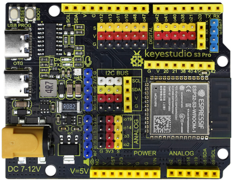
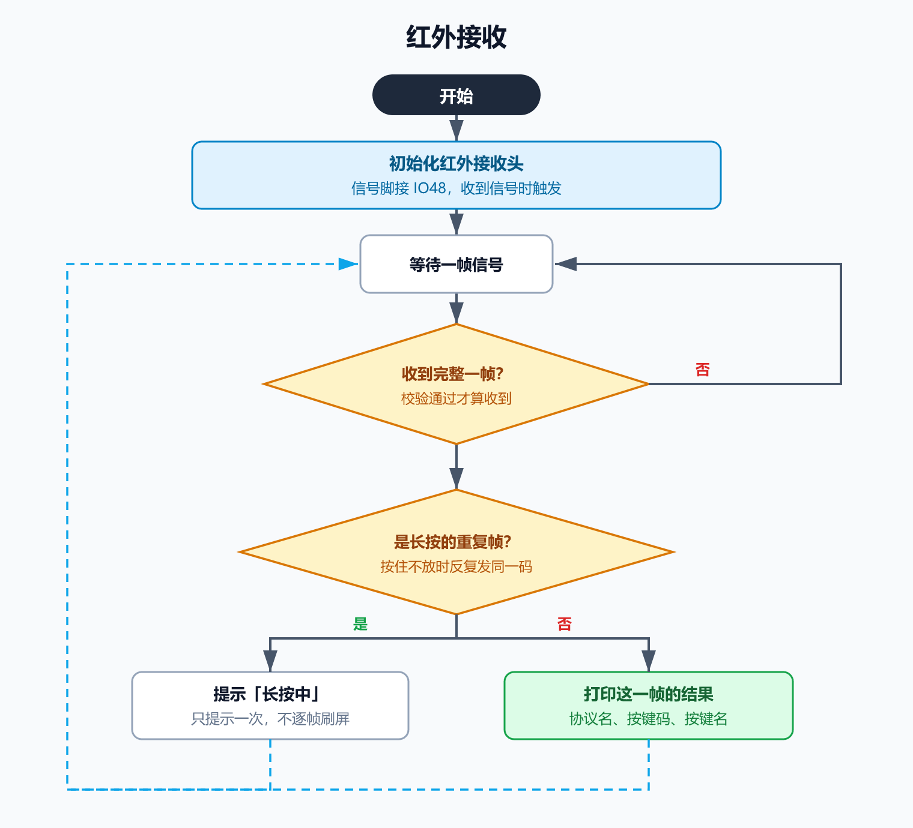

### Project 10: Infrared Receiving

#### **1. Introduction:**


Televisions, air conditioners and toy remotes all use infrared. Press a key and what leaves the remote is not a steady beam but a burst flickering thirty-eight thousand times a second — invisible to the eye, yet the receiver can decode that burst into 0s and 1s.

One press sends a whole frame, and the frame contains an address, a key value and a checksum; hold the key down and the remote stops repeating whole frames, sending only a very short repeat marker every so often to say the key is still held. So holding a key leaves a completely different trace in the data than tapping it once.

This lesson controls nothing yet; it only teaches the car to understand the remote: point it at the front of the car and press the arrow keys, and the Shell prints the protocol name and the key value, where up, down, left, right and OK correspond to 70, 21, 68, 67 and 64.

Different remotes do not necessarily use the same codes — the set in these notes is just the sample in hand, and the number the Shell prints is the answer for your remote.

#### **2. Parts List:**
Components used in this lesson:

| 17-key infrared remote control (JMFP-4) ×1 | Infrared receiver ×1 |
| :---: | :---: |
|  |  |
| DRV8835 motor expansion board ×1 | ESP32-S3 development board ×1 |
|  |  |
> ⚠️ **The receiver is on the expansion board. This table is for reference only, so there is no need to remove anything; the wiring notes below only describe the wiring method for reference and do not require disassembly. See the kit list in 1.4 for the full bill of materials.**

#### **3. Parameters:**
| Item | Parameter |
| --- | --- |
| Receiver pin | IO48 |
| Carrier frequency | 38 kHz |
| Protocol | NEC |
| Debug output | Thonny Shell (USB REPL, 115200) |
| Keys recorded | Up 70, Down 21, Left 68, Right 67, OK 64 |
| Long-press repeat code | `data == -1` (callback argument) |
| Required library | `ir_rx` (`NEC_8`) |

#### **4. Wiring:**

| Receiver pin | Connects to |
| --- | :---: |
| OUT / S | IO48 |
| VCC | 5V |
| GND | GND |

#### **5. Flowchart:**

Receiving and decoding are two separate things: `NEC_8` turns the light signal back into a data frame in the background, and the `data` handed to the callback `on_ir(data, addr, ctrl)` is the actual key value, with `-1` meaning the long-press repeat code.



#### **6. Test Code:**
> ⚠️ **Before uploading the code, upload `mini_tracked_tank_robot.py` and the `ir_rx/ folder` to the `lib/` directory on the board** (see Section 5.5), otherwise importing the library raises `ImportError`.

```python
from machine import Pin
from ir_rx.nec import NEC_8
import time

IR_RX_PIN = 48

# Remote control key codes; they may differ between batches, trust the Shell output
KEY_NAMES = {
    70: 'Up',
    21: 'Down',
    68: 'Left',
    67: 'Right',
    64: 'OK / Stop',
}

holding = False


def on_ir(data, addr, ctrl):
    # data == -1 means a long-press repeat code, any other negative value is a decode error
    global holding
    if data == -1:
        if not holding:
            print('(key held, further frames are not printed)')
            holding = True
        return

    holding = False
    if data < 0:
        return

    name = KEY_NAMES.get(data, '')
    print('Key code: {} (0x{:02X}) {}'.format(data, data, name))


ir = NEC_8(Pin(IR_RX_PIN, Pin.IN), on_ir)
print('IR receiver ready, point the remote at the front of the car')

while True:
    time.sleep_ms(100)
```

#### **7. Code Explanation:**
**(1) Importing the libraries, the receiver pin and the key table**

```python
from machine import Pin
from ir_rx.nec import NEC_8
import time

IR_RX_PIN = 48

# Remote control key codes; they may differ between batches, trust the Shell output
KEY_NAMES = {
    70: 'Up',
    21: 'Down',
    68: 'Left',
    67: 'Right',
    64: 'OK / Stop',
}
```

No board-level library is used here; MicroPython's infrared library is used directly: `from machine import Pin` brings in the pin class and `from ir_rx.nec import NEC_8` brings in the NEC protocol decoder, and both files have to be uploaded to `lib/`. `IR_RX_PIN = 48` is the pin the receiver is connected to. `KEY_NAMES` merely turns common codes into readable names, and **every remote has different codes**, so change the keys here to the actual numbers the Shell prints.

**(2) The callback function and the long-press flag**

```python
holding = False


def on_ir(data, addr, ctrl):
    # data == -1 means a long-press repeat code, any other negative value is a decode error
    global holding
```

`on_ir(data, addr, ctrl)` is the function the library calls automatically once decoding succeeds: `data` is the key code, `addr` is the address code and `ctrl` is the control bit, and this lesson only uses `data`. `holding` records whether a long press is in progress, and it takes `global` to modify it from inside the function.

**(3) Announcing the long-press repeat code only once**

```python
    if data == -1:
        if not holding:
            print('(key held, further frames are not printed)')
            holding = True
        return

    holding = False
    if data < 0:
        return
```

When a NEC key is held down the library reports the repeat code as `data == -1`, while other negative values mean a decode error. On the first repeat code a line is printed and `holding = True` is set, and after that it simply returns, which avoids flooding the screen many times a second. On a normal code `holding` is first cleared back to `False`, and then the negative error codes are filtered out.

**(4) Looking the key up and printing the code**

```python
    name = KEY_NAMES.get(data, '')
    print('Key code: {} (0x{:02X}) {}'.format(data, data, name))
```

`KEY_NAMES.get(data, '')` returns an empty string when nothing matches instead of raising an error. In the `format` call `{}` prints the decimal code, `0x{:02X}` prints it as two hexadecimal digits and `name` prints the readable name — and the number this line prints is exactly what goes into the key constants in the next lesson.

**(5) Registering the receiver and idling in the main loop**

```python
ir = NEC_8(Pin(IR_RX_PIN, Pin.IN), on_ir)
print('IR receiver ready, point the remote at the front of the car')

while True:
    time.sleep_ms(100)
```

`NEC_8(Pin(48, Pin.IN), on_ir)` creates a receiver: the pin is set as an input and the decoded result is passed automatically to `on_ir`. After that a key press is interrupt-driven, so the main loop does not have to poll; `sleep_ms(100)` just idles the program.

#### **8. Expected Behavior:**
After power-on the Shell prints:

```text
IR receiver ready, point the remote at the front of the car
```

With the remote pointed at the front of the car, pressing an arrow key prints:

```text
Key code: 70 (0x46) Up
Key code: 21 (0x15) Down
Key code: 68 (0x44) Left
Key code: 67 (0x43) Right
Key code: 64 (0x40) OK / Stop
```

Holding **Up** down prints:

```text
Key code: 70 (0x46) Up
(key held, further frames are not printed)
```

> [Image to be added] A screenshot of the complete Shell output below Thonny after pressing the five arrow keys in sequence.

#### **9. Troubleshooting:**

(1) Running the code raises `ImportError: no module named 'ir_rx'`, which means the infrared decoding library was not saved to the board; use Thonny's **Save to board** to put the `ir_rx` folder into the `lib/` directory.

(2) Pressing keys gives no output at all in the Shell below Thonny. First check whether the remote has batteries and whether the plastic tab has been pulled out of the battery compartment — a new remote will not be powered at all until that tab is removed.

(3) If the batteries are fine and there is still no response, check whether the receiver's light-sensing face is covered by the car's shell. The code uses IO48 in `ir = NEC_8(Pin(48, Pin.IN), on_ir)`, and the receiver senses from its side, so it has to be able to **see** the remote: one layer of tinted acrylic is fine, but black plastic blocks it completely.

(4) Distance matters too: indoors, pointing straight at the front of the car, it works within about 8 m, but in direct sunlight or under an incandescent lamp the infrared is swamped, so try within 1 m first.

(5) A Shell `NameError: name 'on_ir' isn't defined` means the callback is being used to build the receiver before it has been defined, so move the function above `ir = NEC_8(...)`; an `OSError` most likely means IO48 is occupied by another program, so restart the board or move to a free pin.
