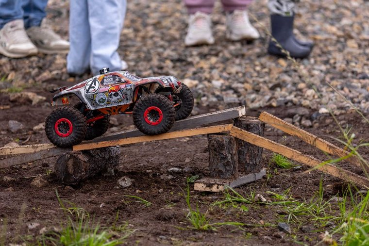
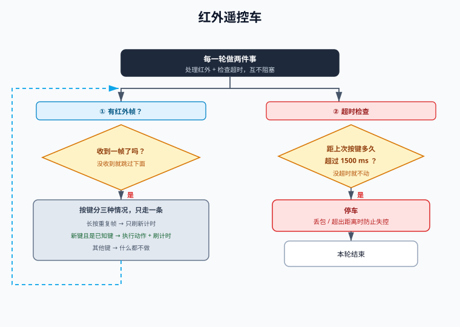

### 项目 11：红外遥控车

#### **1. 简介：**

{width=520px}

给车装一只遥控器：方向键按下就走，松开就停。红外是单向的，车没法回话，你怎么知道它还听不听得见？办法是在程序里挂一个 1.5 秒的计时，收到有效按键就重新计时，超时没有新指令就自己停下。

按住不放时，遥控器发的不是新指令，而是一帧帧很短的重复标记，只能说明还是这个键，说不清按了多久。车拿这些标记只做一件事：把计时续上，动作不重复执行。

方向键对应四个动作：上、下两轮同速前进后退，左、右两轮一正一反原地打转，OK 立即停车。

按上，车往前走；松手约 1.5 秒，它自己停住，Shell 也不再打印。

#### **2. 所需清单：**

本课用到的器件：

|     |     |     |
| :---: | :---: | :---: |
| {width=200px}<br><span style="font-size:0.85em">17 键红外遥控器（JMFP-4） ×1</span> | {width=200px}<br><span style="font-size:0.85em">红外接收头 ×1</span> | {width=200px}<br><span style="font-size:0.85em">DRV8835 电机扩展板 ×1</span> |
| {width=200px}<br><span style="font-size:0.85em">ESP32-S3 开发板 ×1</span> | {width=200px}<br><span style="font-size:0.85em">履带底盘总成 ×1</span> |  |
> ⚠️ **全是第 2 章装好的器件，本表只作对照，不用拆；下面的接线说明只标清接线方式，供对照，不必拆装。完整物料见 1.4 套件清单。**

#### **3. 参数：**

| 项目 | 参数 |
| --- | --- |
| 接收脚 | IO48 |
| 直行速度 | 180 |
| 原地转速度 | 180 |
| 指令超时 | 1500 ms |
| 键值 | 上 70、下 21、左 68、右 67、OK 64 |
| 循环周期 | 无延时，靠 `decode()` 自身节流 |

#### **4. 接线说明：**

| 信号 | 主控 GPIO |
| --- | :---: |
| 红外接收 OUT | IO48 |
| 左轮 AIN / AEN | IO38 / IO21 |
| 右轮 BIN / BEN | IO40 / IO41 |

#### **5. 流程图：**

主循环做两件事：有信号就处理，没信号就看超时。两件事互不阻塞，所以车不会因为等按键而停住响应：



#### **6. 测试代码：**

> ⚠️ **上传代码前，先把 `mini_tracked_tank_robot.py`、`ir_rx/ 文件夹` 上传到板子的 `lib/` 目录**（方法见第 5.5 节），否则导入库时会报 `ImportError`。

```python
from machine import Pin
from ir_rx.nec import NEC_8
from mini_tracked_tank_robot import MiniTrackedTankRobot
import time

IR_RX_PIN = 48
SPEED_RUN = 180
SPEED_TURN = 180
STOP_AFTER = 1500          # 超时自动停车（ms）

# 遥控器键值；换遥控器后按串口打印值修改
KEY_UP = 70
KEY_DOWN = 21
KEY_LEFT = 68
KEY_RIGHT = 67
KEY_STOP = 64

car = MiniTrackedTankRobot()
car.Motor_init()
car.stop_motor()

key = None                 # 待处理的按键，主循环取走
last_cmd = time.ticks_ms()


def on_ir(data, addr, ctrl):
    # 中断里只记键值和时刻，动作留给主循环做
    global key, last_cmd
    if data == -1:                 # 长按重复码：只刷新超时计时
        last_cmd = time.ticks_ms()
    elif data in (KEY_UP, KEY_DOWN, KEY_LEFT, KEY_RIGHT, KEY_STOP):
        key = data                 # 已知键：记键值并刷新计时
        last_cmd = time.ticks_ms()
    # 未知键：不处理也不刷新计时，与 Arduino 的 isKnownKey 一致


ir = NEC_8(Pin(IR_RX_PIN, Pin.IN), on_ir)
print('红外遥控车就绪')

while True:
    if key is not None:
        cmd = key
        key = None

        if cmd == KEY_UP:
            print('前进')
            car.forward(SPEED_RUN, SPEED_RUN)
        elif cmd == KEY_DOWN:
            print('后退')
            car.back(SPEED_RUN, SPEED_RUN)
        elif cmd == KEY_LEFT:
            print('左转')
            car.left(SPEED_TURN, SPEED_TURN)
        elif cmd == KEY_RIGHT:
            print('右转')
            car.right(SPEED_TURN, SPEED_TURN)
        elif cmd == KEY_STOP:
            print('停车')
            car.stop_motor()

    # 超时没有有效按键就停车，避免遥控器失联后一直跑
    if time.ticks_diff(time.ticks_ms(), last_cmd) > STOP_AFTER:
        car.stop_motor()

    time.sleep_ms(10)
```

#### **7. 代码解释：**

**(1) 引入库与常量**

```python
from machine import Pin
from ir_rx.nec import NEC_8
from mini_tracked_tank_robot import MiniTrackedTankRobot
import time

IR_RX_PIN = 48
SPEED_RUN = 180
SPEED_TURN = 180
STOP_AFTER = 1500          # 超时自动停车（ms）
```

这一课红外和电机都要用，所以三个来源都导入：`Pin` 和 `NEC_8` 解红外，`MiniTrackedTankRobot` 开车。`SPEED_RUN/TURN` 是直行和原地转的速度，`STOP_AFTER` 是失联多久后自动停车的毫秒数——这是全课的安全阀，改大车会跑得更远才停。

**(2) 键值、车对象与状态变量**

```python
# 遥控器键值；换遥控器后按Shell 打印值修改
KEY_UP = 70
KEY_DOWN = 21
KEY_LEFT = 68
KEY_RIGHT = 67
KEY_STOP = 64

car = MiniTrackedTankRobot()
car.Motor_init()
car.stop_motor()

key = None                 # 待处理的按键，主循环取走
last_cmd = time.ticks_ms()
```

五个 `KEY_*` 是遥控器码值，换遥控器就按第 10 课Shell 打印的数字改。`Motor_init()` 加 `stop_motor()` 让车先停住。`key` 是中断和主循环之间的**信箱**：初始 `None` 表示没有待办按键；`last_cmd` 记最后一次有效指令的时刻，用 `time.ticks_ms()` 取毫秒。

**(3) 中断回调只记键值，不动电机**

```python
def on_ir(data, addr, ctrl):
    # 中断里只记键值和时刻，动作留给主循环做
    global key, last_cmd
    if data == -1:                 # 长按重复码：只刷新超时计时
        last_cmd = time.ticks_ms()
    elif data in (KEY_UP, KEY_DOWN, KEY_LEFT, KEY_RIGHT, KEY_STOP):
        key = data                 # 已知键：记键值并刷新计时
        last_cmd = time.ticks_ms()
    # 未知键：不处理也不刷新计时，与 Arduino 的 isKnownKey 一致
```

回调跑在中断里，刻意只做两件轻活：记下 `key` 和刷新 `last_cmd`，真正开车留给主循环，避免中断里调电机出乱子。`data == -1` 是长按重复码，只刷新计时不重复动作；五个已知键才记 `key`；未知键既不处理也不刷新计时，这样乱按别的键不会让车误以为还在线。

**(4) 注册接收器**

```python
ir = NEC_8(Pin(IR_RX_PIN, Pin.IN), on_ir)
print('红外遥控车就绪')
```

和第 10 课一样，用 `NEC_8` 建接收器、把 `on_ir` 交给它解码。之后按键自动进回调，主循环不用管接收细节。

**(5) 主循环取键开车**

```python
while True:
    if key is not None:
        cmd = key
        key = None

        if cmd == KEY_UP:
            print('前进')
            car.forward(SPEED_RUN, SPEED_RUN)
        elif cmd == KEY_DOWN:
            print('后退')
            car.back(SPEED_RUN, SPEED_RUN)
        elif cmd == KEY_LEFT:
            print('左转')
            car.left(SPEED_TURN, SPEED_TURN)
        elif cmd == KEY_RIGHT:
            print('右转')
            car.right(SPEED_TURN, SPEED_TURN)
        elif cmd == KEY_STOP:
            print('停车')
            car.stop_motor()
```

主循环一发现 `key` 不是 `None` 就取走，并立刻清回 `None`，保证一个按键只执行一次。`forward/back/left/right` 是板级库的四个动作方法，参数都是左右轮速度：`forward/back` 两轮同向，`left/right` 两轮反向原地转。按 OK 直接 `stop_motor()`。改 `SPEED_RUN/TURN` 就能调快慢。

**(6) 超时自动停车**

```python
    # 超时没有有效按键就停车，避免遥控器失联后一直跑
    if time.ticks_diff(time.ticks_ms(), last_cmd) > STOP_AFTER:
        car.stop_motor()

    time.sleep_ms(10)
```

每轮都用 `time.ticks_diff()` 算距上次有效指令过了多久，超过 `STOP_AFTER`（1500 ms）就 `stop_motor()`——遥控器没电、被挡住或你走远了，车也不会一直冲。`sleep_ms(10)` 让循环慢下来，省资源又足够灵敏。

#### **8. 运行现象：**

上电后Shell 打印 `红外遥控车启动，用方向盘控制`。按方向键：

| 按键 | 串口 | 车 |
| --- | --- | --- |
| ↑ | 前进 | 两轮同速正转 |
| ↓ | 后退 | 两轮同速反转 |
| ← | 左转 | 左轮反转、右轮正转，原地打转 |
| → | 右转 | 左轮正转、右轮反转 |
| OK | 停车 | 立即停 |

松手后约 1.5 s，车自己停下（Shell 不会再打印，因为 `stopCar()` 在超时分支里被静默调用）。

> 【图片待补】Shell 打印五个按键动作的连续截图。

#### **9. 常见问题解决：**

(1) 点**运行**后 Thonny 下方的 Shell 跳出 `ImportError: no module named 'ir_rx'`，或者找不到 `mini_tracked_tank_robot`，是库文件没进板子。把 `ir_rx` 文件夹和 `mini_tracked_tank_robot.py` 用 Thonny 保存到板子的 `lib/` 下再运行，只放在电脑这边一定会报这个错。

(2) Shell 直接报 `OSError`，多半是 `IR_RX_PIN = 48` 这个脚被别的功能占了，或者接收头信号脚没插在 IO48。先核对接收头输出接 IO48、电源和地没反，再把占用 48 的旧程序停掉重新运行。

(3) 按遥控器完全没动静、Shell 也不打印**前进**，一般是键值不匹配：代码里 `KEY_UP = 70`、`KEY_DOWN = 21`、`KEY_LEFT = 68`、`KEY_RIGHT = 67`、`KEY_STOP = 64` 是按配的遥控器定的，换一个遥控器码就变了。照着 Shell 打印出来的实际键值改这几个 `KEY_*` 常量就行。

(4) 动作和按键对不上——按**上**车却后退——是左右电机线接反了，或者调用 `car.forward()` 时把左右轮速度写反了。先用第 2 课的方法单独测电机，确认 A 路带的是左轮，再回来核对 `forward/back/left/right` 那几个调用的两个参数。

(5) 遥控距离变短、偶尔按了没反应，多半是接收头被车壳挡住了一角。它是侧面受光的，正对遥控器效果最好，把接收头装在底盘边缘朝前、别让外壳遮住就行。
