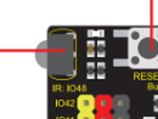

### Project 11: Infrared Remote-Controlled Car

#### **1. Introduction:**

{width=520px}

Fit the car with a remote control: press an arrow key and it drives, let go and it stops. Infrared is one-way, so the car cannot answer back — how do you know whether it can still hear you? The trick is to run a 1.5 second timer in the program, restart it whenever a valid key arrives, and stop the car yourself when no new command arrives before it expires.

Hold a key down and the remote is no longer sending new commands but a series of very short repeat markers, which only say that the key is still down, not how long it has been held. The car uses those markers for exactly one thing: to top up the timer, without re-running the action.

The arrow keys map to four actions: up and down drive both wheels forward and backward at the same speed, left and right spin in place with the two wheels turning opposite ways, and OK stops the car immediately.

Press up and the car drives forward; let go and about 1.5 seconds later it stops by itself, and the Shell stops printing too.

#### **2. Parts List:**
Components used in this lesson:

|     |     |     |
| :---: | :---: | :---: |
| {width=200px}<br><span style="font-size:0.85em">17-key infrared remote control (JMFP-4) ×1</span> | {width=200px}<br><span style="font-size:0.85em">Infrared receiver ×1</span> | {width=200px}<br><span style="font-size:0.85em">DRV8835 motor expansion board ×1</span> |
| {width=200px}<br><span style="font-size:0.85em">ESP32-S3 development board ×1</span> | {width=200px}<br><span style="font-size:0.85em">Mini Tracked Tank Robot bottom assembly ×1</span> |  |
> ⚠️ **Everything here was installed in Chapter 2. This table is for reference only, so there is no need to remove anything; the wiring notes below only describe the wiring method for reference and do not require disassembly. See the kit list in 1.4 for the full bill of materials.**

#### **3. Parameters:**
| Item | Parameter |
| --- | --- |
| Receiver pin | IO48 |
| Straight-line speed | 180 |
| Pivot speed | 180 |
| Command timeout | 1500 ms |
| Key values | Up 70, Down 21, Left 68, Right 67, OK 64 |
| Loop period | No delay; `decode()` throttles itself |

#### **4. Wiring:**

| Signal | Controller GPIO |
| --- | :---: |
| Infrared receiver OUT | IO48 |
| Left wheel AIN / AEN | IO38 / IO21 |
| Right wheel BIN / BEN | IO40 / IO41 |

#### **5. Flowchart:**

The main loop does two things: handle a command if there is one, and check the timeout if there is not. Neither blocks the other, so the car never stops responding while waiting for a key:


#### **6. Test Code:**
> ⚠️ **Before uploading the code, upload `mini_tracked_tank_robot.py` and the `ir_rx/ folder` to the `lib/` directory on the board** (see Section 5.5), otherwise importing the library raises `ImportError`.

```python
from machine import Pin
from ir_rx.nec import NEC_8
from mini_tracked_tank_robot import MiniTrackedTankRobot
import time

IR_RX_PIN = 48
SPEED_RUN = 180
SPEED_TURN = 180
STOP_AFTER = 1500          # Auto stop after this timeout (ms)

# Remote key codes; change them according to the Shell output if you use another remote
KEY_UP = 70
KEY_DOWN = 21
KEY_LEFT = 68
KEY_RIGHT = 67
KEY_STOP = 64

car = MiniTrackedTankRobot()
car.Motor_init()
car.stop_motor()

key = None                 # Pending key, consumed by the main loop
last_cmd = time.ticks_ms()


def on_ir(data, addr, ctrl):
    # The interrupt only records the key and the time, the main loop performs the action
    global key, last_cmd
    if data == -1:                 # Long-press repeat code: only refresh the timeout
        last_cmd = time.ticks_ms()
    elif data in (KEY_UP, KEY_DOWN, KEY_LEFT, KEY_RIGHT, KEY_STOP):
        key = data                 # Known key: store it and refresh the timeout
        last_cmd = time.ticks_ms()
    # Unknown key: ignored and the timeout is not refreshed, same as isKnownKey in the Arduino version


ir = NEC_8(Pin(IR_RX_PIN, Pin.IN), on_ir)
print('IR remote car ready')

while True:
    if key is not None:
        cmd = key
        key = None

        if cmd == KEY_UP:
            print('Forward')
            car.forward(SPEED_RUN, SPEED_RUN)
        elif cmd == KEY_DOWN:
            print('Backward')
            car.back(SPEED_RUN, SPEED_RUN)
        elif cmd == KEY_LEFT:
            print('Turn left')
            car.left(SPEED_TURN, SPEED_TURN)
        elif cmd == KEY_RIGHT:
            print('Turn right')
            car.right(SPEED_TURN, SPEED_TURN)
        elif cmd == KEY_STOP:
            print('Stop')
            car.stop_motor()

    # Stop when no valid key arrives in time, so the car does not keep running when the remote is out of range
    if time.ticks_diff(time.ticks_ms(), last_cmd) > STOP_AFTER:
        car.stop_motor()

    time.sleep_ms(10)
```

#### **7. Code Explanation:**
**(1) Importing the libraries and the constants**

```python
from machine import Pin
from ir_rx.nec import NEC_8
from mini_tracked_tank_robot import MiniTrackedTankRobot
import time

IR_RX_PIN = 48
SPEED_RUN = 180
SPEED_TURN = 180
STOP_AFTER = 1500          # Auto stop after this timeout (ms)
```

This lesson needs both infrared and motors, so all three sources are imported: `Pin` and `NEC_8` decode the infrared, and `MiniTrackedTankRobot` drives the car. `SPEED_RUN/TURN` are the speeds for driving straight and for pivoting, and `STOP_AFTER` is how many milliseconds of silence trigger the automatic stop — this is the safety valve of the whole lesson, and raising it lets the car run further before stopping.

**(2) Key values, the car object and the state variables**

```python
# Remote key codes; change them according to the Shell output if you use another remote
KEY_UP = 70
KEY_DOWN = 21
KEY_LEFT = 68
KEY_RIGHT = 67
KEY_STOP = 64

car = MiniTrackedTankRobot()
car.Motor_init()
car.stop_motor()

key = None                 # Pending key, consumed by the main loop
last_cmd = time.ticks_ms()
```

The five `KEY_*` constants are the remote codes; with a different remote, change them to the numbers the Shell printed in Lesson 10. `car.Motor_init()` followed by `car.stop_motor()` brings the car to a halt first. `key` is the **mailbox** between the interrupt and the main loop: `None` at the start means no key is pending; `last_cmd` records the moment of the last valid command, taken in milliseconds with `time.ticks_ms()`.

**(3) The interrupt callback only records keys, never touches the motors**

```python
def on_ir(data, addr, ctrl):
    # The interrupt only records the key and the time, the main loop performs the action
    global key, last_cmd
    if data == -1:                 # Long-press repeat code: only refresh the timeout
        last_cmd = time.ticks_ms()
    elif data in (KEY_UP, KEY_DOWN, KEY_LEFT, KEY_RIGHT, KEY_STOP):
        key = data                 # Known key: store it and refresh the timeout
        last_cmd = time.ticks_ms()
    # Unknown key: ignored and the timeout is not refreshed, same as isKnownKey in the Arduino version
```

The callback runs inside an interrupt, so it deliberately does only two light jobs: storing `key` and refreshing `last_cmd`. The actual driving is left to the main loop, which keeps motor calls out of the interrupt where they could misbehave. `data == -1` is the long-press repeat code, which only refreshes the timer and does not re-run the action; only the five known keys store `key`; unknown keys are neither handled nor used to refresh the timer, so punching random keys does not fool the car into thinking it is still in touch.

**(4) Registering the receiver**

```python
ir = NEC_8(Pin(IR_RX_PIN, Pin.IN), on_ir)
print('IR remote car ready')
```

As in Lesson 10, `NEC_8` is used to create a receiver and `on_ir` is handed to it for decoding. After that, key presses go to the callback automatically and the main loop does not have to deal with the receiving details.

**(5) The main loop picks up keys and drives**

```python
while True:
    if key is not None:
        cmd = key
        key = None

        if cmd == KEY_UP:
            print('Forward')
            car.forward(SPEED_RUN, SPEED_RUN)
        elif cmd == KEY_DOWN:
            print('Backward')
            car.back(SPEED_RUN, SPEED_RUN)
        elif cmd == KEY_LEFT:
            print('Turn left')
            car.left(SPEED_TURN, SPEED_TURN)
        elif cmd == KEY_RIGHT:
            print('Turn right')
            car.right(SPEED_TURN, SPEED_TURN)
        elif cmd == KEY_STOP:
            print('Stop')
            car.stop_motor()
```

As soon as the main loop finds `key` is not `None` it takes it and immediately clears it back to `None`, which guarantees one action per key press. `forward/back/left/right` are the four action methods of the board-level library and all take the left and right wheel speeds as arguments: `forward/back` turn both wheels the same way, while `left/right` turn them opposite ways to pivot in place. OK calls `car.stop_motor()` directly. Change `SPEED_RUN/TURN` to adjust the speed.

**(6) Automatic stop on timeout**

```python
    # Stop when no valid key arrives in time, so the car does not keep running when the remote is out of range
    if time.ticks_diff(time.ticks_ms(), last_cmd) > STOP_AFTER:
        car.stop_motor()

    time.sleep_ms(10)
```

Every round `time.ticks_diff()` works out how long it has been since the last valid command, and once that exceeds `STOP_AFTER` (1500 ms) the car calls `car.stop_motor()` — so a flat battery, something blocking the remote or simply walking out of range will not leave the car charging off. `sleep_ms(10)` slows the loop down, which saves resources and is still responsive enough.

#### **8. Expected Behavior:**
After power-on the Shell prints `IR remote car ready`. Press the arrow keys:

| Key | Shell output | Car |
| --- | --- | --- |
| ↑ | Forward | Both wheels forward at the same speed |
| ↓ | Backward | Both wheels reverse at the same speed |
| ← | Turn left | Left wheel reverse, right wheel forward, pivoting in place |
| → | Turn right | Left wheel forward, right wheel reverse |
| OK | Stop | Stops immediately |

About 1.5 s after you let go the car stops by itself (the Shell does not print anything further, because `car.stop_motor()` is called silently in the timeout branch).

> [Image to be added] A screenshot of the Shell output for the five key actions in sequence.

If a key triggers the wrong motion — pressing **Up** makes the car reverse — either the left and right motor wires are swapped or the two arguments in `car.forward()` are reversed. Test the motors individually as in Lesson 2 to confirm channel A drives the left wheel, then check back here.

Shorter remote range or occasional missed presses usually mean a corner of the receiver is blocked by the car body. It senses from its side, so facing the remote directly works best — mounting it at the front edge of the chassis is ideal.

#### **9. Troubleshooting:**

(1) After clicking **Run**, the Shell below Thonny reports `ImportError: no module named 'ir_rx'`, or cannot find `mini_tracked_tank_robot`: the library files are not on the board. Use Thonny to save the `ir_rx` folder and `mini_tracked_tank_robot.py` to `lib/` on the board and run again — leaving them only on the computer always produces this error.

(2) A Shell `OSError` most likely means the pin in `IR_RX_PIN = 48` is taken by another function, or the receiver's signal wire is not in IO48. Check first that the receiver output goes to IO48 and that power and ground are not reversed, then stop the old program that occupies pin 48 and run again.

(3) Pressing the remote does nothing at all and the Shell does not print **Forward**. This is usually a key-value mismatch: `KEY_UP = 70`, `KEY_DOWN = 21`, `KEY_LEFT = 68`, `KEY_RIGHT = 67` and `KEY_STOP = 64` are set for the supplied remote, and a different remote uses different codes. Change these `KEY_*` constants to the actual values the Shell prints.

(4) The action does not match the key — press **Up** and the car reverses. Either the left and right motor wires are swapped, or the left and right speeds are written the wrong way round in `car.forward()`. Test the motors individually the way Lesson 2 describes, confirm that channel A drives the left wheel, and then check the two arguments of the `forward/back/left/right` calls.

(5) If the range gets shorter and keys are occasionally missed, a corner of the receiver is probably hidden by the car body. It senses from its side, so it works best pointing at the remote; mount the receiver on the edge of the chassis facing forward and keep the shell from covering it.
