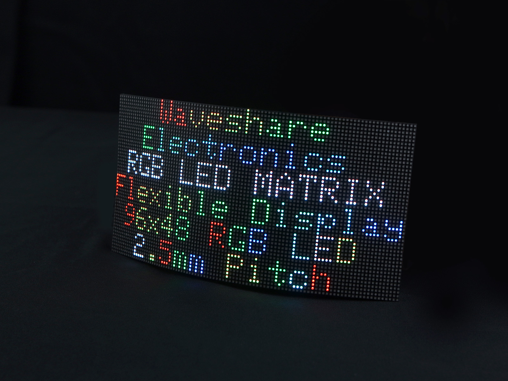
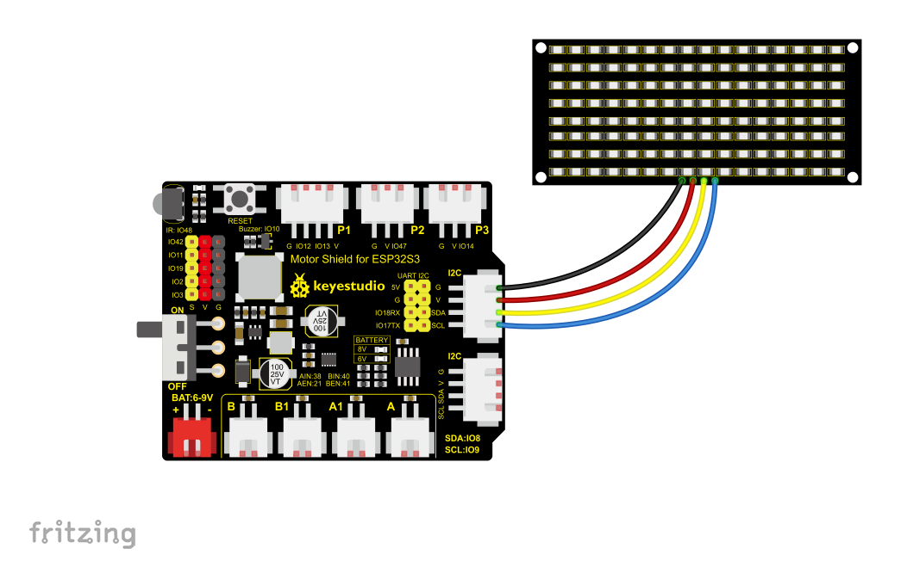
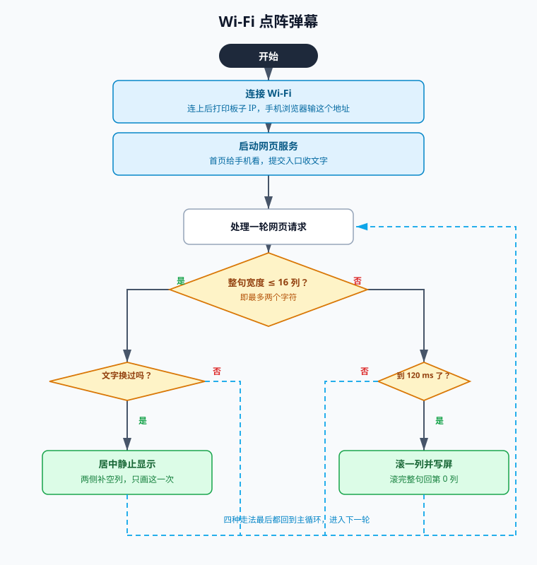

### 项目 12：Wi-Fi 点阵弹幕屏

#### **1. 简介：**

{width=520px}

第 1 课的点阵只能循环播几个写死的图案，现在把它变成一块弹幕屏：手机连上和车同一个 Wi-Fi，浏览器打开板子的地址，输入一句话，点发送，点阵上就滚出来了。

这块屏只有 16 列宽。字库里一个字母占 5 列，加上 1 列间隔就是 6 列，一屏顶多两个字——超过的必须滚起来，不滚就只剩半截。滚动每 120 毫秒挪一列，读起来刚好跟得上。

字库是幕后的主角：26 个字母加 10 个数字，每个字符 5 列，每列一个字节。想换一种字形，动的就是这些字节。

上电后 Shell 打印板子拿到的地址，手机在同一个 Wi-Fi 下打开它，是一个深色页面：输入框加一个发送按钮。发 HI，居中不动；发 LOVE，从右往左滚，滚完留一段空白再从头来。

#### **2. 所需清单：**

本课用到的器件：

|     |     |     |
| :---: | :---: | :---: |
| {width=170px}<br><span style="font-size:0.85em">8×16 LED 点阵屏 ×1</span> | {width=170px}<br><span style="font-size:0.85em">DRV8835 电机扩展板 ×1</span> | {width=170px}<br><span style="font-size:0.85em">ESP32-S3 开发板 ×1</span> |
| <span style="font-size:0.85em">2.4 GHz 无线路由器或手机热点 ×1</span> |  |  |
> ⚠️ **点阵在第 2 章就装好了，本表只作对照，不用拆；下面的接线说明只标清接线方式，供对照，不必拆装。完整物料见 1.4 套件清单。**

#### **3. 参数：**

| 项目 | 参数 |
| --- | --- |
| Wi-Fi 模式 | STA，仅 2.4 GHz |
| 网页端口 | 80 |
| 访问方式 | 浏览器打开Shell 打印的 IP |
| 字符集 | A ~ Z、0 ~ 9、空格，共 37 个 |
| 字库规格 | 5×7，每字符 5 列，每列 1 字节 |
| 字符占宽 | 6 列（5 列字模 + 1 列间隔） |
| 最大字符数 | 24 |
| 一屏容量 | 16 列，约 2 个字符 |
| 滚动间隔 | 120 ms / 列 |

#### **4. 接线说明：**

| 信号 | 主控 GPIO |
| --- | :---: |
| 点阵 CLK | IO9 |
| 点阵 DIN | IO8 |

这一课不用电机和传感器，只接点阵。Wi-Fi 是片内功能，不需要额外接线。



#### **5. 流程图：**

从手机点**发送**到点阵亮起来，中间要过四道关：



#### **6. 测试代码：**

> ⚠️ **上传代码前，先把 `mini_tracked_tank_robot.py`、`mini_tracked_tank_robot_web.py` 上传到板子的 `lib/` 目录**（方法见第 5.5 节），否则导入库时会报 `ImportError`。

```python
import network
import time
from mini_tracked_tank_robot import MiniTrackedTankRobot
from mini_tracked_tank_robot_web import WebServer

WIFI_SSID = '你的WiFi账号'
WIFI_PASS = '你的WiFi密码'

CLK_PIN = 9
DIN_PIN = 8
SCROLL_MS = 120            # 每列滚动间隔（ms），越小越快
MAX_CHARS = 24             # 最大字符数

# 点阵列序：本车模组是正常列序（地址 0 在最左），不用翻转
# 若换到列序相反的模组（字会左右反），把它改成 True
MIRROR_X = False

# 5×7 字库：每字符 5 列，1 字节/列，bit0 为最上行
# 索引 0~25 为 A~Z，26~35 为 0~9，36 为空格
FONT = [
    (0x7E, 0x11, 0x11, 0x11, 0x7E),  # A
    (0x7F, 0x49, 0x49, 0x49, 0x36),  # B
    (0x3E, 0x41, 0x41, 0x41, 0x22),  # C
    (0x7F, 0x41, 0x41, 0x22, 0x1C),  # D
    (0x7F, 0x49, 0x49, 0x49, 0x41),  # E
    (0x7F, 0x09, 0x09, 0x09, 0x01),  # F
    (0x3E, 0x41, 0x49, 0x49, 0x7A),  # G
    (0x7F, 0x08, 0x08, 0x08, 0x7F),  # H
    (0x00, 0x41, 0x7F, 0x41, 0x00),  # I
    (0x20, 0x40, 0x41, 0x3F, 0x01),  # J
    (0x7F, 0x08, 0x14, 0x22, 0x41),  # K
    (0x7F, 0x40, 0x40, 0x40, 0x40),  # L
    (0x7F, 0x02, 0x0C, 0x02, 0x7F),  # M
    (0x7F, 0x04, 0x08, 0x10, 0x7F),  # N
    (0x3E, 0x41, 0x41, 0x41, 0x3E),  # O
    (0x7F, 0x09, 0x09, 0x09, 0x06),  # P
    (0x3E, 0x41, 0x51, 0x21, 0x5E),  # Q
    (0x7F, 0x09, 0x19, 0x29, 0x46),  # R
    (0x46, 0x49, 0x49, 0x49, 0x31),  # S
    (0x01, 0x01, 0x7F, 0x01, 0x01),  # T
    (0x3F, 0x40, 0x40, 0x40, 0x3F),  # U
    (0x1F, 0x20, 0x40, 0x20, 0x1F),  # V
    (0x3F, 0x40, 0x38, 0x40, 0x3F),  # W
    (0x63, 0x14, 0x08, 0x14, 0x63),  # X
    (0x07, 0x08, 0x70, 0x08, 0x07),  # Y
    (0x61, 0x51, 0x49, 0x45, 0x43),  # Z
    (0x3E, 0x51, 0x49, 0x45, 0x3E),  # 0
    (0x00, 0x42, 0x7F, 0x40, 0x00),  # 1
    (0x42, 0x61, 0x51, 0x49, 0x46),  # 2
    (0x21, 0x41, 0x45, 0x4B, 0x31),  # 3
    (0x18, 0x14, 0x12, 0x7F, 0x10),  # 4
    (0x27, 0x45, 0x45, 0x45, 0x39),  # 5
    (0x3C, 0x4A, 0x49, 0x49, 0x30),  # 6
    (0x01, 0x71, 0x09, 0x05, 0x03),  # 7
    (0x36, 0x49, 0x49, 0x49, 0x36),  # 8
    (0x06, 0x49, 0x49, 0x29, 0x1E),  # 9
    (0x00, 0x00, 0x00, 0x00, 0x00),  # 空格
]

INDEX_HTML = """<!DOCTYPE html><html><head>
<meta charset="utf-8">
<meta name="viewport" content="width=device-width,initial-scale=1">
<title>点阵弹幕</title>
<style>
body{font-family:-apple-system,"Microsoft YaHei",sans-serif;background:#1a1a1a;color:#ddd;
     text-align:center;margin:0;padding:20px}
.card{background:#242424;border-radius:14px;padding:18px;max-width:420px;margin:0 auto}
h2{margin:0 0 14px;font-size:18px;color:#4dd0e1;font-weight:500}
input{width:100%;box-sizing:border-box;height:52px;font-size:20px;text-align:center;
      border:none;border-radius:10px;background:#111;color:#eee;outline:none;
      letter-spacing:2px;text-transform:uppercase}
button{margin-top:12px;width:100%;height:52px;font-size:19px;border:none;border-radius:10px;
       background:#00897b;color:#fff}
p{font-size:13px;color:#777;margin:14px 0 0;line-height:1.6}
</style></head><body>
<div class="card">
<h2>点阵弹幕</h2>
<input id="t" maxlength="24" placeholder="输入英文或数字">
<button onclick="send()">发送到点阵</button>
<p id="r">只支持字母、数字和空格，最多 24 个字符</p>
</div>
<script>
function send(){
  var t=document.getElementById('t').value;
  fetch('/msg?t='+encodeURIComponent(t)).then(function(){
    document.getElementById('r').innerText='已发送：'+t.toUpperCase();
  });
}
</script>
</body></html>"""

car = MiniTrackedTankRobot()
car.Matrix_init(CLK_PIN, DIN_PIN)
car.Matrix_clear()

msg = 'HELLO'
scroll_pos = 0
last_scroll = 0
need_redraw = True


def text_width(text):
    # 每字符 6 列，末字符不计间隔
    if len(text) == 0:
        return 0
    return len(text) * 6 - 1


def char_index(c):
    if 'A' <= c <= 'Z':
        return ord(c) - ord('A')
    if '0' <= c <= '9':
        return 26 + ord(c) - ord('0')
    return 36


def get_column(idx):
    if idx < 0:
        return 0
    char_idx = idx // 6
    col_idx = idx % 6
    if char_idx >= len(msg):
        return 0
    if col_idx >= 5:
        return 0
    return FONT[char_index(msg[char_idx])][col_idx]


def send_frame(cols):
    # MIRROR_X 为 True 时才反转 16 列（用于列序相反的模组）
    if MIRROR_X:
        cols = bytes(reversed(cols))
    car.Matrix_display(bytes(cols))


def render_static():
    # 整句居中显示在一屏 16 列内
    total = text_width(msg)
    start_col = (16 - total) // 2
    cols = bytearray(16)
    for i in range(16):
        idx = i - start_col
        cols[i] = get_column(idx) if idx >= 0 else 0
    send_frame(cols)


def render_frame(pos):
    cols = bytearray(16)
    for i in range(16):
        cols[i] = get_column(pos + i)
    send_frame(cols)


def on_index(params):
    return INDEX_HTML


def on_msg(params):
    global msg, scroll_pos, need_redraw
    text = params.get('t', '').strip().upper()
    # 对齐 Arduino charToIndex：非法字符不当作删除，而是按空格占位
    text = ''.join(c if (('A' <= c <= 'Z') or ('0' <= c <= '9')) else ' ' for c in text)
    if len(text) > MAX_CHARS:
        text = text[:MAX_CHARS]
    if len(text) > 0:
        msg = text
        scroll_pos = 0
        need_redraw = True
    return 'OK'


# ==================== 连接 Wi-Fi ====================
wlan = network.WLAN(network.STA_IF)
wlan.active(True)
print('正在连接', WIFI_SSID)
wlan.connect(WIFI_SSID, WIFI_PASS)
while not wlan.isconnected():
    time.sleep(0.5)
    print('.', end='')
print()
print('弹幕屏就绪，手机打开：http://' + wlan.ifconfig()[0])

server = WebServer(80)
server.route('/', on_index)
server.route('/msg', on_msg)

# ==================== 主循环 ====================
while True:
    server.handle()

    # 一屏装得下：居中静止显示
    if text_width(msg) <= 16:
        if need_redraw:
            render_static()
            need_redraw = False
        time.sleep_ms(20)
        continue

    # 超出一屏：横向滚动
    if time.ticks_diff(time.ticks_ms(), last_scroll) < SCROLL_MS:
        time.sleep_ms(5)
        continue

    last_scroll = time.ticks_ms()
    render_frame(scroll_pos)
    scroll_pos = (scroll_pos + 1) % (text_width(msg) + 16)
```

#### **7. 代码解释：**

**(1) 引入库与网络模块**

```python
import network
import time
from mini_tracked_tank_robot import MiniTrackedTankRobot
from mini_tracked_tank_robot_web import WebServer
```

比第 1 课多了两个库：`network` 是 MicroPython 自带的 Wi-Fi 模块，负责让板子连上路由器；`WebServer` 来自 `mini_tracked_tank_robot_web`，把网页服务封装好了。这两个 py 文件都要先传进板子的 `lib/`，缺一个就 `ImportError`。

**(2) 初始化点阵与弹幕状态**

```python
car = MiniTrackedTankRobot()
car.Matrix_init(CLK_PIN, DIN_PIN)
car.Matrix_clear()

msg = 'HELLO'
scroll_pos = 0
last_scroll = 0
need_redraw = True
```

`Matrix_init(CLK_PIN, DIN_PIN)` 把 CLK 接 IO9、DIN 接 IO8，跟第 1 课是同一套点阵。`msg` 存当前要显示的字串，初值是 `HELLO`；`scroll_pos` 是滚动起点，`last_scroll` 记上次滚的时间，`need_redraw` 是个开关——换了新字串就置 `True`，让主循环重画一次。

**(3) 5×7 字库：每个字符 5 列**

```python
# 5×7 字库：每字符 5 列，1 字节/列，bit0 为最上行
# 索引 0~25 为 A~Z，26~35 为 0~9，36 为空格
FONT = [
    (0x7E, 0x11, 0x11, 0x11, 0x7E),  # A
```

字库是一个列表，索引 0~25 存字母、26~35 存数字、36 是空格，正好对应 `char_index()` 的返回值。每个字符是 5 个字节（tuple），一字节管一列，bit0 是最上面一行——和第 1 课 16 字节字模同理，只是从**整屏一幅图**缩成**一个字 5 列**。想改字形，改这几个十六进制数就行。

**(4) 把字符拆成一列列字模**

```python
def char_index(c):
    if 'A' <= c <= 'Z':
        return ord(c) - ord('A')
    if '0' <= c <= '9':
        return 26 + ord(c) - ord('0')
    return 36

def get_column(idx):
    if idx < 0:
        return 0
    char_idx = idx // 6
    col_idx = idx % 6
    if char_idx >= len(msg):
        return 0
    if col_idx >= 5:
        return 0
    return FONT[char_index(msg[char_idx])][col_idx]
```

`char_index()` 把字母/数字换算成字库下标。`get_column(idx)` 是核心：它把整句话看成一条很长的**列带**，输入任意列号 `idx`，用 `//6` 算出这是第几个字、`%6` 算出是这个字的第几列（每个字占 6 列 = 5 列字模 + 1 列空白）。`idx` 超出范围或落在字符间隙就返回 0（灭灯）。滚动时只是不断改变取列的起点，不用搬动字模本身。

**(5) 两种渲染：居中静止与横向滚动**

```python
def send_frame(cols):
    # MIRROR_X 为 True 时才反转 16 列（用于列序相反的模组）
    if MIRROR_X:
        cols = bytes(reversed(cols))
    car.Matrix_display(bytes(cols))

def render_static():
    # 整句居中显示在一屏 16 列内
    total = text_width(msg)
    start_col = (16 - total) // 2
    cols = bytearray(16)
    for i in range(16):
        idx = i - start_col
        cols[i] = get_column(idx) if idx >= 0 else 0
    send_frame(cols)

def render_frame(pos):
    cols = bytearray(16)
    for i in range(16):
        cols[i] = get_column(pos + i)
    send_frame(cols)
```

每帧都先建一个 16 元素的 `bytearray`，再逐列填。`render_static()` 算出居中起点 `start_col`，短句就停在屏中间；`render_frame(pos)` 从 `pos` 开始连续取 16 列，`pos` 每加 1 就是左移一列。`MIRROR_X` 为 `True` 时 `send_frame()` 把 16 列反转，用来适配列序相反的点阵模组——字左右反了就把它改成 `True`。最后统一转成 `bytes` 送给 `Matrix_display()`。

**(6) 网页那部分：只负责把文字递进来**

```python
def on_index(params):
    return INDEX_HTML

def on_msg(params):
    global msg, scroll_pos, need_redraw
    text = params.get('t', '').strip().upper()
    # 对齐 Arduino charToIndex：非法字符不当作删除，而是按空格占位
    text = ''.join(c if (('A' <= c <= 'Z') or ('0' <= c <= '9')) else ' ' for c in text)
    if len(text) > MAX_CHARS:
        text = text[:MAX_CHARS]
    if len(text) > 0:
        msg = text
        scroll_pos = 0
        need_redraw = True
    return 'OK'
```

这是 `WebServer` 库的标准写法，不是本课的重点，知道它干了什么就够了：`route()` 把网址和一个函数绑在一起，浏览器一访问，那个函数就被调用，返回值直接发给浏览器。`/` 交给 `on_index()` 返回整页 HTML，`/msg?t=...` 交给 `on_msg()`。

`params` 是库解析好的网址参数字典。`on_msg()` 里那几行才是和显示有关的：去空格、转大写（字库只有大写和数字）、非字母数字换成空格占位、超长截到 24 个字符。加工完更新 `msg`、滚动位置归零、打开重画开关，再返回 `'OK'`。

```python
wlan = network.WLAN(network.STA_IF)
wlan.active(True)
wlan.connect(WIFI_SSID, WIFI_PASS)
while not wlan.isconnected():
    time.sleep(0.5)
    print('.', end='')
print('弹幕屏就绪，手机打开：http://' + wlan.ifconfig()[0])

server = WebServer(80)
server.route('/', on_index)
server.route('/msg', on_msg)
```

连 Wi-Fi 那几行是固定套路：`STA_IF` 是客户端模式，让板子像手机一样连路由器；`isconnected()` 为真才算连上，`ifconfig()[0]` 取板子 IP 打印出来，每次上电可能变，以 Shell 打印为准。

后面三行才是把网页接起来：`WebServer(80)` 在 80 端口开服务（浏览器默认连这个端口，所以地址里不用写 `:80`），两条 `route()` 分别绑首页和提交入口。要加新接口，照这个格式再加一条就行。

真正的活是下面：这段文字怎么变成 16 列点阵上的画面。

**(7) 主循环：静止与滚动的分流**

```python
while True:
    server.handle()

    # 一屏装得下：居中静止显示
    if text_width(msg) <= 16:
        if need_redraw:
            render_static()
            need_redraw = False
        time.sleep_ms(20)
        continue

    # 超出一屏：横向滚动
    if time.ticks_diff(time.ticks_ms(), last_scroll) < SCROLL_MS:
        time.sleep_ms(5)
        continue

    last_scroll = time.ticks_ms()
    render_frame(scroll_pos)
    scroll_pos = (scroll_pos + 1) % (text_width(msg) + 16)
```

每次循环先调 `server.handle()`，否则网页请求没人处理。`text_width()` 算整句占多少列：不超过 16 列就走静止分支，只在 `need_redraw` 为真时画一次，画完关掉开关，免得每帧重复刷。超过 16 列就走滚动分支：用 `ticks_diff()` 做非阻塞定时，没到 `SCROLL_MS`（120 ms）就跳过，到了才推进一列。`scroll_pos` 用取模循环，`+16` 是为了让整句话滚出屏幕后再补一段空白，字和字之间不会首尾黏在一起。调 `SCROLL_MS` 能改滚动速度。

#### **8. 运行现象：**

上电后Shell 打印：

```text
正在连接 你的WiFi名字
.....
弹幕屏就绪，手机打开：http://192.168.1.23
```

手机连同一个 Wi-Fi，浏览器输入这个地址，出现一个深色页面：输入框、**发送到点阵**按钮，下面两行说明。

| 输入 | 点阵表现 |
| --- | --- |
| `HI` | 居中静止显示 |
| `LOVE` | 从右往左滚动，滚完留 16 列空白再循环 |
| `HELLO WORLD` | 滚动，字符间距均匀 |

> 【图片待补】输入 `LOVE` 后点阵滚动到中间位置的实拍图。

#### **9. 常见问题解决：**

**Wi-Fi 连不上、网页打不开，按这个顺序查：**

(1) **账号密码换了没有**：代码开头的 `WIFI_SSID`、`WIFI_PASS` 还是占位符就运行，一定连不上，改成自己路由器的名称和密码。

(2) **Shell 里一行字都没有**：按一下板子上的 RESET 键再试，可能是上一版程序卡住了。

{width=340px}

(3) **Shell 一直冒点、拿不到 IP**：Wi-Fi 连接失败。路由器必须是 **2.4 GHz**，5 GHz 板子不支持；没有 2.4 G 就开手机热点（热点默认 2.4 G）。

(4) **拿到 IP 但页面打不开**：地址要带 `http://`，IP 以 Shell 打印的为准；手机必须连同一个 Wi-Fi，两边 IP 前三段要一样。

(5) **网段对、还是打不开**：进路由器后台把**AP 隔离**关掉，开了它同一 Wi-Fi 下的设备互相访问不了。

(6) Shell 报 `ImportError: no module named 'mini_tracked_tank_robot_web'`，是 WebServer 库没到板子上。把 `mini_tracked_tank_robot.py` 和 `mini_tracked_tank_robot_web.py` 用 Thonny 保存到板子的 `lib/` 下再运行。

(7) 网页能打开、点**发送到点阵**弹幕却没变化，多半是接口对不上：检查 `server.route('/msg', on_msg)` 注册的路径和网页里 `fetch` 的地址是否一致，另外主循环里 `server.handle()` 要一直调用，漏了就没人处理请求。

(8) 整屏一个点都不亮，先查点阵接线——`CLK_PIN = 9`、`DIN_PIN = 8`，CLK 和 DIN 接反了就什么都显示不出来，对调过来再运行。
