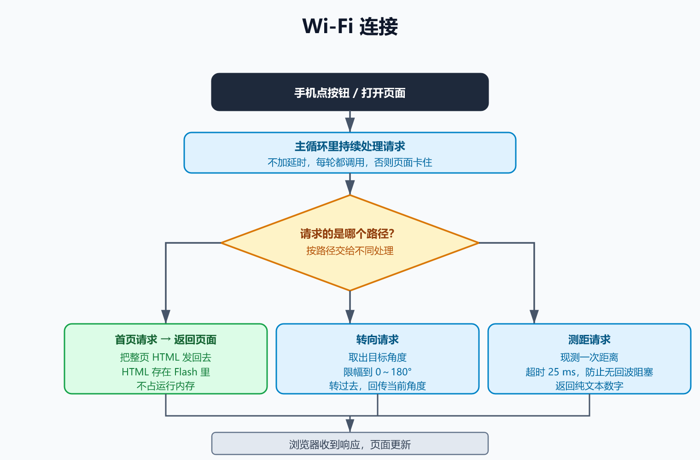

### Project 13: Wi-Fi Connection and Remote Control

#### **1. Introduction:**

{width=520px}

The web page in Lesson 12 could only push text to the dot matrix; the page in this lesson really reaches out and moves hardware: three buttons on the phone screen swing the pan-tilt and one button measures distance, and the reading comes straight back to the page so you no longer have to watch the Shell.

The chain is short: you press a button, the browser sends a request carrying a parameter, the board receives it and turns the servo or takes one distance reading, then sends the result back to the browser as text. A round trip on the local network takes milliseconds, so the delay you actually see is mostly the servo travelling to its new position.

The car does not drive at all in this lesson — only the pan-tilt and the ultrasonic sensor take orders from the web page, and the motors do not come into it until the next lesson. The page and the actions are also kept apart: the page is one block of HTML, and what to do with a request lives in a few handler functions, so changing the interface never touches the behavior.

Once the board is on the router the Shell prints the address it has been given; open that address on a phone on the same Wi-Fi and the top half of the page shows the current pan angle, the bottom half the distance ahead. Tap Left 180° and the sensor head swings left, the number following it to 180; tap Center 90° and it returns to straight ahead; tap Right 0° and it swings right; tap measure and `--` turns into three dots before the reading in centimetres appears.

#### **2. Parts List:**
Components used in this lesson:

|     |     |     |
| :---: | :---: | :---: |
| {width=200px}<br><span style="font-size:0.85em">9G servo (180°, with cross arm) ×1</span> | {width=200px}<br><span style="font-size:0.85em">Ultrasonic module ×1</span> | {width=200px}<br><span style="font-size:0.85em">DRV8835 motor expansion board ×1</span> |
| {width=200px}<br><span style="font-size:0.85em">ESP32-S3 development board ×1</span> | <span style="font-size:0.85em">2.4 GHz wireless router or phone hotspot ×1</span> |  |
> ⚠️ **The pan-tilt and the ultrasonic sensor were installed back in Chapter 2. This table is for reference only, so there is no need to remove anything; the wiring notes below only describe the wiring method for reference and do not require disassembly. See the kit list in 1.4 for the full bill of materials.**

#### **3. Parameters:**
| Item | Parameter |
| --- | --- |
| Wi-Fi mode | STA, 2.4 GHz only |
| Web port | 80 |
| Pan servo signal pin | IO42 |
| Pan range | 0° to 180° (0° points right, 180° points left) |
| Ultrasonic Trig / Echo | IO13 / IO12 |
| Ranging timeout | 25 ms |

#### **4. Wiring:**

| Signal | Controller GPIO |
| --- | :---: |
| Pan servo signal | IO42 |
| Ultrasonic Trig | IO13 |
| Ultrasonic Echo | IO12 |

> **Note**: the components in the wiring diagram only illustrate the connections; there is no need to take a cased module apart for the actual wiring.


#### **5. Flowchart:**

When a web request arrives, `server.handle()` looks up the matching callback by URL, runs it and then returns the result:



#### **6. Test Code:**
> ⚠️ **Before uploading the code, upload `mini_tracked_tank_robot.py` and `mini_tracked_tank_robot_web.py` to the `lib/` directory on the board** (see Section 5.5), otherwise importing the library raises `ImportError`.

```python
import network
import time
from mini_tracked_tank_robot import MiniTrackedTankRobot
from mini_tracked_tank_robot_web import WebServer

WIFI_SSID = 'your_wifi_ssid'
WIFI_PASS = 'your_wifi_password'

PAN_SERVO_PIN = 42
TRIG_PIN = 13
ECHO_PIN = 12

INDEX_HTML = """<!DOCTYPE html><html><head>
<meta charset="utf-8">
<meta name="viewport" content="width=device-width,initial-scale=1">
<title>Mini Tracked Tank Robot V4.0 - Network Test</title>
<style>
body{font-family:-apple-system,"Microsoft YaHei",sans-serif;text-align:center;
     background:#f2f3f5;margin:0;padding:16px}
.card{background:#fff;border-radius:14px;padding:16px;max-width:420px;margin:0 auto}
h2{margin:4px 0 16px;font-size:20px}
button{height:56px;font-size:17px;border:none;border-radius:12px;color:#fff;
       background:#3f51b5;margin:4px;width:30%}
.wide{width:100%;background:#009688;margin-top:16px}
p{font-size:17px;margin:12px 0}
b{color:#e53935;font-size:22px}
</style></head><body>
<div class="card">
<h2>Mini Tracked Tank Robot V4.0</h2>
<p>Pan-tilt angle: <b id="a">90</b> deg</p>
<button onclick="pan(180)">Left 180 deg</button>
<button onclick="pan(90)">Center 90 deg</button>
<button onclick="pan(0)">Right 0 deg</button>
<button class="wide" onclick="readD()">Measure distance</button>
<p>Distance ahead: <b id="d">--</b> cm</p>
</div>
<script>
function pan(v){
  fetch('/pan?angle='+v).then(r=>r.text()).then(t=>document.getElementById('a').innerText=t);
}
function readD(){
  document.getElementById('d').innerText='...';
  fetch('/distance').then(r=>r.text()).then(t=>document.getElementById('d').innerText=t);
}
</script>
</body></html>"""

car = MiniTrackedTankRobot()
car.Servo_init(PAN_SERVO_PIN)
car.Ultrasonic_init(TRIG_PIN, ECHO_PIN)

pan_angle = 90


def on_index(params):
    return INDEX_HTML


def on_pan(params):
    global pan_angle
    try:
        angle = int(params.get('angle', '90'))
    except ValueError:
        angle = 90
    if angle < 0:
        angle = 0
    if angle > 180:
        angle = 180
    pan_angle = angle
    car.Servo_set_angle(angle)
    return str(angle)


def on_distance(params):
    return str(car.Ultrasonic_distance())


# ==================== Connect to Wi-Fi ====================
wlan = network.WLAN(network.STA_IF)
wlan.active(True)
print('Connecting to', WIFI_SSID)
wlan.connect(WIFI_SSID, WIFI_PASS)
while not wlan.isconnected():
    time.sleep(0.5)
    print('.', end='')
print()
print('WiFi connected')
print('Board IP: ' + wlan.ifconfig()[0])

server = WebServer(80)
server.route('/', on_index)
server.route('/pan', on_pan)
server.route('/distance', on_distance)

print('Web server started')

while True:
    server.handle()
    car.quiet_motor()          # Keep forcing the motors low while idle to cancel the crosstalk caused by servo movement
```

#### **7. Code Explanation:**
**(1) Importing the libraries and the network module**

```python
import network
import time
from mini_tracked_tank_robot import MiniTrackedTankRobot
from mini_tracked_tank_robot_web import WebServer
```

Just as in Lesson 12: `network` gets the board onto Wi-Fi, and `WebServer` from `mini_tracked_tank_robot_web` provides the web service. Both library files (`mini_tracked_tank_robot.py` and `mini_tracked_tank_robot_web.py`) have to be uploaded to `lib/` on the board first. `time` is a standard library, used here mainly for the connection wait.

**(2) Initializing the servo and the ultrasonic sensor**

```python
car = MiniTrackedTankRobot()
car.Servo_init(PAN_SERVO_PIN)
car.Ultrasonic_init(TRIG_PIN, ECHO_PIN)

pan_angle = 90
```

`car.Servo_init(42)` sets the pan servo signal pin to IO42, and `car.Ultrasonic_init(13, 12)` sets Trig=IO13 and Echo=IO12. If you rewire, change the three pin constants at the top. `pan_angle` remembers the current pan angle, starting at 90°, and both the page display and the movement use it. Note that this lesson does not initialize the motors — which is exactly why the main loop needs `car.quiet_motor()`.

**(3) The three web callbacks**

```python
def on_index(params):
    return INDEX_HTML


def on_pan(params):
    global pan_angle
    try:
        angle = int(params.get('angle', '90'))
    except ValueError:
        angle = 90
    if angle < 0:
        angle = 0
    if angle > 180:
        angle = 180
    pan_angle = angle
    car.Servo_set_angle(angle)
    return str(angle)


def on_distance(params):
    return str(car.Ultrasonic_distance())
```

`params` is the dictionary of parameters that `WebServer` has parsed out of the URL. `on_index()` returns the whole HTML page when the home page is requested. `on_pan()` handles `/pan?angle=N`: it takes `angle` and converts it to an integer, falling back to 90 if the conversion fails (`ValueError`), then clamps it between 0 and 180 so the servo cannot be driven past its mechanical stop — the page only ever sends 180/90/0, but typing something random into the address bar works too. Finally `car.Servo_set_angle()` does the actual movement and the angle is returned to the page for display. `on_distance()` is even simpler: take one ultrasonic reading and return it as a string.

**(4) How the page sends the request back**

```javascript
function pan(v){
  fetch('/pan?angle='+v).then(r=>r.text()).then(t=>document.getElementById('a').innerText=t);
}
function readD(){
  document.getElementById('d').innerText='...';
  fetch('/distance').then(r=>r.text()).then(t=>document.getElementById('d').innerText=t);
}
```

This sits inside `INDEX_HTML` and is the browser-side logic. Tapping **Left 180** calls `pan(180)`, which fetches `/pan?angle=180`, and the text the board returns (the new angle) is written straight back into the page, so the number updates. The measure button shows `...` first and fills in the real value once `/distance` comes back. This is the complete **page → hardware → page** chain.

**(5) Connecting to Wi-Fi**

```python
wlan = network.WLAN(network.STA_IF)
wlan.active(True)
print('Connecting to', WIFI_SSID)
wlan.connect(WIFI_SSID, WIFI_PASS)
while not wlan.isconnected():
    time.sleep(0.5)
    print('.', end='')
print()
print('WiFi connected')
print('Board IP: ' + wlan.ifconfig()[0])
```

`STA_IF` is client mode, which joins the board to a router; `active(True)` powers the interface up and `connect()` takes the SSID and password. The loop prints a dot every half second until `isconnected()` becomes true — if it cannot connect (wrong password, 5 GHz band) it keeps printing dots here forever. `ifconfig()[0]` fetches the board's IP; it may change on every power-on, so trust whatever the Shell prints.

**(6) Registering the routes and the main loop**

```python
server = WebServer(80)
server.route('/', on_index)
server.route('/pan', on_pan)
server.route('/distance', on_distance)

print('Web server started')

while True:
    server.handle()
    car.quiet_motor()          # Keep forcing the motors low while idle to cancel the crosstalk caused by servo movement
```

`WebServer(80)` starts the service on port 80, and `route()` hands the three URLs to the three callbacks: `/` returns the page, `/pan` turns the pan-tilt and `/distance` reads the distance. To add an endpoint, write a function and hook it up with `route()`. The main loop has to keep calling `server.handle()` or web requests are never handled. The `car.quiet_motor()` line after it is the important one: the current surge when the servo moves couples into the motor driver and makes the wheels twitch, and holding the motors down repeatedly while idle cancels that interference — the car is not supposed to drive in this lesson, and this line makes sure it does not wander off on its own.

#### **8. Expected Behavior:**
After power-on the Shell prints:

```text
Connecting to YourWiFiName
.....
WiFi connected
Board IP: 192.168.1.23
Web server started
```

With that address opened on the phone, the page appears:

| Action | Behavior |
| --- | --- |
| Tap **Left 180** | The pan-tilt swings left and the page angle becomes 180 |
| Tap **Center 90** | The pan-tilt returns to straight ahead |
| Tap **Right 0** | The pan-tilt swings right |
| Tap **Measure distance** | The reading changes from `--` to the current distance (cm) |

> [Image to be added] A photo showing the phone page and the car together with the pan-tilt turned to each end.

#### **9. Troubleshooting:**

**If the Wi-Fi will not connect or the page will not open, check in this order:**

(1) **Have the credentials been changed?** If `WIFI_SSID` and `WIFI_PASS` at the top of the code are still placeholders when you run it, it will certainly not connect; change them to your own router's name and password.

(2) **Nothing at all in the Shell.** Press the RESET button on the board and try again; the previous program may be stuck.

{width=340px}

(3) **The Shell keeps printing dots and never gets an IP.** The Wi-Fi connection failed. The router must be **2.4 GHz**; the board does not support 5 GHz, and if you have no 2.4 GHz network, turn on your phone's hotspot (hotspots default to 2.4 GHz).

(4) **An IP appears but the page will not open.** The address needs `http://`, and the IP must be the one the Shell printed; the phone has to be on the same Wi-Fi, and the first three parts of both IPs must match.

(5) **Same subnet, still will not open.** Go into the router settings and turn off **AP isolation**; with it on, devices on the same Wi-Fi cannot reach each other.

(6) A Shell `ImportError: no module named 'mini_tracked_tank_robot_web'` means the WebServer library is not on the board. Use Thonny to save `mini_tracked_tank_robot.py` and `mini_tracked_tank_robot_web.py` to `lib/` on the board and run again.

(7) The page opens but the buttons do nothing. Open the browser developer tools, look at Network and check the requests: if they stay pending the board's main loop is blocked by something else and `server.handle()` is not being called repeatedly, so look for a long delay or an endless loop in the main loop.

(8) A request returns 404 because the path registered with `server.route()` does not match the address used by `fetch` in the page — check the leading slash in particular: `/pan` and `/distance` must match character for character.

(9) The pan-tilt does not move or the distance stays 0. Check the pins first: `PAN_SERVO_PIN = 42`, ultrasonic `TRIG_PIN = 13` and `ECHO_PIN = 12`. With Trig and Echo swapped the reading stays 0 forever; if a pin is taken by another function you also get an `OSError`, so move to a free pin or stop the code that occupies it.
