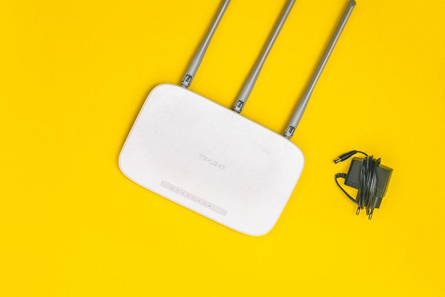
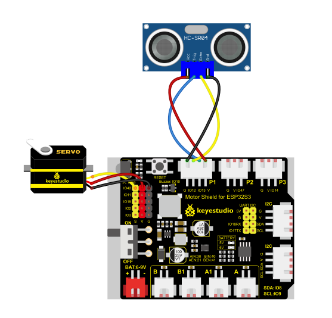
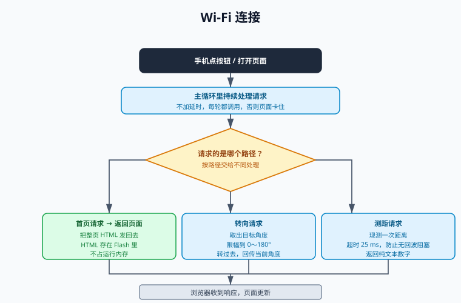

### 项目 13：Wi-Fi 连接与遥控

#### **1. 简介：**

上一课的网页只能发文字，这一课让网页真正控制硬件：手机屏幕上三个按钮转云台，一个按钮量距离，数值直接回到手机页面上，不用看串口。

这是「网页 → 硬件」的第一条完整链路。手机按下按钮，浏览器发出一个 HTTP 请求（比如 `GET /pan?angle=180`），板子上的 `WebServer` 收到后解析参数、转舵机、再回一个数字。整个过程不到 100 ms，看起来就像手机直接连着舵机。

代码分为两半：一半定义「有哪些网址」（`server.on`），一半定义「每个网址做什么」（回调函数）。网页本身放在单独的 `webpage.h` 里，用 `R"rawliteral(...)"` 原样存着——这样改页面不用动主程序。

{width=520px}

#### **2. 所需清单：**

本课用到的器件：

|     |     |     |
| :---: | :---: | :---: |
| {width=200px}<br><span style="font-size:0.85em">9G 舵机（180°，配十字臂） ×1</span> | {width=200px}<br><span style="font-size:0.85em">超声波模块（带外壳） ×1</span> | {width=200px}<br><span style="font-size:0.85em">DRV8835 电机扩展板 ×1</span> |
| {width=200px}<br><span style="font-size:0.85em">ESP32-S3 开发板 ×1</span> | <span style="font-size:0.85em">2.4 GHz 无线路由器或手机热点 ×1</span> |  |
> ⚠️ **云台与超声波在第 2 章就装好了，本表只作对照，不用拆；下面的接线说明只标清接线方式，供对照，不必拆装。完整物料见 1.4 套件清单。**

#### **3. 参数：**

| 项目 | 参数 |
| --- | --- |
| Wi-Fi 模式 | STA，仅 2.4 GHz |
| 网页端口 | 80 |
| 云台信号脚 | IO42 |
| 云台范围 | 0°～180°（0° 指右、180° 指左） |
| 超声波 Trig / Echo | IO13 / IO12 |
| 测距超时 | 25 ms |
| 指令接口 | `/pan?angle=N`、`/distance` |
| 返回格式 | `text/plain` |

#### **4. 接线说明：**

| 信号 | 主控 GPIO |
| --- | :---: |
| 云台舵机信号 | IO42 |
| 超声波 Trig | IO13 |
| 超声波 Echo | IO12 |



#### **5. 流程图：**

网页请求进来后，`server.handleClient()` 按网址找到对应的回调，执行完再返回：



#### **6. 测试代码：**

> ⚠️ **上传代码前，先把 `mini_tracked_tank_robot.py`、`mini_tracked_tank_robot_web.py` 上传到板子的 `lib/` 目录**（方法见第 5.5 节），否则导入库时会报 `ImportError`。

```python
# 项目 13：Wi-Fi 连接
# 接线：云台舵机=IO42、超声波 TRIG=IO13 / ECHO=IO12
# 现象：手机浏览器能改云台角度、能读到前方距离，链路就算通了

import network
import time
from mini_tracked_tank_robot import MiniTrackedTankRobot
from mini_tracked_tank_robot_web import WebServer

WIFI_SSID = '你的WiFi账号'
WIFI_PASS = '你的WiFi密码'

PAN_SERVO_PIN = 42
TRIG_PIN = 13
ECHO_PIN = 12

INDEX_HTML = """<!DOCTYPE html><html><head>
<meta charset="utf-8">
<meta name="viewport" content="width=device-width,initial-scale=1">
<title>迷你履带坦克 联网测试</title>
<style>
body{font-family:-apple-system,"Microsoft YaHei",sans-serif;text-align:center;
     background:#f2f3f5;margin:0;padding:16px}
.card{background:#fff;border-radius:14px;padding:16px;max-width:420px;margin:0 auto}
h2{margin:4px 0 16px;font-size:20px}
button{height:56px;font-size:17px;border:none;border-radius:12px;color:#fff;
       background:#3f51b5;margin:4px;width:30%}
.wide{width:100%;background:#009688;margin-top:16px}
p{font-size:17px;margin:12px 0}
b{color:#e53935;font-size:22px}
</style></head><body>
<div class="card">
<h2>迷你履带坦克 V4.0</h2>
<p>云台角度：<b id="a">90</b> °</p>
<button onclick="pan(180)">左 180°</button>
<button onclick="pan(90)">中 90°</button>
<button onclick="pan(0)">右 0°</button>
<button class="wide" onclick="readD()">测一次距离</button>
<p>前方距离：<b id="d">--</b> cm</p>
</div>
<script>
function pan(v){
  fetch('/pan?angle='+v).then(r=>r.text()).then(t=>document.getElementById('a').innerText=t);
}
function readD(){
  document.getElementById('d').innerText='...';
  fetch('/distance').then(r=>r.text()).then(t=>document.getElementById('d').innerText=t);
}
</script>
</body></html>"""

car = MiniTrackedTankRobot()
car.Servo_init(PAN_SERVO_PIN)
car.Ultrasonic_init(TRIG_PIN, ECHO_PIN)

pan_angle = 90

def on_index(params):
    return INDEX_HTML

def on_pan(params):
    global pan_angle
    try:
        angle = int(params.get('angle', '90'))
    except ValueError:
        angle = 90
    if angle < 0:
        angle = 0
    if angle > 180:
        angle = 180
    pan_angle = angle
    car.Servo_set_angle(angle)
    return str(angle)

def on_distance(params):
    return str(car.Ultrasonic_distance())

# ==================== 连接 Wi-Fi ====================
wlan = network.WLAN(network.STA_IF)
wlan.active(True)
print('正在连接', WIFI_SSID)
wlan.connect(WIFI_SSID, WIFI_PASS)
while not wlan.isconnected():
    time.sleep(0.5)
    print('.', end='')
print()
print('WiFi 已连接')
print('板子的 IP：' + wlan.ifconfig()[0])

server = WebServer(80)
server.route('/', on_index)
server.route('/pan', on_pan)
server.route('/distance', on_distance)

print('网页服务已启动')

while True:
    server.handle()
    car.quiet_motor()          # 空闲时反复压住电机，抵消舵机动作带来的串扰
```

#### **7. 代码解释：**

**(1) 引入库与网络模块**

```python
import network
import time
from mini_tracked_tank_robot import MiniTrackedTankRobot
from mini_tracked_tank_robot_web import WebServer
```

和第 12 课一样：`network` 让板子连 Wi-Fi，`WebServer` 来自 `mini_tracked_tank_robot_web`，负责网页服务。两个库文件（`mini_tracked_tank_robot.py`、`mini_tracked_tank_robot_web.py`）都要先上传到板子的 `lib/`。`time` 是标准库，这里主要给连网等待用。

**(2) 初始化舵机与超声波**

```python
car = MiniTrackedTankRobot()
car.Servo_init(PAN_SERVO_PIN)
car.Ultrasonic_init(TRIG_PIN, ECHO_PIN)

pan_angle = 90
```

`Servo_init(42)` 把云台舵机的信号脚设为 IO42，`Ultrasonic_init(13, 12)` 设 Trig=IO13、Echo=IO12。换接线就改开头那三个引脚常量。`pan_angle` 记住云台当前角度，初值 90°，网页显示和转动都用它。注意本课不初始化电机——所以主循环里才要用 `quiet_motor()` 压住电机。

**(3) 三个网页回调**

```python
def on_index(params):
    return INDEX_HTML

def on_pan(params):
    global pan_angle
    try:
        angle = int(params.get('angle', '90'))
    except ValueError:
        angle = 90
    if angle < 0:
        angle = 0
    if angle > 180:
        angle = 180
    pan_angle = angle
    car.Servo_set_angle(angle)
    return str(angle)

def on_distance(params):
    return str(car.Ultrasonic_distance())
```

`params` 是 `WebServer` 从网址里解析出来的参数字典。`on_index()` 收到首页请求就把整页 HTML 返回。`on_pan()` 处理 `/pan?angle=N`：取出 `angle` 转成整数，转不成功（`ValueError`）就回落到 90；再把角度钳在 0~180 之间，防止舵机转到机械限位外——网页只发 180/90/0，但手动在地址栏乱填也有效。最后 `Servo_set_angle()` 真正转动，并把角度返回给网页显示。`on_distance()` 更简单，读一次超声波距离转成字符串返回。

**(4) 网页如何把请求发回来**

```python
function pan(v){
  fetch('/pan?angle='+v).then(r=>r.text()).then(t=>document.getElementById('a').innerText=t);
}
function readD(){
  document.getElementById('d').innerText='...';
  fetch('/distance').then(r=>r.text()).then(t=>document.getElementById('d').innerText=t);
}
```

这段在 `INDEX_HTML` 里，是网页端的逻辑。点「左 180°」就调 `pan(180)`，用 `fetch` 请求 `/pan?angle=180`，板子返回的文字（转后的角度）直接写回页面，所以角度数字会更新。测距离按钮先显示 `...`，请求 `/distance` 回来后再填真实数值。这就是「网页 → 硬件 → 网页」的完整链路。

**(5) 连接 Wi-Fi**

```python
wlan = network.WLAN(network.STA_IF)
wlan.active(True)
print('正在连接', WIFI_SSID)
wlan.connect(WIFI_SSID, WIFI_PASS)
while not wlan.isconnected():
    time.sleep(0.5)
    print('.', end='')
print()
print('WiFi 已连接')
print('板子的 IP：' + wlan.ifconfig()[0])
```

`STA_IF` 是客户端模式，让板子连路由器；`active(True)` 开启网卡，`connect()` 传 SSID 和密码。循环里每 0.5 秒打一个点，直到 `isconnected()` 变真——连不上（密码错、5G 频段）就会一直在这里打点。`ifconfig()[0]` 取到板子的 IP，每次上电可能变，以Shell 打印的为准。

**(6) 注册路由与主循环**

```python
server = WebServer(80)
server.route('/', on_index)
server.route('/pan', on_pan)
server.route('/distance', on_distance)

print('网页服务已启动')

while True:
    server.handle()
    car.quiet_motor()          # 空闲时反复压住电机，抵消舵机动作带来的串扰
```

`WebServer(80)` 在 80 端口开服务，`route()` 把三条网址分别交给三个回调：`/` 返回页面、`/pan` 转云台、`/distance` 读距离。要加新接口，写个函数再 `route()` 挂上去即可。主循环里 `server.handle()` 必须反复调用，网页请求才会被处理。后面那句 `quiet_motor()` 是关键：舵机转动瞬间电流波动会串到电机驱动上，让轮子误动，空闲时反复把电机压住就能抵消这个干扰——本课没让车走，这句保证它不会自己乱窜。

#### **8. 运行现象：**

上电后Shell 打印：

```text
正在连接 你的WiFi名字
.....
WiFi 已连接
板子的 IP：192.168.1.23
网页服务已启动，手机浏览器打开上面的 IP
```

手机打开这个地址，看到页面：

| 操作 | 现象 |
| --- | --- |
| 点「左 180°」 | 云台转向左边，页面角度变成 180 |
| 点「中 90°」 | 云台回正前方 |
| 点「右 0°」 | 云台转向右边 |
| 点「测一次距离」 | 数值从 `--` 变成当前距离（cm） |

> 【图片待补】云台转到左右两端时手机页面与实车同框的实拍图。

#### **9. 常见问题解决：**

**Wi-Fi 连不上、网页打不开，按这个顺序查：**

(1) **账号密码换了没有**：代码开头的 `WIFI_SSID`、`WIFI_PASS` 还是占位符就运行，一定连不上，改成自己路由器的名称和密码。

(2) **Shell 里一行字都没有**：按一下板子上的 RESET 键再试，可能是上一版程序卡住了。

{width=340px}

(3) **Shell 一直冒点、拿不到 IP**：Wi-Fi 连接失败。路由器必须是 **2.4 GHz**，5 GHz 板子不支持；没有 2.4 G 就开手机热点（热点默认 2.4 G）。

(4) **拿到 IP 但页面打不开**：地址要带 `http://`，IP 以 Shell 打印的为准；手机必须连同一个 Wi-Fi，两边 IP 前三段要一样。

(5) **网段对、还是打不开**：进路由器后台把「AP 隔离」关掉，开了它同一 Wi-Fi 下的设备互相访问不了。

(6) Shell 报 `ImportError: no module named 'mini_tracked_tank_robot_web'`，是 WebServer 库没保存到板子。把 `mini_tracked_tank_robot.py` 和 `mini_tracked_tank_robot_web.py` 用 Thonny 保存到板子的 `lib/` 下再运行。

(7) 页面能打开、按钮点了却没反应，打开浏览器开发者工具的 Network 看请求：一直 pending 说明板子的主循环被别的东西卡住了，`server.handle()` 没被反复调用，检查主循环里有没有长延时或死循环。

(8) 请求返回 404，是 `server.route()` 注册的路径和网页里 `fetch` 的地址对不上，重点看有没有前导斜杠——`/pan`、`/distance` 要和网页里写的一字不差。

(9) 云台不转、距离读数一直是 0，先核对引脚：`PAN_SERVO_PIN = 42`、超声波 `TRIG_PIN = 13` / `ECHO_PIN = 12`。超声波 Trig 和 Echo 对调读数会一直是 0；引脚被别的功能占了还会抛 `OSError`，换个脚或者停掉占用它的代码。
