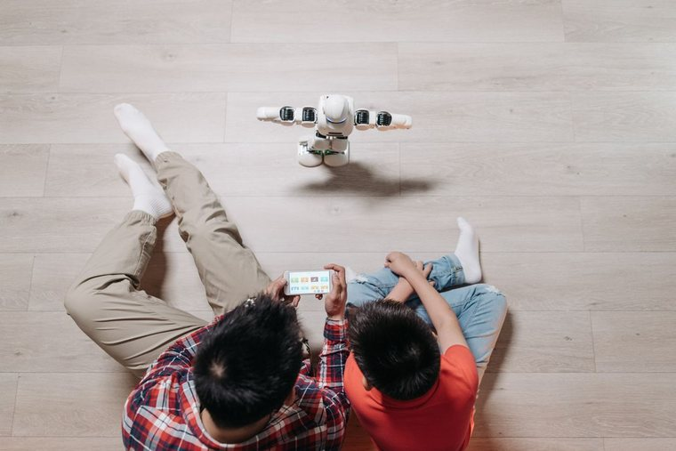
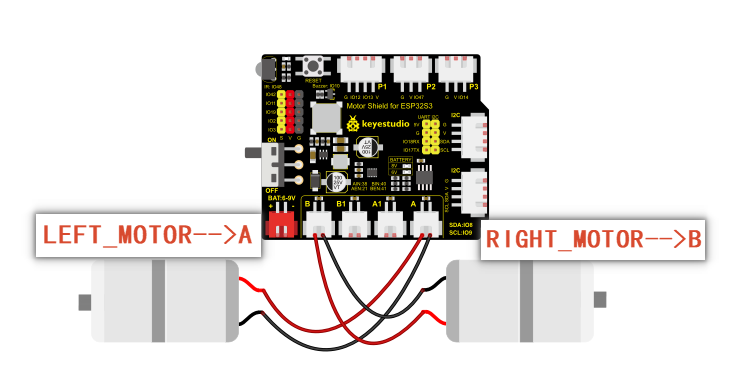
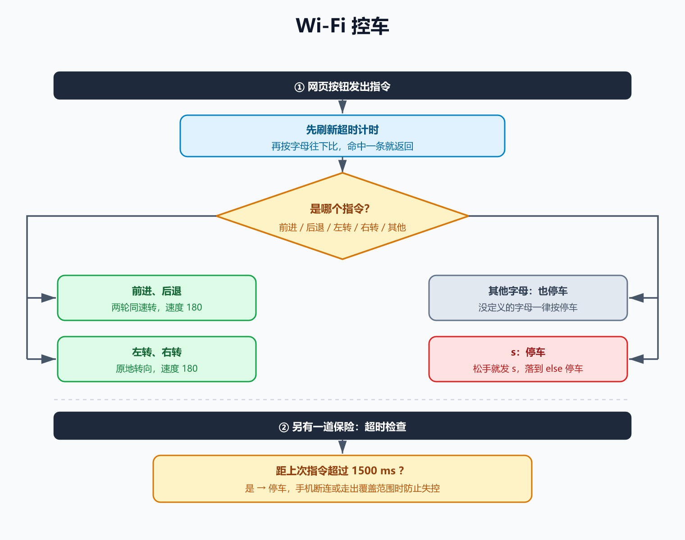

### Project 14: Wi-Fi Car Control

#### **1. Introduction:**



Your phone becomes the remote, and this time it is driving the car. A set of direction buttons on the page: hold one and the car moves, let go and it stops. The advantage over an infrared remote is that Wi-Fi has no directionality — you can control it through a wall or with your back to the car, as long as you are on the same local network.

The price is variable latency: a command has to make a round trip through the router, twenty-odd milliseconds at best, over a hundred when the network is busy, and packets can be dropped. So the rule is the same as for the infrared car: if no new command arrives for 1.5 seconds, stop automatically.

The button behavior is different too. An infrared press sends one frame, whereas a web button sends once on press and once on release, so forward and stop are two separate commands and the browser always sends a stop when you let go.

Hold up and both wheels drive forward at the same speed; press left and the two wheels turn opposite ways to pivot on the spot; let go and it stops immediately. Turn off the phone's Wi-Fi and the car stops by itself 1.5 seconds later.

#### **2. Parts List:**
Components used in this lesson:

|     |     |
| :---: | :---: |
| <br><span style="font-size:0.85em">DRV8835 motor expansion board ×1</span> | <br><span style="font-size:0.85em">Mini Tracked Tank Robot bottom assembly ×1</span> |
| <br><span style="font-size:0.85em">ESP32-S3 development board ×1</span> | <span style="font-size:0.85em">2.4 GHz wireless router or phone hotspot ×1</span> |
> ⚠️ **Everything here was installed in Chapter 2. This table is for reference only, so there is no need to remove anything; the wiring notes below only describe the wiring method for reference and do not require disassembly. See the kit list in 1.4 for the full bill of materials.**

#### **3. Parameters:**
| Item | Parameter |
| --- | --- |
| Web port | 80 |
| Straight-line speed | 180 |
| Pivot speed | 180 |
| Left wheel AIN / AEN | IO38 / IO21 |
| Right wheel BIN / BEN | IO40 / IO41 |

#### **4. Wiring:**

| Signal | Controller GPIO |
| --- | :---: |
| Left wheel AIN (direction) | IO38 |
| Left wheel AEN (speed) | IO21 |
| Right wheel BIN (direction) | IO40 |
| Right wheel BEN (speed) | IO41 |

This lesson uses no sensors, only the motors. Wi-Fi is built into the chip.



#### **5. Flowchart:**

From your finger going down to the wheels turning, the signal passes through three layers: the browser, the router and the board:



#### **6. Test Code:**
> ⚠️ **Before uploading the code, upload `mini_tracked_tank_robot.py` and `mini_tracked_tank_robot_web.py` to the `lib/` directory on the board** (see Section 5.5), otherwise importing the library raises `ImportError`.

```python
import network
import time
from mini_tracked_tank_robot import MiniTrackedTankRobot
from mini_tracked_tank_robot_web import WebServer

WIFI_SSID = 'your_wifi_ssid'
WIFI_PASS = 'your_wifi_password'

SPEED_RUN = 180
SPEED_TURN = 180
STOP_AFTER = 1500          # Auto stop when a command times out (ms)

INDEX_HTML = """<!DOCTYPE html><html><head>
<meta charset="utf-8">
<meta name="viewport" content="width=device-width,initial-scale=1,user-scalable=no">
<title>Mini Tracked Tank Robot V4.0 - Remote Car</title>
<style>
body{font-family:-apple-system,"Microsoft YaHei",sans-serif;text-align:center;
     background:#f2f3f5;margin:0;padding:16px}
.card{background:#fff;border-radius:14px;padding:16px;max-width:420px;margin:0 auto}
h2{margin:4px 0 16px;font-size:20px}
.grid{display:grid;grid-template-columns:repeat(3,1fr);gap:10px}
button{height:72px;font-size:24px;border:none;border-radius:14px;color:#fff;
       user-select:none;-webkit-tap-highlight-color:transparent;touch-action:none}
.f{background:#4caf50}.b{background:#f44336}.l{background:#ff9800}
.r{background:#2196f3}.s{background:#607d8b}
.blank{background:transparent}
p{font-size:15px;color:#888;margin-top:14px}
</style></head><body>
<div class="card">
<h2>Hold a direction button to drive</h2>
<div class="grid">
<div class="blank"></div>
<button class="f" onpointerdown="go('f')" onpointerup="go('s')" onpointercancel="go('s')" onpointerleave="go('s')">↑</button>
<div class="blank"></div>
<button class="l" onpointerdown="go('l')" onpointerup="go('s')" onpointercancel="go('s')" onpointerleave="go('s')">←</button>
<button class="s" onclick="go('s')">■</button>
<button class="r" onpointerdown="go('r')" onpointerup="go('s')" onpointercancel="go('s')" onpointerleave="go('s')">→</button>
<div class="blank"></div>
<button class="b" onpointerdown="go('b')" onpointerup="go('s')" onpointercancel="go('s')" onpointerleave="go('s')">↓</button>
<div class="blank"></div>
</div>
<p>Release to stop automatically, it also stops after 1.5 s without commands</p>
</div>
<script>
function go(d){ fetch('/cmd?d='+d).catch(function(){}); }
</script>
</body></html>"""

car = MiniTrackedTankRobot()
car.Motor_init()
car.stop_motor()

last_cmd = time.ticks_ms()


def on_index(params):
    return INDEX_HTML


def on_cmd(params):
    global last_cmd
    last_cmd = time.ticks_ms()
    cmd = params.get('d', 's')

    if cmd == 'f':
        car.forward(SPEED_RUN, SPEED_RUN)
    elif cmd == 'b':
        car.back(SPEED_RUN, SPEED_RUN)
    elif cmd == 'l':
        car.left(SPEED_TURN, SPEED_TURN)
    elif cmd == 'r':
        car.right(SPEED_TURN, SPEED_TURN)
    else:
        car.stop_motor()
    return 'OK'


# ==================== Connect to Wi-Fi ====================
wlan = network.WLAN(network.STA_IF)
wlan.active(True)
print('Connecting to', WIFI_SSID)
wlan.connect(WIFI_SSID, WIFI_PASS)
while not wlan.isconnected():
    time.sleep(0.5)
    print('.', end='')
print()
print('Board IP: ' + wlan.ifconfig()[0])

server = WebServer(80)
server.route('/', on_index)
server.route('/cmd', on_cmd)

print('Remote car ready')

while True:
    server.handle()

    # Stop when no command arrives in time
    if time.ticks_diff(time.ticks_ms(), last_cmd) > STOP_AFTER:
        car.stop_motor()
```

#### **7. Code Explanation:**
**(1) Importing the libraries and the speed parameters**

```python
import network
import time
from mini_tracked_tank_robot import MiniTrackedTankRobot
from mini_tracked_tank_robot_web import WebServer
```

Again `network` is used for Wi-Fi and `WebServer` for the web service, with the motor driver inside `MiniTrackedTankRobot`. The three speed and timeout constants are grouped at the top: both straight-line and pivot speeds are 180, and `STOP_AFTER = 1500` is the command timeout in milliseconds. If the car is too fast or too slow, change these numbers.

**(2) Initializing the motors and the timing reference**

```python
car = MiniTrackedTankRobot()
car.Motor_init()
car.stop_motor()

last_cmd = time.ticks_ms()
```

`car.Motor_init()` initializes the motor pins and `car.stop_motor()` stops the car as soon as it powers up, so the motors do not twitch during reset. `last_cmd` records when the last command arrived, taken in milliseconds with `ticks_ms()` — the **stop after 1.5 s without a command** relies entirely on it.

**(3) Web callbacks: home page and commands**

```python
def on_index(params):
    return INDEX_HTML


def on_cmd(params):
    global last_cmd
    last_cmd = time.ticks_ms()
    cmd = params.get('d', 's')

    if cmd == 'f':
        car.forward(SPEED_RUN, SPEED_RUN)
    elif cmd == 'b':
        car.back(SPEED_RUN, SPEED_RUN)
    elif cmd == 'l':
        car.left(SPEED_TURN, SPEED_TURN)
    elif cmd == 'r':
        car.right(SPEED_TURN, SPEED_TURN)
    else:
        car.stop_motor()
    return 'OK'
```

`on_index()` returns the home page HTML. `on_cmd()` handles `/cmd?d=X`: every command first refreshes `last_cmd` to the current time (which tells the main loop "a command has just arrived"), then dispatches on `d` — `f/b/l/r` call `car.forward/back/left/right` respectively, and anything else (including the `s` the page sends on release) calls `car.stop_motor()`. The default `'s'` guarantees the car is stopped when the parameter is missing.

**(4) Web buttons: press to drive, release to stop**

```javascript
function go(d){ fetch('/cmd?d='+d).catch(function(){}); }
```

Every direction button on the page is bound to `onpointerdown` and `onpointerup`: holding it sends `go('f')` to drive forward, and releasing (or cancelling, or sliding the finger off) sends `go('s')` to stop. `go()` simply builds a request such as `/cmd?d=f` and sends it to the board. The `.catch()` swallows network errors — losing the release packet does not upset the page. This feels much more like a real remote than **tap once, move one step**.

**(5) Connecting to Wi-Fi and registering the routes**

```python
wlan = network.WLAN(network.STA_IF)
wlan.active(True)
print('Connecting to', WIFI_SSID)
wlan.connect(WIFI_SSID, WIFI_PASS)
while not wlan.isconnected():
    time.sleep(0.5)
    print('.', end='')
print()
print('Board IP: ' + wlan.ifconfig()[0])

server = WebServer(80)
server.route('/', on_index)
server.route('/cmd', on_cmd)
```

The same networking block as the previous three lessons: `STA_IF` client mode joins a 2.4 GHz router, the loop prints dots while it waits for `isconnected()`, and `ifconfig()[0]` fetches the IP to print. Then `WebServer(80)` serves on port 80, with `route('/')` returning the page and `route('/cmd')` receiving the driving commands.

**(6) The main loop and the timeout protection**

```python
while True:
    server.handle()

    # Stop when no command arrives in time
    if time.ticks_diff(time.ticks_ms(), last_cmd) > STOP_AFTER:
        car.stop_motor()
```

`server.handle()` keeps polling for web requests. The second statement is the safety net: `ticks_diff()` works out **how long it has been since the last command**, and past `STOP_AFTER` (1500 ms) it calls `car.stop_motor()`. Wi-Fi drops packets, phones lock their screens and people walk out of range, and in any of those cases the stop command sent on **release** may never reach the board; with the timeout the car drives for 1.5 seconds at most and then stops itself instead of racing off. Changing `STOP_AFTER` changes how sensitive this protection is.

#### **8. Expected Behavior:**
The Shell prints:

```text
Connecting to YourWiFiName
.....
Board IP: 192.168.1.23
Remote car ready
```

The phone page shows a set of direction buttons; hold one down and the car keeps moving, let go and it stops at once (the command callback does not print to the Shell, so just watch the car):

| Action | Car |
| --- | --- |
| Press ↑ | Both wheels forward |
| Press ↓ | Both wheels reverse |
| Press ← | Pivots left |
| Press → | Pivots right |
| Release / press stop | Stops immediately |
| Turn the phone's Wi-Fi off | Stops itself after 1.5 s |

> [Image to be added] A photo showing the phone's direction-button page and the car driving together.

#### **9. Troubleshooting:**

**If the Wi-Fi will not connect or the page will not open, check in this order:**

(1) **Have the credentials been changed?** If `WIFI_SSID` and `WIFI_PASS` at the top of the code are still placeholders when you run it, it will certainly not connect; change them to your own router's name and password.

(2) **Nothing at all in the Shell.** Press the RESET button on the board and try again; the previous program may be stuck.


(3) **The Shell keeps printing dots and never gets an IP.** The Wi-Fi connection failed. The router must be **2.4 GHz**; the board does not support 5 GHz, and if you have no 2.4 GHz network, turn on your phone's hotspot (hotspots default to 2.4 GHz).

(4) **An IP appears but the page will not open.** The address needs `http://`, and the IP must be the one the Shell printed; the phone has to be on the same Wi-Fi, and the first three parts of both IPs must match.

(5) **Same subnet, still will not open.** Go into the router settings and turn off **AP isolation**; with it on, devices on the same Wi-Fi cannot reach each other.

(6) A Shell `ImportError: no module named 'mini_tracked_tank_robot_web'` means the WebServer library is not on the board. Use Thonny to save `mini_tracked_tank_robot.py` and `mini_tracked_tank_robot_web.py` to `lib/` on the board and run again.

(7) If the car moves in a stuttering way, the router signal is probably weak or the 2.4 GHz band too crowded. Move the phone and the car closer together, or go into the router settings and change channel (1, 6 and 11 do not overlap).

(8) If one wheel is clearly slower while turning, check the battery first — the current can peak at 300 mA the instant Wi-Fi transmits, and with a low battery the voltage sags, the PWM output collapses and one side stops turning. Charge the battery or try a fresh one.
