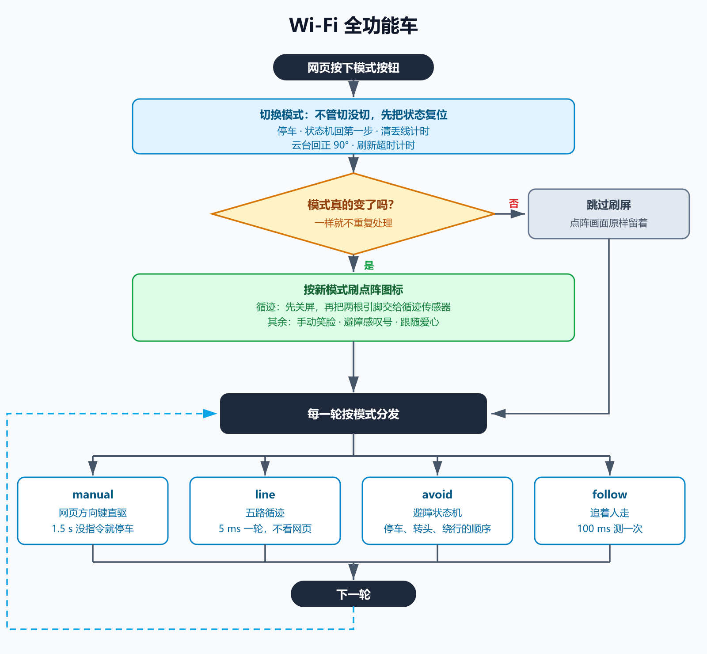

### Project 15: Wi-Fi Full-Function Car

#### **1. Introduction:**

The code of the previous fourteen lessons is combined into one program here: manual remote control, line following, obstacle avoidance and following, with the four modes switched from a single web page, the dot matrix changing its expression along with them, and the pan-tilt and claw adjustable at any time. More than three hundred lines — the longest program in the book.

Each of the four functions works fine on its own, and the first problem when they are combined is pin contention: the dot matrix occupies IO8 and IO9, and the line sensor's bus uses the same two pins. So they are given time slots by mode instead — while following a line the pins belong to the sensor and the matrix steps aside, and in the other modes it is the other way round.

The second problem is waiting. Obstacle avoidance has to turn the servo, wait 300 milliseconds and then measure, and the page freezes during that time; so avoidance is split into five steps that each do one thing and advance on timers, and nothing has to wait for anything else. Each mode switch also has its own clean-up: stop the car, center the pan-tilt, clear the previous stage's memory, then enter the new mode.

The phone page has four mode buttons along the top. Manual mode shows a smiley on the matrix, line following blanks the screen, avoidance shows an exclamation mark and following shows a heart; the moment you switch, the car stops briefly and the pan-tilt recenters, then it moves according to the new mode.

#### **2. Parts List:**
Components used in this lesson:

| ESP32-S3 development board ×1 | DRV8835 motor expansion board ×1 | Mini Tracked Tank Robot bottom assembly ×1 |
| :---: | :---: | :---: |
|  |  |  |
| Ultrasonic module ×1 | 8×16 LED dot matrix display ×1 | 9G servo (180°) ×2 |
|  |  |  |
| 5-channel IIC line-tracking sensor module ×1 | 2.4 GHz wireless router or phone hotspot ×1 |  |
|  |  |  |
> ⚠️ **Everything was installed in Chapter 2. This table is for reference only, so there is no need to remove anything; the wiring notes below only describe the wiring method for reference and do not require disassembly. See the kit list in 1.4 for the full bill of materials.**

#### **3. Parameters:**
| Item | Parameter |
| --- | --- |
| Working modes | manual / line / avoid / follow |
| Manual timeout | 1500 ms |
| Line-following straight speed | 115 |
| Line-following sharp turn | Inner wheel reverse 95, outer wheel 125 |
| Following window | Forward between 30 and 50 cm, reverse below 10 cm |
| Avoidance threshold | Closer than 15 cm counts as an obstacle |
| Avoidance states | AV_GO to AV_LEFT to AV_RIGHT to AV_TURN to AV_TURNING |
| Pan step | 15° per press |
| Claw angle | Open 140°, closed 90° |
| Matrix and line sensor | Share IO8 / IO9, exclusive by mode |

#### **4. Wiring:**

| Module | Pin | Controller GPIO |
| --- | --- | :---: |
| Left wheel motor | AIN / AEN | IO38 / IO21 |
| Right wheel motor | BIN / BEN | IO40 / IO41 |
| Ultrasonic | Trig / Echo | IO13 / IO12 |
| Dot matrix | CLK / DIN | IO9 / IO8 |
| Line-tracking I2C | SCL / SDA | IO9 / IO8 |
| Pan servo | Signal | IO42 |
| Claw servo | Signal | IO11 |

> **Note**: the components in the wiring diagram only illustrate the connections; there is no need to take a cased module apart for the actual wiring.

Note that **IO8 / IO9 appear twice**, and this is not a typo: the dot matrix is a **fake I2C** with bit-banged timing while the line sensor is real hardware I2C, and the two compete for the same pair of pins, so the code switches between them by time slot.


#### **5. Flowchart:**

The main loop dispatches by mode, and `mode` decides which of the four is running:



#### **6. Test Code:**
> ⚠️ **Before uploading the code, upload `mini_tracked_tank_robot.py` and `mini_tracked_tank_robot_web.py` to the `lib/` directory on the board** (see Section 5.5), otherwise importing the library raises `ImportError`.

```python
import network
import time
from mini_tracked_tank_robot import MiniTrackedTankRobot
from mini_tracked_tank_robot_web import WebServer

WIFI_SSID = 'your_wifi_ssid'
WIFI_PASS = 'your_wifi_password'

# ==================== Parameters ====================
MANUAL_TIMEOUT = 1500      # Manual mode command timeout (ms)
SERVO_STEP = 15            # Pan-tilt step angle per press
CLAW_OPEN = 140
CLAW_CLOSE = 90

BASE_SPEED = 115           # Line tracking straight speed
SPIN_SPEED = 125           # Outer wheel speed for sharp turns
INNER_SPEED = 95           # Inner wheel reverse speed for sharp turns

SAFE_DISTANCE = 30         # Following: advance at 30-50 cm
CLOSE_FOLLOW = 10          # Following: back off below 10 cm
MAX_DISTANCE = 50
CLOSE_AVOID = 15           # Avoidance: anything closer than 15 cm is an obstacle

# Avoidance state machine, so a delay does not stall the web page
AV_GO, AV_LEFT, AV_RIGHT, AV_TURN, AV_TURNING = 0, 1, 2, 3, 4

INDEX_HTML = """<!DOCTYPE html><html><head>
<meta charset="utf-8">
<meta name="viewport" content="width=device-width,initial-scale=1,user-scalable=no">
<title>Mini Tracked Tank Robot V4.0 - Wi-Fi Multi-Function Car</title>
<style>
body{font-family:-apple-system,"Microsoft YaHei",sans-serif;text-align:center;
     background:#f2f3f5;margin:0;padding:16px}
.card{background:#fff;border-radius:14px;padding:16px;max-width:440px;margin:0 auto}
h2{margin:4px 0 10px;font-size:20px}
.dist{font-size:16px;color:#666;margin:0 0 14px}
.dist b{color:#e53935;font-size:20px}
button{font-size:22px;border:none;border-radius:14px;color:#fff;
       user-select:none;-webkit-tap-highlight-color:transparent;touch-action:none}
.modes{display:grid;grid-template-columns:repeat(2,1fr);gap:8px;margin-bottom:14px}
.modes button{height:46px;font-size:16px;background:#3f51b5}
.on{background:#e53935 !important}
.grid{display:grid;grid-template-columns:repeat(3,1fr);gap:10px}
.grid button{height:66px;font-size:20px}
.f{background:#4caf50}.b{background:#f44336}.l{background:#ff9800}
.r{background:#2196f3}.s{background:#607d8b}
.p{background:#9c27b0}.c{background:#009688}
p.tip{font-size:14px;color:#999;margin:14px 0 0}
</style></head><body>
<div class="card">
<h2>Current mode: <span id="m">Manual control</span></h2>
<p class="dist">Distance ahead: <b id="d">--</b> cm</p>
<div class="modes">
<button id="b-manual" class="on" onclick="mode('manual')">Manual control</button>
<button id="b-line" onclick="mode('line')">Line tracking</button>
<button id="b-avoid" onclick="mode('avoid')">Ultrasonic avoidance</button>
<button id="b-follow" onclick="mode('follow')">Ultrasonic following</button>
</div>
<div class="grid">
<button class="p" onclick="go('servo_plus')">Pan-tilt &lt;</button>
<button class="f" onpointerdown="go('forward')" onpointerup="go('stop')" onpointercancel="go('stop')"
        onpointerleave="go('stop')">↑</button>
<button class="p" onclick="go('servo_minus')">Pan-tilt &gt;</button>
<button class="l" onpointerdown="go('left')" onpointerup="go('stop')" onpointercancel="go('stop')"
        onpointerleave="go('stop')">←</button>
<button class="s" onclick="go('stop')">■</button>
<button class="r" onpointerdown="go('right')" onpointerup="go('stop')" onpointercancel="go('stop')"
        onpointerleave="go('stop')">→</button>
<button class="c" onclick="go('claw_close')">Claw close</button>
<button class="b" onpointerdown="go('backward')" onpointerup="go('stop')" onpointercancel="go('stop')"
        onpointerleave="go('stop')">↓</button>
<button class="c" onclick="go('claw_open')">Claw open</button>
</div>
</div>

<script>
var names={manual:'Manual control',line:'Line tracking',avoid:'Ultrasonic avoidance',follow:'Ultrasonic following'};
function mode(m){
  document.getElementById('m').innerText=names[m];
  for(var k in names){
    document.getElementById('b-'+k).className=(k===m)?'on':'';
  }
  fetch('/cmd?mode='+m).catch(function(){});
}
function go(cmd){ fetch('/cmd?move='+cmd).catch(function(){}); }
setInterval(function(){
  fetch('/distance').then(function(r){return r.text();})
    .then(function(t){document.getElementById('d').innerText=t;})
    .catch(function(){});
},1000);
</script>
</body></html>"""

# ==================== Glyphs ====================
smile = bytes([
    0x00, 0x00, 0x1C, 0x02, 0x02, 0x02, 0x5C, 0x40,
    0x40, 0x5C, 0x02, 0x02, 0x02, 0x1C, 0x00, 0x00
])
alert = bytes([
    0x00, 0x00, 0x00, 0x00, 0x00, 0x00, 0x00, 0x5F,
    0x5F, 0x00, 0x00, 0x00, 0x00, 0x00, 0x00, 0x00
])
heart = bytes([
    0x00, 0x00, 0x00, 0x00, 0x08, 0x1C, 0x3E, 0x7C,
    0x7C, 0x3E, 0x1C, 0x08, 0x00, 0x00, 0x00, 0x00
])

# ==================== Initialisation ====================
car = MiniTrackedTankRobot()
car.Motor_init()
car.Ultrasonic_init(13, 12)
car.Servo_init(42)
car.Claw_init(11)
car.Claw_set_angle(CLAW_CLOSE)     # Same as the Arduino version: clamp to 90 deg at power-on
car.Matrix_init(9, 8)
car.Matrix_display(smile)
car.stop_motor()

mode = 'manual'
last_cmd = time.ticks_ms()
pan_angle = 90
left_distance = 0
right_distance = 0
av_step = AV_GO
av_time = 0
last_dir = 0
lost_start = 0
last_line_read = 0
last_follow_check = 0


def show_mode_icon():
    # The matrix and line sensors share io8/io9: in line tracking mode turn the display off and hand the bus to I2C
    if mode == 'line':
        car.Matrix_init(9, 8)
        car.Matrix_off()
        car.Line_init(9, 8)
        return

    car.Matrix_init(9, 8)          # This also releases the I2C bus
    if mode == 'manual':
        car.Matrix_display(smile)
    elif mode == 'avoid':
        car.Matrix_display(alert)
    else:
        car.Matrix_display(heart)


def set_mode(m):
    global mode, av_step, lost_start, pan_angle, last_cmd
    if m not in ('manual', 'line', 'avoid', 'follow'):
        return

    changed = (mode != m)
    mode = m
    car.stop_motor()
    av_step = AV_GO
    lost_start = 0
    pan_angle = 90
    car.Servo_set_angle(90)
    last_cmd = time.ticks_ms()

    if changed:
        show_mode_icon()


# ==================== 1. Line tracking ====================
def run_line():
    global last_dir, lost_start, last_line_read

    if time.ticks_diff(time.ticks_ms(), last_line_read) < 5:
        return
    last_line_read = time.ticks_ms()

    A, B, C, D, E = car.Line_get()
    state = (A << 4) | (B << 3) | (C << 2) | (D << 1) | E

    if state != 0:
        lost_start = 0

    if state in (0b00100, 0b01110, 0b11111):
        car.drive(BASE_SPEED, BASE_SPEED)
        last_dir = 0
    elif state == 0b01100:
        car.drive(85, BASE_SPEED)
        last_dir = 1
    elif state in (0b01000, 0b11100):
        car.drive(45, SPIN_SPEED)
        last_dir = 1
    elif state in (0b11000, 0b10000):
        car.drive(-INNER_SPEED, SPIN_SPEED)
        last_dir = 1
    elif state == 0b00110:
        car.drive(BASE_SPEED, 85)
        last_dir = 2
    elif state in (0b00010, 0b00111):
        car.drive(SPIN_SPEED, 45)
        last_dir = 2
    elif state in (0b00011, 0b00001):
        car.drive(SPIN_SPEED, -INNER_SPEED)
        last_dir = 2
    elif state == 0b00000:
        # All five sensors off the line: search in the last known direction
        if lost_start == 0:
            lost_start = time.ticks_ms()
        if time.ticks_diff(time.ticks_ms(), lost_start) < 1500:
            if last_dir == 1:
                car.drive(-INNER_SPEED, SPIN_SPEED)
            elif last_dir == 2:
                car.drive(SPIN_SPEED, -INNER_SPEED)
            else:
                car.stop_motor()
        else:
            car.stop_motor()

    # Other combinations are sensor transitions: keep the last motor command


# ==================== 2. Following ====================
def run_follow():
    global last_follow_check

    if time.ticks_diff(time.ticks_ms(), last_follow_check) < 100:
        return
    last_follow_check = time.ticks_ms()

    d = car.Ultrasonic_distance()
    if SAFE_DISTANCE < d <= MAX_DISTANCE:
        car.forward(150, 150)
    elif 0 < d < CLOSE_FOLLOW:
        car.back(105, 150)
    else:
        car.stop_motor()


# ==================== 3. Avoidance ====================
def run_avoidance():
    global av_step, av_time, pan_angle, left_distance, right_distance

    now = time.ticks_ms()

    if av_step == AV_GO:
        d = car.Ultrasonic_distance()
        if 0 < d <= CLOSE_AVOID:
            car.stop_motor()
            pan_angle = 180
            car.Servo_set_angle(180)
            av_time = now
            av_step = AV_LEFT
        else:
            car.forward(150, 150)

    elif av_step == AV_LEFT:
        if time.ticks_diff(now, av_time) >= 300:
            left_distance = car.Ultrasonic_distance()
            pan_angle = 0
            car.Servo_set_angle(0)
            av_time = now
            av_step = AV_RIGHT

    elif av_step == AV_RIGHT:
        if time.ticks_diff(now, av_time) >= 300:
            right_distance = car.Ultrasonic_distance()
            pan_angle = 90
            car.Servo_set_angle(90)
            av_time = now
            av_step = AV_TURN

    elif av_step == AV_TURN:
        if time.ticks_diff(now, av_time) >= 100:
            if left_distance > right_distance:
                car.left(255, 255)
            else:
                car.right(255, 255)
            av_time = now
            av_step = AV_TURNING

    elif av_step == AV_TURNING:
        if time.ticks_diff(now, av_time) >= 500:
            car.stop_motor()
            av_step = AV_GO


# ==================== Web requests ====================
def on_index(params):
    return INDEX_HTML


def on_cmd(params):
    global last_cmd, pan_angle

    if 'mode' in params:
        set_mode(params['mode'])
        return 'OK'

    move = params.get('move', '')

    # Pan-tilt and claw: available in every mode
    if move == 'servo_plus':
        pan_angle = min(180, pan_angle + SERVO_STEP)
        car.Servo_set_angle(pan_angle)
    elif move == 'servo_minus':
        pan_angle = max(0, pan_angle - SERVO_STEP)
        car.Servo_set_angle(pan_angle)
    elif move == 'claw_open':
        car.Claw_set_angle(CLAW_OPEN)
    elif move == 'claw_close':
        car.Claw_set_angle(CLAW_CLOSE)
    else:
        # Driving command: switch back to manual mode first, then execute
        if mode != 'manual':
            set_mode('manual')
        last_cmd = time.ticks_ms()
        if move == 'forward':
            car.forward(180, 180)
        elif move == 'backward':
            car.back(180, 180)
        elif move == 'left':
            car.left(180, 180)
        elif move == 'right':
            car.right(180, 180)
        else:
            car.stop_motor()

    return 'OK'


def on_distance(params):
    return str(car.Ultrasonic_distance())


# ==================== Connect to Wi-Fi ====================
wlan = network.WLAN(network.STA_IF)
wlan.active(True)
print('Connecting to', WIFI_SSID)
wlan.connect(WIFI_SSID, WIFI_PASS)
while not wlan.isconnected():
    time.sleep(0.5)
    print('.', end='')
print()
print('Board IP: ' + wlan.ifconfig()[0])

server = WebServer(80)
server.route('/', on_index)
server.route('/cmd', on_cmd)
server.route('/distance', on_distance)

print('Web server started, manual mode by default')

while True:
    server.handle()

    if mode == 'line':
        run_line()
    elif mode == 'avoid':
        run_avoidance()
    elif mode == 'follow':
        run_follow()
    elif time.ticks_diff(time.ticks_ms(), last_cmd) > MANUAL_TIMEOUT:
        car.stop_motor()
```

#### **7. Code Explanation:**
**(1) Importing the libraries and the state-machine constants**

```python
import network
import time
from mini_tracked_tank_robot import MiniTrackedTankRobot
from mini_tracked_tank_robot_web import WebServer
```

`network` handles Wi-Fi, `WebServer` serves the pages and `MiniTrackedTankRobot` wraps every driver — motors, line sensor, ultrasonic, pan-tilt, claw and dot matrix — in a single class, so all six modules share one `car` object. Both library files have to be uploaded to `lib/` on the board first.

```python
# Avoidance state machine, so a delay does not stall the web page
AV_GO, AV_LEFT, AV_RIGHT, AV_TURN, AV_TURNING = 0, 1, 2, 3, 4
```

Obstacle avoidance is split into five steps numbered by five constants, with `av_step` holding the current one. The reason for not using **turn the servo, delay, measure** is that the delay would block the whole program, web responses included, for hundreds of milliseconds; here each step does exactly one thing and timestamps decide when to move to the next.

**(2) Initializing every module and the state variables**

```python
car = MiniTrackedTankRobot()
car.Motor_init()
car.Ultrasonic_init(13, 12)
car.Servo_init(42)
car.Claw_init(11)
car.Claw_set_angle(CLAW_CLOSE)     # Same as the Arduino version: clamp to 90 deg at power-on
car.Matrix_init(9, 8)
car.Matrix_display(smile)
car.stop_motor()
```

The peripherals from four lessons are all brought up here in one go: motors, ultrasonic, pan-tilt, claw and dot matrix are each initialized. At power-on the claw closes to 90°, the matrix shows a smiley and the motors stop, giving manual mode its starting state. Note that `car.Matrix_init(9, 8)` uses IO9/IO8, which — as the next section shows — competes with the line sensor for the same pair of pins.

```python
mode = 'manual'
last_cmd = time.ticks_ms()
pan_angle = 90
left_distance = 0
right_distance = 0
av_step = AV_GO
av_time = 0
last_dir = 0
lost_start = 0
last_line_read = 0
last_follow_check = 0
```

These globals are shared between the mode functions and the web callbacks: `mode` decides which logic runs, `last_cmd` handles the manual timeout, and the rest are the internal memory of line following and avoidance. They have to be reset together on a mode switch, otherwise the previous mode's turning memory leaks into the new one.

**(3) The expression bitmaps and the I2C time-sharing**

```python
alert = bytes([
    0x00, 0x00, 0x00, 0x00, 0x00, 0x00, 0x00, 0x5F,
    0x5F, 0x00, 0x00, 0x00, 0x00, 0x00, 0x00, 0x00
])
```

The three 16-byte bitmaps are for manual (a smiley), avoidance (an exclamation mark) and following (a heart), in the same format as Lesson 1: one byte per column, bit0 the top row. The two `0x5F` values in the middle of `alert` are the vertical bar of the exclamation mark.

```python
def show_mode_icon():
    # The matrix and line sensors share io8/io9: in line tracking mode turn the display off and hand the bus to I2C
    if mode == 'line':
        car.Matrix_init(9, 8)
        car.Matrix_off()
        car.Line_init(9, 8)
        return

    car.Matrix_init(9, 8)          # This also releases the I2C bus
    if mode == 'manual':
        car.Matrix_display(smile)
    elif mode == 'avoid':
        car.Matrix_display(alert)
    else:
        car.Matrix_display(heart)
```

This is the most important block in the whole lesson, because the dot matrix and the line sensor share IO8 and IO9. Entering line mode calls `car.Matrix_off()` to blank the screen and then `car.Line_init()` to hand both pins to I2C, so the matrix shows nothing; going back to another mode does the reverse, with `car.Matrix_init()` releasing I2C internally to take the pins back and then drawing the matching expression. The order cannot be reversed, or you get either a garbled display or no line data at all.

**(4) set_mode: reset first, then switch**

```python
def set_mode(m):
    global mode, av_step, lost_start, pan_angle, last_cmd
    if m not in ('manual', 'line', 'avoid', 'follow'):
        return

    changed = (mode != m)
    mode = m
    car.stop_motor()
    av_step = AV_GO
    lost_start = 0
    pan_angle = 90
    car.Servo_set_angle(90)
    last_cmd = time.ticks_ms()

    if changed:
        show_mode_icon()
```

The mode name is validated against a tuple first and illegal values are simply ignored. The switch performs four resets every time: stop the car, zero the avoidance state machine, clear the line-lost timer and recenter the pan-tilt — so a leftover turn or timer from the previous mode cannot contaminate the new one. `changed` records whether the mode actually changed, and only then is `show_mode_icon()` called to swap the expression and the pin ownership, so tapping the same button twice does not keep churning the I2C.

**(5) run_line: following the line and finding it again**

```python
def run_line():
    global last_dir, lost_start, last_line_read

    if time.ticks_diff(time.ticks_ms(), last_line_read) < 5:
        return
    last_line_read = time.ticks_ms()

    A, B, C, D, E = car.Line_get()
    state = (A << 4) | (B << 3) | (C << 2) | (D << 1) | E
```

`car.Line_get()` reads back the five sensors, each occupying one bit, and after shifting they are packed into a 5-bit binary number: `0b00100` means the middle sensor is on the line, `0b01100` is slightly left, `0b00011` is far right, and so on. The `ticks_diff()` guard at the top limits reading to once every 5 ms, since reading more often is pointless and only costs CPU. The long `if/elif` chain afterwards is a lookup table: driving straight, turning gently, and turning sharply by speeding the outer wheel up, with the most extreme case reversing the inner wheel (`INNER_SPEED` with a minus sign) to pivot on the spot.

```python
    elif state == 0b00000:
        # All five sensors off the line: search in the last known direction
        if lost_start == 0:
            lost_start = time.ticks_ms()
        if time.ticks_diff(time.ticks_ms(), lost_start) < 1500:
            if last_dir == 1:
                car.drive(-INNER_SPEED, SPIN_SPEED)
            elif last_dir == 2:
                car.drive(SPIN_SPEED, -INNER_SPEED)
            else:
                car.stop_motor()
        else:
            car.stop_motor()
```

All five sensors dark means the line is completely lost: the car keeps pivoting in the direction remembered in `last_dir` to look for it, and stops if 1.5 seconds (1500 ms) pass without finding it. `last_dir` is set to 0/1/2 in the straight, left-turn and right-turn branches, which is where the remembered direction comes from. Changing `SPIN_SPEED` and `INNER_SPEED` adjusts how hard the car swings.

**(6) run_follow for following and run_avoidance for avoidance**

```python
def run_follow():
    global last_follow_check

    if time.ticks_diff(time.ticks_ms(), last_follow_check) < 100:
        return
    last_follow_check = time.ticks_ms()

    d = car.Ultrasonic_distance()
    if SAFE_DISTANCE < d <= MAX_DISTANCE:
        car.forward(150, 150)
    elif 0 < d < CLOSE_FOLLOW:
        car.back(105, 150)
    else:
        car.stop_motor()
```

Following is a three-stage affair: 30–50 cm forward, back off once closer than 10 cm (so it does not run into your hand), and stop in between. The distance is measured every 100 ms. The thresholds are all defined at the top of the file, so change those constants to change the following distance.

```python
def run_avoidance():
    global av_step, av_time, pan_angle, left_distance, right_distance

    now = time.ticks_ms()

    if av_step == AV_GO:
        d = car.Ultrasonic_distance()
        if 0 < d <= CLOSE_AVOID:
            car.stop_motor()
            pan_angle = 180
            car.Servo_set_angle(180)
            av_time = now
            av_step = AV_LEFT
        else:
            car.forward(150, 150)

    elif av_step == AV_LEFT:
        if time.ticks_diff(now, av_time) >= 300:
            left_distance = car.Ultrasonic_distance()
            pan_angle = 0
            car.Servo_set_angle(0)
            av_time = now
            av_step = AV_RIGHT
```

Avoidance is a five-step state machine: `AV_GO` drives forward, and once an obstacle is within 15 cm it stops and swings the pan-tilt left into `AV_LEFT`, where it measures the left distance after 300 ms for the servo to arrive; then it swings right and measures again (`AV_RIGHT`), `AV_TURN` compares the two sides and turns towards the emptier one, and after 500 ms in `AV_TURNING` it returns to `AV_GO`. Each step times itself with `av_time` and `ticks_diff()` and nothing blocks, so the web page keeps responding throughout.

The three automatic modes run at different cadences:

| Mode | Condition | Period |
| --- | --- | --- |
| `run_line()` | `time.ticks_diff(now, last_read) < 5` | 5 ms (200 Hz) |
| `run_follow()` | `time.ticks_diff(now, last_check) < 100` | 100 ms (10 Hz) |
| `run_avoidance()` | Separate `av_time` per state | 300 / 100 / 500 ms |

**(7) on_cmd: telling mode commands from action commands**

```python
def on_cmd(params):
    global last_cmd, pan_angle

    if 'mode' in params:
        set_mode(params['mode'])
        return 'OK'

    move = params.get('move', '')
```

If the URL carries a `mode` parameter it switches mode and returns immediately; otherwise it reads the `move` parameter to see which action is wanted.

```python
    # Pan-tilt and claw: available in every mode
    if move == 'servo_plus':
        pan_angle = min(180, pan_angle + SERVO_STEP)
        car.Servo_set_angle(pan_angle)
    elif move == 'servo_minus':
        pan_angle = max(0, pan_angle - SERVO_STEP)
        car.Servo_set_angle(pan_angle)
    elif move == 'claw_open':
        car.Claw_set_angle(CLAW_OPEN)
    elif move == 'claw_close':
        car.Claw_set_angle(CLAW_CLOSE)
    else:
        # Driving command: switch back to manual mode first, then execute
        if mode != 'manual':
            set_mode('manual')
        last_cmd = time.ticks_ms()
        if move == 'forward':
            car.forward(180, 180)
```

The pan and claw commands come first so they work in any mode — `min`/`max` clamp the angle to 0–180 and each press moves by `SERVO_STEP` (15°), one step per tap. Driving commands fall into the `else` branch, which first checks whether the mode is manual: if not it calls `set_mode('manual')` to take back control, so touching an arrow while an automatic mode is running immediately hands control to you instead of fighting the line following or avoidance. Changing `SERVO_STEP` changes the angle per press.

**(8) Connecting to Wi-Fi, the routes and the main-loop dispatch**

```python
server = WebServer(80)
server.route('/', on_index)
server.route('/cmd', on_cmd)
server.route('/distance', on_distance)
```

The networking part is the same as the previous three lessons. `WebServer(80)` registers three routes: `/` returns the page, `/cmd` receives modes and actions, and `/distance` lets the page poll the distance once a second for display.

```python
while True:
    server.handle()

    if mode == 'line':
        run_line()
    elif mode == 'avoid':
        run_avoidance()
    elif mode == 'follow':
        run_follow()
    elif time.ticks_diff(time.ticks_ms(), last_cmd) > MANUAL_TIMEOUT:
        car.stop_motor()
```

Each round of the main loop handles web requests with `server.handle()` and then dispatches on `mode` — the four branches are mutually exclusive, so only one mode runs at any moment. Manual mode has no function of its own and relies on the final timeout branch: no command for 1.5 s means stop, the same idea as the remote car in Lesson 14. After a mode switch, or after `on_cmd` changes `mode`, the next round naturally runs the other set of logic.

#### **8. Expected Behavior:**
The Shell prints:

```text
Connecting to YourWiFiName
.....
Board IP: 192.168.1.23
Web server started, manual mode by default
```

The phone page has four mode buttons along the top and the arrow, pan and claw buttons below.

| Mode | Dot matrix | Behavior |
| --- | --- | --- |
| Manual | Smiley | Drive with the arrows, stops 1.5 s after release |
| Line following | Screen off | Follows the line by itself, modes can still be switched from the page |
| Avoidance | Exclamation mark | Stops at an obstacle, looks left and right, then goes around |
| Following | Heart | Follows your hand at 30 to 50 cm |

All four modes can be switched at any time, and the car stops briefly at the moment of switching (`car.stop_motor()` inside `set_mode()`), recenters the pan-tilt and then enters the new mode.

> [Image to be added] A composite of four screenshots of the phone page in each mode.

#### **9. Troubleshooting:**

**If the Wi-Fi will not connect or the page will not open, check in this order:**

(1) **Have the credentials been changed?** If `WIFI_SSID` and `WIFI_PASS` at the top of the code are still placeholders when you run it, it will certainly not connect; change them to your own router's name and password.

(2) **Nothing at all in the Shell.** Press the RESET button on the board and try again; the previous program may be stuck.


(3) **The Shell keeps printing dots and never gets an IP.** The Wi-Fi connection failed. The router must be **2.4 GHz**; the board does not support 5 GHz, and if you have no 2.4 GHz network, turn on your phone's hotspot (hotspots default to 2.4 GHz).

(4) **An IP appears but the page will not open.** The address needs `http://`, and the IP must be the one the Shell printed; the phone has to be on the same Wi-Fi, and the first three parts of both IPs must match.

(5) **Same subnet, still will not open.** Go into the router settings and turn off **AP isolation**; with it on, devices on the same Wi-Fi cannot reach each other.

(6) A Shell `ImportError: no module named 'mini_tracked_tank_robot_web'` means the WebServer library is not on the board. Use Thonny to save `mini_tracked_tank_robot.py` and `mini_tracked_tank_robot_web.py` to `lib/` on the board and run again.

(7) The matrix going dark after switching to line mode is normal, not a fault: the matrix and the line sensor share IO8 and IO9, and `show_mode_icon()` calls `car.Matrix_off()` first and then hands the bus to `car.Line_init(9, 8)`. It lights back up with the smiley when you switch back to manual, so do not change pins for the sake of the matrix — an I2C conflict raises `OSError` immediately.

(8) If the car does not move in line mode and the Shell shows no error, first check that the line sensor's 4-pin connector is firmly seated, then whether the car is off the line — when all five readings are 0 (`state == 0b00000`) and there is no remembered direction, the code stops the car. Put the car back on the line and push the connector fully home.
