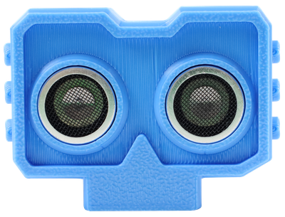
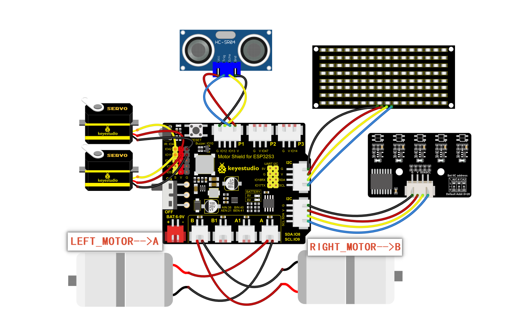

### 项目 15：Wi-Fi 全功能车

#### **1. 简介：**

前面十四课的代码，到这里合成一份：手动遥控、循迹、避障、跟随，四种模式在同一个网页上切换，点阵跟着换表情，云台和夹爪随时能调。三百多行，全书最长的一份。

四套功能单独跑都没问题，合到一起第一件事是抢线：点阵占着 IO8、IO9，循迹传感器的总线也是这两根。于是改成按模式分时占用——循迹时把线交给传感器、点阵让开，其余模式反过来。

第二件事是等待。避障要转舵机、停 300 毫秒、再测距，这段时间网页会僵住；改成把避障拆成五步，每步只做一件事，靠计时往前推，谁也不用等谁。模式切换也各自带一段收尾：先停车、云台回中、清掉上一段的记忆，再进入新模式。

手机页面顶部四个模式按钮。手动模式点阵笑脸，循迹关屏，避障感叹号，跟随爱心；切换的一瞬间车会先停一下、云台回正，然后按新模式动起来。

#### **2. 所需清单：**

本课用到的器件：

|     |     |     |
| :---: | :---: | :---: |
| {width=170px}<br><span style="font-size:0.85em">ESP32-S3 开发板 ×1</span> | {width=170px}<br><span style="font-size:0.85em">DRV8835 电机扩展板 ×1</span> | {width=170px}<br><span style="font-size:0.85em">履带底盘总成（含循迹传感器） ×1</span> |
| {width=170px}<br><span style="font-size:0.85em">超声波模块（带外壳） ×1</span> | {width=170px}<br><span style="font-size:0.85em">8×16 LED 点阵屏 ×1</span> | {width=170px}<br><span style="font-size:0.85em">9G 舵机（180°） ×2</span> |
| <span style="font-size:0.85em">2.4 GHz 无线路由器或手机热点 ×1</span> |  |  |
> ⚠️ **全部器件都在第 2 章装好，本表只作对照，不用拆；下面的接线说明只标清接线方式，供对照，不必拆装。完整物料见 1.4 套件清单。**

#### **3. 参数：**

| 项目 | 参数 |
| --- | --- |
| 工作模式 | manual / line / avoid / follow |
| 手动超时 | 1500 ms |
| 循迹直行速度 | 115 |
| 循迹急转 | 内侧反转 95、外侧 125 |
| 跟随区间 | 30～50 cm 前进，小于 10 cm 后退 |
| 避障阈值 | 小于 15 cm 视为障碍 |
| 避障状态 | AV_GO → AV_LEFT → AV_RIGHT → AV_TURN → AV_TURNING |
| 云台步进 | 15° / 次 |
| 夹爪角度 | 张开 140°、夹紧 90° |
| 点阵与循迹 | 共用 IO8 / IO9，按模式独占 |

#### **4. 接线说明：**

| 模块 | 引脚 | 主控 GPIO |
| --- | --- | :---: |
| 左轮电机 | AIN / AEN | IO38 / IO21 |
| 右轮电机 | BIN / BEN | IO40 / IO41 |
| 超声波 | Trig / Echo | IO13 / IO12 |
| 点阵 | CLK / DIN | IO9 / IO8 |
| 循迹 I2C | SCL / SDA | IO9 / IO8 |
| 云台舵机 | 信号 | IO42 |
| 夹爪舵机 | 信号 | IO11 |

> **注意**：接线图中的元器件只用于说明接线关系，实际接线时不需要把清单中带外壳的元器件拆开。

注意 **IO8 / IO9 出现两次**，这不是笔误：点阵是软件模拟时序的**假 I2C**，循迹是真的硬件 I2C，两者抢同一对引脚，靠代码分时切换。



#### **5. 流程图：**

主循环按模式分发，四种模式谁在跑由 `carMode` 决定：


#### **6. 测试代码：**

> ⚠️ **上传代码前，先把 `mini_tracked_tank_robot.py`、`mini_tracked_tank_robot_web.py` 上传到板子的 `lib/` 目录**（方法见第 5.5 节），否则导入库时会报 `ImportError`。

```python
import network
import time
from mini_tracked_tank_robot import MiniTrackedTankRobot
from mini_tracked_tank_robot_web import WebServer

WIFI_SSID = '你的WiFi账号'
WIFI_PASS = '你的WiFi密码'

# ==================== 参数 ====================
MANUAL_TIMEOUT = 1500      # 手动模式指令超时（ms）
SERVO_STEP = 15            # 云台单次步进角度
CLAW_OPEN = 140
CLAW_CLOSE = 90

BASE_SPEED = 115           # 循迹直行速度
SPIN_SPEED = 125           # 急转外侧轮速度
INNER_SPEED = 95           # 急转内侧轮反转速度

SAFE_DISTANCE = 30         # 跟随：30~50 cm 前进
CLOSE_FOLLOW = 10          # 跟随：小于 10 cm 后退
MAX_DISTANCE = 50
CLOSE_AVOID = 15           # 避障：小于 15 cm 视为障碍

# 避障状态机，避免用 delay 卡住网页
AV_GO, AV_LEFT, AV_RIGHT, AV_TURN, AV_TURNING = 0, 1, 2, 3, 4

INDEX_HTML = """<!DOCTYPE html><html><head>
<meta charset="utf-8">
<meta name="viewport" content="width=device-width,initial-scale=1,user-scalable=no">
<title>迷你履带坦克 V4.0 - Wi-Fi 全功能车</title>
<style>
body{font-family:-apple-system,"Microsoft YaHei",sans-serif;text-align:center;
     background:#f2f3f5;margin:0;padding:16px}
.card{background:#fff;border-radius:14px;padding:16px;max-width:440px;margin:0 auto}
h2{margin:4px 0 10px;font-size:20px}
.dist{font-size:16px;color:#666;margin:0 0 14px}
.dist b{color:#e53935;font-size:20px}
button{font-size:22px;border:none;border-radius:14px;color:#fff;
       user-select:none;-webkit-tap-highlight-color:transparent;touch-action:none}
.modes{display:grid;grid-template-columns:repeat(2,1fr);gap:8px;margin-bottom:14px}
.modes button{height:46px;font-size:16px;background:#3f51b5}
.on{background:#e53935 !important}
.grid{display:grid;grid-template-columns:repeat(3,1fr);gap:10px}
.grid button{height:66px;font-size:20px}
.f{background:#4caf50}.b{background:#f44336}.l{background:#ff9800}
.r{background:#2196f3}.s{background:#607d8b}
.p{background:#9c27b0}.c{background:#009688}
p.tip{font-size:14px;color:#999;margin:14px 0 0}
</style></head><body>
<div class="card">
<h2>当前模式：<span id="m">手动遥控</span></h2>
<p class="dist">前方距离：<b id="d">--</b> cm</p>
<div class="modes">
<button id="b-manual" class="on" onclick="mode('manual')">手动遥控</button>
<button id="b-line" onclick="mode('line')">循迹行驶</button>
<button id="b-avoid" onclick="mode('avoid')">超声波避障</button>
<button id="b-follow" onclick="mode('follow')">超声波跟随</button>
</div>
<div class="grid">
<button class="p" onclick="go('servo_plus')">云台◀</button>
<button class="f" onpointerdown="go('forward')" onpointerup="go('stop')" onpointercancel="go('stop')"
        onpointerleave="go('stop')">↑</button>
<button class="p" onclick="go('servo_minus')">云台▶</button>
<button class="l" onpointerdown="go('left')" onpointerup="go('stop')" onpointercancel="go('stop')"
        onpointerleave="go('stop')">←</button>
<button class="s" onclick="go('stop')">■</button>
<button class="r" onpointerdown="go('right')" onpointerup="go('stop')" onpointercancel="go('stop')"
        onpointerleave="go('stop')">→</button>
<button class="c" onclick="go('claw_close')">爪合</button>
<button class="b" onpointerdown="go('backward')" onpointerup="go('stop')" onpointercancel="go('stop')"
        onpointerleave="go('stop')">↓</button>
<button class="c" onclick="go('claw_open')">爪开</button>
</div>
<p class="tip">按住方向键开车，松手即停 ｜ 云台和夹爪点一下走一步</p>
</div>
<script>
var names={manual:'手动遥控',line:'循迹行驶',avoid:'超声波避障',follow:'超声波跟随'};
function mode(m){
  document.getElementById('m').innerText=names[m];
  for(var k in names){
    document.getElementById('b-'+k).className=(k===m)?'on':'';
  }
  fetch('/cmd?mode='+m).catch(function(){});
}
function go(cmd){ fetch('/cmd?move='+cmd).catch(function(){}); }
setInterval(function(){
  fetch('/distance').then(function(r){return r.text();})
    .then(function(t){document.getElementById('d').innerText=t;})
    .catch(function(){});
},1000);
</script>
</body></html>"""

# ==================== 字模 ====================
smile = bytes([
    0x00, 0x00, 0x1C, 0x02, 0x02, 0x02, 0x5C, 0x40,
    0x40, 0x5C, 0x02, 0x02, 0x02, 0x1C, 0x00, 0x00
])
alert = bytes([
    0x00, 0x00, 0x00, 0x00, 0x00, 0x00, 0x00, 0x5F,
    0x5F, 0x00, 0x00, 0x00, 0x00, 0x00, 0x00, 0x00
])
heart = bytes([
    0x00, 0x00, 0x00, 0x00, 0x08, 0x1C, 0x3E, 0x7C,
    0x7C, 0x3E, 0x1C, 0x08, 0x00, 0x00, 0x00, 0x00
])

# ==================== 初始化 ====================
car = MiniTrackedTankRobot()
car.Motor_init()
car.Ultrasonic_init(13, 12)
car.Servo_init(42)
car.Claw_init(11)
car.Claw_set_angle(CLAW_CLOSE)     # 对齐 Arduino：上电夹紧到 90°
car.Matrix_init(9, 8)
car.Matrix_display(smile)
car.stop_motor()

mode = 'manual'
last_cmd = time.ticks_ms()
pan_angle = 90
left_distance = 0
right_distance = 0
av_step = AV_GO
av_time = 0
last_dir = 0
lost_start = 0
last_line_read = 0
last_follow_check = 0


def show_mode_icon():
    # 点阵与循迹共用 io8/io9：循迹模式关屏后把总线交给 I2C
    if mode == 'line':
        car.Matrix_init(9, 8)
        car.Matrix_off()
        car.Line_init(9, 8)
        return

    car.Matrix_init(9, 8)          # 内部会释放 I2C
    if mode == 'manual':
        car.Matrix_display(smile)
    elif mode == 'avoid':
        car.Matrix_display(alert)
    else:
        car.Matrix_display(heart)


def set_mode(m):
    global mode, av_step, lost_start, pan_angle, last_cmd
    if m not in ('manual', 'line', 'avoid', 'follow'):
        return

    changed = (mode != m)
    mode = m
    car.stop_motor()
    av_step = AV_GO
    lost_start = 0
    pan_angle = 90
    car.Servo_set_angle(90)
    last_cmd = time.ticks_ms()

    if changed:
        show_mode_icon()


# ==================== 1. 循迹 ====================
def run_line():
    global last_dir, lost_start, last_line_read

    if time.ticks_diff(time.ticks_ms(), last_line_read) < 5:
        return
    last_line_read = time.ticks_ms()

    A, B, C, D, E = car.Line_get()
    state = (A << 4) | (B << 3) | (C << 2) | (D << 1) | E

    if state != 0:
        lost_start = 0

    if state in (0b00100, 0b01110, 0b11111):
        car.drive(BASE_SPEED, BASE_SPEED)
        last_dir = 0
    elif state == 0b01100:
        car.drive(85, BASE_SPEED)
        last_dir = 1
    elif state in (0b01000, 0b11100):
        car.drive(45, SPIN_SPEED)
        last_dir = 1
    elif state in (0b11000, 0b10000):
        car.drive(-INNER_SPEED, SPIN_SPEED)
        last_dir = 1
    elif state == 0b00110:
        car.drive(BASE_SPEED, 85)
        last_dir = 2
    elif state in (0b00010, 0b00111):
        car.drive(SPIN_SPEED, 45)
        last_dir = 2
    elif state in (0b00011, 0b00001):
        car.drive(SPIN_SPEED, -INNER_SPEED)
        last_dir = 2
    elif state == 0b00000:
        # 五路全部脱线：按记忆方向找线
        if lost_start == 0:
            lost_start = time.ticks_ms()
        if time.ticks_diff(time.ticks_ms(), lost_start) < 1500:
            if last_dir == 1:
                car.drive(-INNER_SPEED, SPIN_SPEED)
            elif last_dir == 2:
                car.drive(SPIN_SPEED, -INNER_SPEED)
            else:
                car.stop_motor()
        else:
            car.stop_motor()

    # 其余组合是探头过渡态，保持上一条电机指令不动


# ==================== 2. 跟随 ====================
def run_follow():
    global last_follow_check

    if time.ticks_diff(time.ticks_ms(), last_follow_check) < 100:
        return
    last_follow_check = time.ticks_ms()

    d = car.Ultrasonic_distance()
    if SAFE_DISTANCE < d <= MAX_DISTANCE:
        car.forward(150, 150)
    elif 0 < d < CLOSE_FOLLOW:
        car.back(105, 150)
    else:
        car.stop_motor()


# ==================== 3. 避障 ====================
def run_avoidance():
    global av_step, av_time, pan_angle, left_distance, right_distance

    now = time.ticks_ms()

    if av_step == AV_GO:
        d = car.Ultrasonic_distance()
        if 0 < d <= CLOSE_AVOID:
            car.stop_motor()
            pan_angle = 180
            car.Servo_set_angle(180)
            av_time = now
            av_step = AV_LEFT
        else:
            car.forward(150, 150)

    elif av_step == AV_LEFT:
        if time.ticks_diff(now, av_time) >= 300:
            left_distance = car.Ultrasonic_distance()
            pan_angle = 0
            car.Servo_set_angle(0)
            av_time = now
            av_step = AV_RIGHT

    elif av_step == AV_RIGHT:
        if time.ticks_diff(now, av_time) >= 300:
            right_distance = car.Ultrasonic_distance()
            pan_angle = 90
            car.Servo_set_angle(90)
            av_time = now
            av_step = AV_TURN

    elif av_step == AV_TURN:
        if time.ticks_diff(now, av_time) >= 100:
            if left_distance > right_distance:
                car.left(255, 255)
            else:
                car.right(255, 255)
            av_time = now
            av_step = AV_TURNING

    elif av_step == AV_TURNING:
        if time.ticks_diff(now, av_time) >= 500:
            car.stop_motor()
            av_step = AV_GO


# ==================== 网页请求 ====================
def on_index(params):
    return INDEX_HTML


def on_cmd(params):
    global last_cmd, pan_angle

    if 'mode' in params:
        set_mode(params['mode'])
        return 'OK'

    move = params.get('move', '')

    # 云台与夹爪：任何模式下都能动
    if move == 'servo_plus':
        pan_angle = min(180, pan_angle + SERVO_STEP)
        car.Servo_set_angle(pan_angle)
    elif move == 'servo_minus':
        pan_angle = max(0, pan_angle - SERVO_STEP)
        car.Servo_set_angle(pan_angle)
    elif move == 'claw_open':
        car.Claw_set_angle(CLAW_OPEN)
    elif move == 'claw_close':
        car.Claw_set_angle(CLAW_CLOSE)
    else:
        # 行驶指令：先切回手动，再执行
        if mode != 'manual':
            set_mode('manual')
        last_cmd = time.ticks_ms()
        if move == 'forward':
            car.forward(180, 180)
        elif move == 'backward':
            car.back(180, 180)
        elif move == 'left':
            car.left(180, 180)
        elif move == 'right':
            car.right(180, 180)
        else:
            car.stop_motor()

    return 'OK'


def on_distance(params):
    return str(car.Ultrasonic_distance())


# ==================== 连接 Wi-Fi ====================
wlan = network.WLAN(network.STA_IF)
wlan.active(True)
print('正在连接', WIFI_SSID)
wlan.connect(WIFI_SSID, WIFI_PASS)
while not wlan.isconnected():
    time.sleep(0.5)
    print('.', end='')
print()
print('板子的 IP：' + wlan.ifconfig()[0])

server = WebServer(80)
server.route('/', on_index)
server.route('/cmd', on_cmd)
server.route('/distance', on_distance)

print('网页服务已启动，默认手动模式')

while True:
    server.handle()

    if mode == 'line':
        run_line()
    elif mode == 'avoid':
        run_avoidance()
    elif mode == 'follow':
        run_follow()
    elif time.ticks_diff(time.ticks_ms(), last_cmd) > MANUAL_TIMEOUT:
        car.stop_motor()
```

#### **7. 代码解释：**

**(1) 引入库与状态机常量**

```python
import network
import time
from mini_tracked_tank_robot import MiniTrackedTankRobot
from mini_tracked_tank_robot_web import WebServer
```

`network` 连 Wi-Fi，`WebServer` 开网页，`MiniTrackedTankRobot` 一个类里封装了电机、循迹、超声波、云台、夹爪、点阵的全部驱动——六个模块共用一个 `car` 对象。两个库文件都要先传进板子的 `lib/`。

```python
# 避障状态机，避免用 delay 卡住网页
AV_GO, AV_LEFT, AV_RIGHT, AV_TURN, AV_TURNING = 0, 1, 2, 3, 4
```

避障被拆成五步，用五个常量编号，`av_step` 记录当前步。之所以不用**转舵机 → 延时 → 测距**那种写法，是因为延时会让整个程序（包括网页响应）卡住几百毫秒；这里每步只做一件事，靠时间戳判断何时进入下一步。

**(2) 初始化全部模块与状态变量**

```python
car = MiniTrackedTankRobot()
car.Motor_init()
car.Ultrasonic_init(13, 12)
car.Servo_init(42)
car.Claw_init(11)
car.Claw_set_angle(CLAW_CLOSE)     # 对齐 Arduino：上电夹紧到 90°
car.Matrix_init(9, 8)
car.Matrix_display(smile)
car.stop_motor()
```

四节课的外设在这里一次装齐：电机、超声波、云台、夹爪、点阵各自初始化。上电先把夹爪夹到 90°、点阵显示笑脸、电机停住，作为手动模式的初始状态。注意 `Matrix_init(9, 8)` 用的是 IO9/IO8，下一节会看到它和循迹抢同一对引脚。

```python
mode = 'manual'
last_cmd = time.ticks_ms()
pan_angle = 90
left_distance = 0
right_distance = 0
av_step = AV_GO
av_time = 0
last_dir = 0
lost_start = 0
last_line_read = 0
last_follow_check = 0
```

这些全局变量在模式函数、网页回调之间共享：`mode` 决定跑哪套逻辑，`last_cmd` 管手动超时，其余几个是循迹/避障的内部记忆。模式切换时要把相关项一起复位，否则上一次的转向记忆会带进新模式。

**(3) 表情字模与 I2C 分时复用**

```python
alert = bytes([
    0x00, 0x00, 0x00, 0x00, 0x00, 0x00, 0x00, 0x5F,
    0x5F, 0x00, 0x00, 0x00, 0x00, 0x00, 0x00, 0x00
])
```

三个 16 字节字模分别给手动（笑脸）、避障（感叹号）、跟随（爱心），格式和第 1 课一样：一字节一列、bit0 顶行。`alert` 中间那两个 `0x5F` 就是感叹号的竖条。

```python
def show_mode_icon():
    # 点阵与循迹共用 io8/io9：循迹模式关屏后把总线交给 I2C
    if mode == 'line':
        car.Matrix_init(9, 8)
        car.Matrix_off()
        car.Line_init(9, 8)
        return

    car.Matrix_init(9, 8)          # 内部会释放 I2C
    if mode == 'manual':
        car.Matrix_display(smile)
    elif mode == 'avoid':
        car.Matrix_display(alert)
    else:
        car.Matrix_display(heart)
```

这是全课最关键的一段：点阵和循迹传感器共用 IO8、IO9。进循迹模式时先 `Matrix_off()` 关屏，再 `Line_init()` 把两根线交给 I2C，此时点阵不显示任何表情；回到其他模式则反过来——`Matrix_init()` 内部会释放 I2C 收回引脚，再刷对应表情。顺序不能颠倒，否则不是花屏就是循迹读不到数据。

**(4) set_mode：切换时先复位**

```python
def set_mode(m):
    global mode, av_step, lost_start, pan_angle, last_cmd
    if m not in ('manual', 'line', 'avoid', 'follow'):
        return

    changed = (mode != m)
    mode = m
    car.stop_motor()
    av_step = AV_GO
    lost_start = 0
    pan_angle = 90
    car.Servo_set_angle(90)
    last_cmd = time.ticks_ms()

    if changed:
        show_mode_icon()
```

先用元组校验模式名，非法值直接忽略。切换瞬间统一做四件复位：停车、避障状态机归零、丢线计时清零、云台回中——这样上一种模式残留的转向或计时不会污染新模式。`changed` 记录是否真的换了模式，只有换了才调 `show_mode_icon()` 换表情和切换引脚归属，重复点同一个按钮不会反复折腾 I2C。

**(5) run_line：循迹与脱线找线**

```python
def run_line():
    global last_dir, lost_start, last_line_read

    if time.ticks_diff(time.ticks_ms(), last_line_read) < 5:
        return
    last_line_read = time.ticks_ms()

    A, B, C, D, E = car.Line_get()
    state = (A << 4) | (B << 3) | (C << 2) | (D << 1) | E
```

`Line_get()` 读回五路探头的值，各占一位，左移后拼成一个 5 位二进制数：`0b00100` 是中间压线，`0b01100` 偏左，`0b00011` 严重偏右，依此类推。开头用 `ticks_diff()` 限制每 5 ms 读一次，读太频繁没意义还占 CPU。后面一长串 `if/elif` 就是查表：直行、缓转、急转时外侧轮加速，最急的情况内侧轮反转（`INNER_SPEED` 带负号）实现原地甩头。

```python
    elif state == 0b00000:
        # 五路全部脱线：按记忆方向找线
        if lost_start == 0:
            lost_start = time.ticks_ms()
        if time.ticks_diff(time.ticks_ms(), lost_start) < 1500:
            if last_dir == 1:
                car.drive(-INNER_SPEED, SPIN_SPEED)
            elif last_dir == 2:
                car.drive(SPIN_SPEED, -INNER_SPEED)
            else:
                car.stop_motor()
        else:
            car.stop_motor()
```

五路全黑表示完全脱线：按 `last_dir` 记住的上次转向继续甩头找线，1.5 秒（1500 ms）还没找到就停。`last_dir` 在直行/左转/右转分支里分别被写成 0/1/2，脱线时才知道往哪边找——这就是"记忆方向"的由来。改 `SPIN_SPEED`、`INNER_SPEED` 能调整急转的力度。

**(6) run_follow 跟随与 run_avoidance 避障**

```python
def run_follow():
    global last_follow_check

    if time.ticks_diff(time.ticks_ms(), last_follow_check) < 100:
        return
    last_follow_check = time.ticks_ms()

    d = car.Ultrasonic_distance()
    if SAFE_DISTANCE < d <= MAX_DISTANCE:
        car.forward(150, 150)
    elif 0 < d < CLOSE_FOLLOW:
        car.back(105, 150)
    else:
        car.stop_motor()
```

跟随是三段式：30~50 cm 前进，近到 10 cm 以内后退（防止撞手），其余区间停车。每 100 ms 测一次距离。阈值都在文件开头定义，想改跟随距离改那几个常量。

```python
def run_avoidance():
    global av_step, av_time, pan_angle, left_distance, right_distance

    now = time.ticks_ms()

    if av_step == AV_GO:
        d = car.Ultrasonic_distance()
        if 0 < d <= CLOSE_AVOID:
            car.stop_motor()
            pan_angle = 180
            car.Servo_set_angle(180)
            av_time = now
            av_step = AV_LEFT
        else:
            car.forward(150, 150)

    elif av_step == AV_LEFT:
        if time.ticks_diff(now, av_time) >= 300:
            left_distance = car.Ultrasonic_distance()
            pan_angle = 0
            car.Servo_set_angle(0)
            av_time = now
            av_step = AV_RIGHT
```

避障是五步状态机：`AV_GO` 前进，测到 15 cm 内有障碍就停车、云台打左进 `AV_LEFT`，等 300 ms 转到位后测左距；再打右测右距（`AV_RIGHT`），接着 `AV_TURN` 比较两边距离、往空的一侧转，`AV_TURNING` 走 500 ms 后回到 `AV_GO`。每步用 `av_time` 加 `ticks_diff()` 计时，全程不阻塞——网页在这期间照样能响应。

**(7) on_cmd：区分模式指令与动作指令**

```python
def on_cmd(params):
    global last_cmd, pan_angle

    if 'mode' in params:
        set_mode(params['mode'])
        return 'OK'

    move = params.get('move', '')
```

网址带 `mode` 参数就切模式并立即返回；否则读 `move` 参数看要做什么动作。

```python
    # 云台与夹爪：任何模式下都能动
    if move == 'servo_plus':
        pan_angle = min(180, pan_angle + SERVO_STEP)
        car.Servo_set_angle(pan_angle)
    elif move == 'servo_minus':
        pan_angle = max(0, pan_angle - SERVO_STEP)
        car.Servo_set_angle(pan_angle)
    elif move == 'claw_open':
        car.Claw_set_angle(CLAW_OPEN)
    elif move == 'claw_close':
        car.Claw_set_angle(CLAW_CLOSE)
    else:
        # 行驶指令：先切回手动，再执行
        if mode != 'manual':
            set_mode('manual')
        last_cmd = time.ticks_ms()
        if move == 'forward':
            car.forward(180, 180)
```

云台和夹爪指令放在前面，任何模式下都能执行——`min/max` 把角度卡在 0~180，每次走 `SERVO_STEP`（15°），所以点一下动一步。行驶指令走 `else` 分支，并且先判断：不在手动模式就 `set_mode('manual')` 抢回控制权，这样自动模式下碰一下方向键就立刻接管为手动，不会和循迹/避障打架。改 `SERVO_STEP` 可调云台每步角度。

**(8) 连接 Wi-Fi、路由与主循环分发**

```python
server = WebServer(80)
server.route('/', on_index)
server.route('/cmd', on_cmd)
server.route('/distance', on_distance)
```

连网部分和前三课相同。`WebServer(80)` 注册三条路由：`/` 返回页面，`/cmd` 收模式和动作，`/distance` 供网页每秒轮询距离显示在页面上。

```python
while True:
    server.handle()

    if mode == 'line':
        run_line()
    elif mode == 'avoid':
        run_avoidance()
    elif mode == 'follow':
        run_follow()
    elif time.ticks_diff(time.ticks_ms(), last_cmd) > MANUAL_TIMEOUT:
        car.stop_motor()
```

主循环每轮先 `server.handle()` 处理网页请求，再按 `mode` 分发——四个分支互斥，同一时刻只跑一种模式。手动模式没有专门的函数，靠最后的超时分支兜底：1.5 秒没收到指令就停车，和第 14 课遥控车同理。模式切换、`on_cmd` 改 `mode` 后，下一轮循环自然就切到另一套逻辑了。

#### **8. 运行现象：**

Shell 打印：

```text
正在连接 你的WiFi名字
.....
WiFi 已连接
板子的 IP：192.168.1.23
网页服务已启动，默认手动模式
```

手机页面顶部是四个模式按钮，下面是方向键、云台、夹爪按钮。

| 模式 | 点阵 | 行为 |
| --- | --- | --- |
| 手动 | 笑脸 | 按方向键走，松手 1.5 s 后停 |
| 循迹 | 关屏 | 自己沿线走，网页仍可切模式 |
| 避障 | 感叹号 | 遇障停下，左右张望后绕开 |
| 跟随 | 爱心 | 手在前方 30～50 cm 跟着走 |

四种模式都能随时切换，切换瞬间车会先停一下（`setMode()` 里的 `stopMotor()`），云台回中，然后进入新模式。

> 【图片待补】手机页面切换四种模式时的四张截图拼图。

#### **9. 常见问题解决：**

**Wi-Fi 连不上、网页打不开，按这个顺序查：**

(1) **账号密码换了没有**：代码开头的 `WIFI_SSID`、`WIFI_PASS` 还是占位符就运行，一定连不上，改成自己路由器的名称和密码。

(2) **Shell 里一行字都没有**：按一下板子上的 RESET 键再试，可能是上一版程序卡住了。

{width=340px}

(3) **Shell 一直冒点、拿不到 IP**：Wi-Fi 连接失败。路由器必须是 **2.4 GHz**，5 GHz 板子不支持；没有 2.4 G 就开手机热点（热点默认 2.4 G）。

(4) **拿到 IP 但页面打不开**：地址要带 `http://`，IP 以 Shell 打印的为准；手机必须连同一个 Wi-Fi，两边 IP 前三段要一样。

(5) **网段对、还是打不开**：进路由器后台把**AP 隔离**关掉，开了它同一 Wi-Fi 下的设备互相访问不了。

(6) Shell 报 `ImportError: no module named 'mini_tracked_tank_robot_web'`，是 WebServer 库没到板子上。把 `mini_tracked_tank_robot.py` 和 `mini_tracked_tank_robot_web.py` 用 Thonny 保存到板子的 `lib/` 下再运行。

(7) 切到循迹后点阵不亮是正常的，不是坏了：点阵和循迹共用 IO8 / IO9，`show_mode_icon()` 会先 `Matrix_off()`，再把总线交给 `Line_init(9, 8)`。切回手动它会自己亮回笑脸，别为了点阵去改引脚，I2C 冲突了会直接报 `OSError`。

(8) 切到循迹后车不动、Shell 也没报错，先确认循迹 4P 头插紧了没，再看车是不是压在线外——五路读数全 0（`state == 0b00000`）又没有历史方向时代码会停车。把车放回线上、插头按到底就好了。
