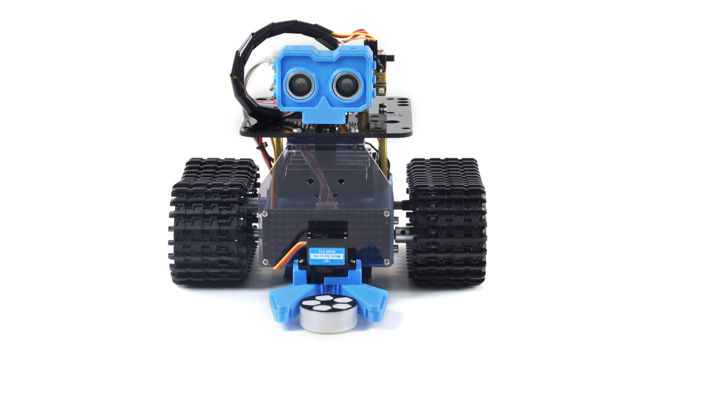
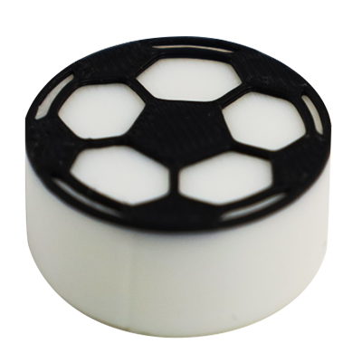
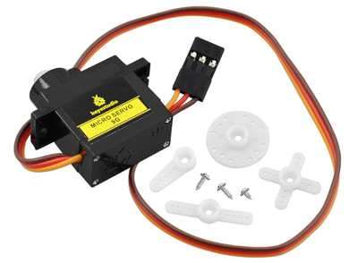
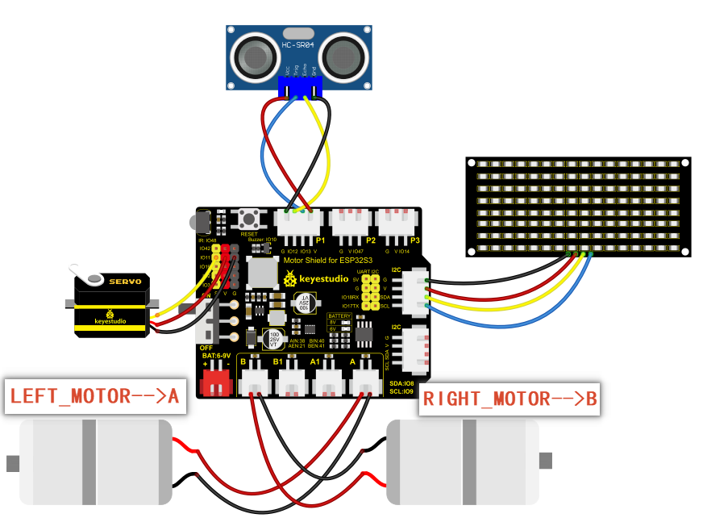
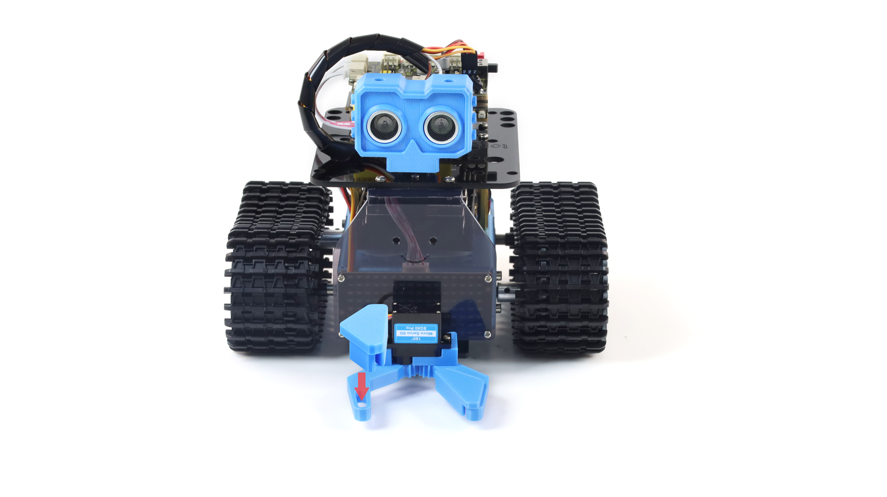

### Project 16: DIY Soccer Competition Car

#### **1. Introduction:**



One car, a 3D-printed ball and a goal make a match — and if a friend has a car too, you can play it as a head-to-head competition. What we are building is not just a car that runs, but a car that plays: the score is on the screen, the matrix jumps to a smiley when a goal is scored, it returns to standby three seconds later, and the score can be cleared and restarted at any time.

The claw is used differently here than in Lesson 9. There, opening and closing was just a pose for people to look at; here, opening to 140° cups the two fingers into a forward-facing pocket that the ball sits in so it can be carried along, and closing to 90° brings the fingers inward and squeezes the ball out of the pocket.

The score and the expressions are computed and stored on the car itself, and the web page only displays them and sends commands — if the router drops, the car can still drive and score, you just cannot see the score on the phone.

Press Carry to open the claw, drive the ball up to the goal line, press Shoot to close the claw and squeeze the ball out, then press Goal: the matrix immediately turns into a smiley, returns to two square eyes after three seconds and the score on the page goes up by one.

#### **2. Parts List:**
Components used in this lesson:

|     |     |     |
| :---: | :---: | :---: |
| <br><span style="font-size:0.85em">Large mechanical claw (semi-finished) ×1</span> | <br><span style="font-size:0.85em">3D-printed soccer ball (31.25 mm diameter) ×1</span> | <br><span style="font-size:0.85em">9G servo (180°, with cross arm) ×1</span> |
| <br><span style="font-size:0.85em">8×16 LED dot matrix display ×1</span> | <br><span style="font-size:0.85em">DRV8835 motor expansion board ×1</span> | <br><span style="font-size:0.85em">ESP32-S3 development board ×1</span> |
| <br><span style="font-size:0.85em">Large mechanical claw launcher set (one left, one right) ×1</span> | <span style="font-size:0.85em">2.4 GHz wireless router or phone hotspot ×1</span> |  |
> ⚠️ **Everything was installed in Chapter 2. This table is for reference only, so there is no need to remove anything; the wiring notes below only describe the wiring method for reference and do not require disassembly. See the kit list in 1.4 for the full bill of materials.**

#### **3. Parameters:**
| Item | Parameter |
| --- | --- |
| Driving speed | 180 |
| Pivot speed | 180 |
| Claw open | 140° (cups the ball) |
| Claw closed | 90° (shoots) |
| Command timeout | 1500 ms |
| Celebration duration | 3 s |
| Score endpoint | `/score` returns **score,state** |
| Web polling | 1 s per request |

#### **4. Wiring:**

| Module | Pin | Controller GPIO |
| --- | --- | :---: |
| Left wheel AIN / AEN | Direction / speed | IO38 / IO21 |
| Right wheel BIN / BEN | Direction / speed | IO40 / IO41 |
| Claw servo | Signal | IO11 |
| Dot matrix | CLK / DIN | IO9 / IO8 |

This lesson uses no ultrasonic, no line sensor and no pan-tilt, keeping only **drive, claw and display**.



**Mechanical claw assembly steps**





#### **5. Flowchart:**

The page sends commands, the board executes them and reports the score and the expression back to the page, forming a closed loop:


#### **6. Test Code:**
> ⚠️ **Before uploading the code, upload `mini_tracked_tank_robot.py` and `mini_tracked_tank_robot_web.py` to the `lib/` directory on the board** (see Section 5.5), otherwise importing the library raises `ImportError`.

```python
import network
import time
from mini_tracked_tank_robot import MiniTrackedTankRobot
from mini_tracked_tank_robot_web import WebServer

WIFI_SSID = 'your_wifi_ssid'
WIFI_PASS = 'your_wifi_password'

SPEED_RUN = 180
SPEED_TURN = 180
STOP_AFTER = 1500          # Auto stop when a command times out (ms)

CLAW_OPEN = 140            # Open: the ball sits inside the claw
CLAW_CLOSE = 90            # Closed: the ball is squeezed out

FACE_EYES = 0
FACE_SMILE = 1

eyes = bytes([
    0x00, 0x00, 0x00, 0x00, 0x1C, 0x1C, 0x00, 0x00,
    0x00, 0x00, 0x1C, 0x1C, 0x00, 0x00, 0x00, 0x00
])
smile = bytes([
    0x00, 0x00, 0x1C, 0x02, 0x02, 0x02, 0x5C, 0x40,
    0x40, 0x5C, 0x02, 0x02, 0x02, 0x1C, 0x00, 0x00
])

INDEX_HTML = """<!DOCTYPE html><html><head>
<meta charset="utf-8">
<meta name="viewport" content="width=device-width,initial-scale=1,user-scalable=no">
<title>Mini Tracked Tank Robot V4.0 - Soccer Car</title>
<style>
body{font-family:-apple-system,"Microsoft YaHei",sans-serif;text-align:center;
     background:#f2f3f5;margin:0;padding:14px}
.card{background:#fff;border-radius:14px;padding:14px;max-width:420px;margin:0 auto 12px}
h2{margin:2px 0 12px;font-size:19px}
.grid{display:grid;grid-template-columns:repeat(3,1fr);gap:9px}
button{height:66px;font-size:22px;border:none;border-radius:14px;color:#fff;
       user-select:none;-webkit-tap-highlight-color:transparent;touch-action:none}
.f{background:#4caf50}.b{background:#f44336}.l{background:#ff9800}
.r{background:#2196f3}.s{background:#607d8b}
.g{background:#009688}.w{background:#ff5722}.k{background:#795548}
.blank{background:transparent}
.score{font-size:40px;font-weight:700;color:#e53935;margin:6px 0}
p{font-size:13px;color:#888;margin:8px 0 0}
</style></head><body>

<div class="card">
<h2>Score</h2>
<div class="score" id="sc">0</div>
<p id="st">Hold a direction button to drive</p>
</div>

<div class="card">
<h2>Driving</h2>
<div class="grid">
<div class="blank"></div>
<button class="f" onpointerdown="go('f')" onpointerup="go('s')" onpointercancel="go('s')" onpointerleave="go('s')">↑</button>
<div class="blank"></div>
<button class="l" onpointerdown="go('l')" onpointerup="go('s')" onpointercancel="go('s')" onpointerleave="go('s')">←</button>
<button class="s" onclick="go('s')">■</button>
<button class="r" onpointerdown="go('r')" onpointerup="go('s')" onpointercancel="go('s')" onpointerleave="go('s')">→</button>
<div class="blank"></div>
<button class="b" onpointerdown="go('b')" onpointerup="go('s')" onpointercancel="go('s')" onpointerleave="go('s')">↓</button>
<div class="blank"></div>
</div>
</div>

<div class="card">
<h2>Claw</h2>
<div class="grid" style="grid-template-columns:repeat(2,1fr)">
<button class="g" onclick="go('carry')">Carry</button>
<button class="w" onclick="go('shoot')">Shoot</button>
</div>
<div class="grid" style="grid-template-columns:repeat(2,1fr);margin-top:9px">
<button class="k" onclick="go('goal')">Score a goal</button>
<button class="k" onclick="go('reset')">Reset score</button>
</div>
<p>Press "Carry" to open the claw and hold the ball; press "Shoot" to close the claw and squeeze the ball out</p>
</div>

<script>
function go(d){
  fetch('/cmd?d='+d).then(function(r){return r.text();}).then(function(t){
    if(t.indexOf(',')>0){
      var a=t.split(',');
      document.getElementById('sc').innerText=a[0];
      document.getElementById('st').innerText=a[1];
    }
  }).catch(function(){});
}
function tick(){
  fetch('/score').then(function(r){return r.text();}).then(function(t){
    document.getElementById('sc').innerText=t.split(',')[0];
  }).catch(function(){});
}
setInterval(tick,1000);
</script>
</body></html>"""

car = MiniTrackedTankRobot()
car.Motor_init()
car.Claw_init(11)
car.Matrix_init(9, 8)
car.Claw_set_angle(CLAW_OPEN)
car.stop_motor()

score = 0
last_cmd = time.ticks_ms()
smile_until = 0
cur_face = -1


def show_face(face):
    # Only refresh the display when the face changes, so the bus is not used constantly
    global cur_face
    if face == cur_face:
        return
    cur_face = face
    if face == FACE_EYES:
        car.Matrix_display(eyes)
    else:
        car.Matrix_display(smile)


def face_name():
    return 'Goal!' if cur_face == FACE_SMILE else 'Standby'


def run_cmd(d):
    # Return "score,state" so one web request refreshes both fields
    global score, last_cmd, smile_until

    last_cmd = time.ticks_ms()

    if d == 'f':
        car.forward(SPEED_RUN, SPEED_RUN)
    elif d == 'b':
        car.back(SPEED_RUN, SPEED_RUN)
    elif d == 'l':
        car.left(SPEED_TURN, SPEED_TURN)
    elif d == 'r':
        car.right(SPEED_TURN, SPEED_TURN)
    elif d == 'carry':
        car.Claw_set_angle(CLAW_OPEN)
    elif d == 'shoot':
        car.Claw_set_angle(CLAW_CLOSE)
    elif d == 'goal':
        score += 1
        show_face(FACE_SMILE)
        smile_until = time.ticks_ms() + 3000
    elif d == 'reset':
        score = 0
    else:
        car.stop_motor()

    return '{},{}'.format(score, face_name())


def on_index(params):
    return INDEX_HTML


def on_cmd(params):
    return run_cmd(params.get('d', 's'))


def on_score(params):
    return '{},{}'.format(score, face_name())


# ==================== Connect to Wi-Fi ====================
wlan = network.WLAN(network.STA_IF)
wlan.active(True)
print('Connecting to', WIFI_SSID)
wlan.connect(WIFI_SSID, WIFI_PASS)
while not wlan.isconnected():
    time.sleep(0.5)
    print('.', end='')
print()
print('Board IP: ' + wlan.ifconfig()[0])

show_face(FACE_EYES)

server = WebServer(80)
server.route('/', on_index)
server.route('/cmd', on_cmd)
server.route('/score', on_score)

print('Soccer car ready')

while True:
    server.handle()

    # Stop when no command arrives in time
    if time.ticks_diff(time.ticks_ms(), last_cmd) > STOP_AFTER:
        car.stop_motor()

    # Return to the standby face 3 seconds after the smile
    if smile_until != 0 and time.ticks_ms() > smile_until:
        smile_until = 0
        show_face(FACE_EYES)
```

#### **7. Code Explanation:**
**(1) Importing the libraries and the parameter constants**

```python
import network
import time
from mini_tracked_tank_robot import MiniTrackedTankRobot
from mini_tracked_tank_robot_web import WebServer

WIFI_SSID = 'your_wifi_ssid'
WIFI_PASS = 'your_wifi_password'

SPEED_RUN = 180
SPEED_TURN = 180
STOP_AFTER = 1500          # Auto stop when a command times out (ms)

CLAW_OPEN = 140            # Open: the ball sits inside the claw
CLAW_CLOSE = 90            # Closed: the ball is squeezed out

FACE_EYES = 0
FACE_SMILE = 1
```

This is the first lesson in which the car joins a network: `network` handles the Wi-Fi connection and `WebServer` comes from another board-level library, `mini_tracked_tank_robot_web`, which takes care of the HTTP requests coming from the browser for us. Both library files must be uploaded to `lib/` on the board. The speeds, claw angles and expression numbers are all pulled out into constants, so changing the feel only means touching these few numbers instead of digging through the command branches below. `STOP_AFTER` is the link-loss protection: one command from the page only moves the car for 1.5 seconds before it stops by itself, so the car will not keep racing forward if the phone disconnects.

**(2) The two bitmaps**

```python
eyes = bytes([
    0x00, 0x00, 0x00, 0x00, 0x1C, 0x1C, 0x00, 0x00,
    0x00, 0x00, 0x1C, 0x1C, 0x00, 0x00, 0x00, 0x00
])
smile = bytes([
    0x00, 0x00, 0x1C, 0x02, 0x02, 0x02, 0x5C, 0x40,
    0x40, 0x5C, 0x02, 0x02, 0x02, 0x1C, 0x00, 0x00
])
```

Same 16-byte bitmap format as Lesson 1: each byte covers one column with bit0 on the top row. `eyes` is the two square eyes (standby) and `smile` is the goal smiley. To change the expression you only change these 16 bytes; the display logic stays as it is.

**(3) How the page buttons get commands to the board**

```javascript
function go(d){
  fetch('/cmd?d='+d).then(function(r){return r.text();}).then(function(t){
    if(t.indexOf(',')>0){
      var a=t.split(',');
      document.getElementById('sc').innerText=a[0];
      document.getElementById('st').innerText=a[1];
    }
  }).catch(function(){});
}
function tick(){
  fetch('/score').then(function(r){return r.text();}).then(function(t){
    document.getElementById('sc').innerText=t.split(',')[0];
  }).catch(function(){});
}
setInterval(tick,1000);
```

The page does not communicate by reloading but with `fetch` requests: an arrow's `onpointerdown` sends the movement and `onpointerup` sends stop (`go('s')`), so it is "hold to drive, release to stop", and it works with both touch and mouse. `go()` splits the `score,state` string returned by the board at the comma, refreshing the score and the hint text with a single request. `tick()` pulls `/score` once a second so that the phone display also follows score changes that did not come from your own key press — remove that timer and the score only changes when you press something yourself.

**(4) Creating the object and initializing the peripherals**

```python
car = MiniTrackedTankRobot()
car.Motor_init()
car.Claw_init(11)
car.Matrix_init(9, 8)
car.Claw_set_angle(CLAW_OPEN)
car.stop_motor()
```

Once `car` exists, the motors, the claw servo (signal pin 11) and the dot matrix (CLK=9, DIN=8) are initialized in turn, and finally the claw is opened and the motors stopped so that the first frame after power-on is the standby state rather than whatever was left over. If you rewire anything, change the arguments of `car.Claw_init` and `car.Matrix_init`.

**(5) Writing the display only when the expression changes**

```python
def show_face(face):
    # Only refresh the display when the face changes, so the bus is not used constantly
    global cur_face
    if face == cur_face:
        return
    cur_face = face
    if face == FACE_EYES:
        car.Matrix_display(eyes)
    else:
        car.Matrix_display(smile)


def face_name():
    return 'Goal!' if cur_face == FACE_SMILE else 'Standby'
```

`cur_face` remembers the current expression and returns straight away when it is unchanged: the main loop runs many times a second, and calling `car.Matrix_display` every round would hold the matrix bus permanently and could also flicker. `face_name()` turns the expression number into the status text shown on the page and returns it together with the score.

**(6) The central command dispatcher run_cmd**

```python
def run_cmd(d):
    # Return "score,state" so one web request refreshes both fields
    global score, last_cmd, smile_until

    last_cmd = time.ticks_ms()

    if d == 'f':
        car.forward(SPEED_RUN, SPEED_RUN)
    elif d == 'b':
        car.back(SPEED_RUN, SPEED_RUN)
    elif d == 'l':
        car.left(SPEED_TURN, SPEED_TURN)
    elif d == 'r':
        car.right(SPEED_TURN, SPEED_TURN)
    elif d == 'carry':
        car.Claw_set_angle(CLAW_OPEN)
    elif d == 'shoot':
        car.Claw_set_angle(CLAW_CLOSE)
    elif d == 'goal':
        score += 1
        show_face(FACE_SMILE)
        smile_until = time.ticks_ms() + 3000
    elif d == 'reset':
        score = 0
    else:
        car.stop_motor()

    return '{},{}'.format(score, face_name())
```

Web commands branch here: `f/b/l/r` drive the car; `carry/shoot` only change the claw angle — the ball is squeezed out by the fingers closing in, not knocked by the motors; `goal` adds a point, lights the smiley and records the moment three seconds ahead; everything else, including the `s` sent on release, stops the car. Every branch refreshes `last_cmd` first so the timeout in the main loop counts from the last valid command. The format of the returned string is agreed with `go()` on the page, so changing the separator means changing both ends.

**(7) Connecting to Wi-Fi and registering three routes**

```python
wlan = network.WLAN(network.STA_IF)
wlan.active(True)
print('Connecting to', WIFI_SSID)
wlan.connect(WIFI_SSID, WIFI_PASS)
while not wlan.isconnected():
    time.sleep(0.5)
    print('.', end='')
print()
print('Board IP: ' + wlan.ifconfig()[0])

show_face(FACE_EYES)

server = WebServer(80)
server.route('/', on_index)
server.route('/cmd', on_cmd)
server.route('/score', on_score)
```

This networking block is the same as in Lessons 13 and 14 and is not explained again. `STA_IF` means the board joins an existing Wi-Fi as a device (it does not create a hotspot itself); after `connect()` it polls `isconnected()` and keeps printing dots until the link is up. Once connected, `ifconfig()[0]` prints the IP, which is the address to type into the phone browser. `WebServer(80)` listens on port 80 and `route()` binds three paths to three callbacks: `/` returns the page, `/cmd` calls `run_cmd()` to perform the action and `/score` reports the score. To change the Wi-Fi name and password, only the two constants at the top need editing.

**(8) Main loop: handle requests plus two background jobs**

```python
while True:
    server.handle()

    # Stop when no command arrives in time
    if time.ticks_diff(time.ticks_ms(), last_cmd) > STOP_AFTER:
        car.stop_motor()

    # Return to the standby face 3 seconds after the smile
    if smile_until != 0 and time.ticks_ms() > smile_until:
        smile_until = 0
        show_face(FACE_EYES)
```

`server.handle()` must be called every round: it checks for browser requests and dispatches them to the routes, and without it the page is dead. Both jobs afterwards use timestamps instead of delays: the stop check uses `ticks_diff()` to see how long since the last command (`ticks_ms()` with `ticks_diff()` rather than a raw subtraction is also safe across counter overflow), and the smiley expiry works the same way. You cannot use `sleep(3)` to wait out the smiley, because the main loop would be blocked for those 3 seconds and every button on the page would stop responding.

#### **8. Expected Behavior:**
The Shell prints `Soccer car ready` and the matrix shows the two square eyes (standby).

| Action | Dot matrix | Web page |
| --- | --- | --- |
| Press an arrow | Unchanged (standby eyes) | Car moves |
| Press **Carry** | Unchanged | Claw opens, ready to cup the ball |
| Press **Shoot** | Unchanged | Claw closes, ball is squeezed out |
| Press **Goal** | Smiley immediately, back to eyes after 3 s | Score +1, shows **Goal!** |
| Press **Reset** | Unchanged | Score back to 0 |

> [Image to be added] A screenshot of the matrix smiley and the phone score +1 in the same frame at the moment of a goal.

How a match is actually played:

1. Press **Carry** to open the claw and cup the ball into it.
2. Drive the ball in front of the goal with the arrows and line it up.
3. Press **Shoot** and the claw closes to squeeze the ball out.
4. Once the ball crosses the goal line, press **Goal** to add a point and celebrate on the matrix.

#### **9. Troubleshooting:**

**If the Wi-Fi will not connect or the page will not open, check in this order:**

(1) **Have the credentials been changed?** If `WIFI_SSID` and `WIFI_PASS` at the top of the code are still placeholders when you run it, it will certainly not connect; change them to your own router's name and password.

(2) **Nothing at all in the Shell.** Press the RESET button on the board and try again; the previous program may be stuck.


(3) **The Shell keeps printing dots and never gets an IP.** The Wi-Fi connection failed. The router must be **2.4 GHz**; the board does not support 5 GHz, and if you have no 2.4 GHz network, turn on your phone's hotspot (hotspots default to 2.4 GHz).

(4) **An IP appears but the page will not open.** The address needs `http://`, and the IP must be the one the Shell printed; the phone has to be on the same Wi-Fi, and the first three parts of both IPs must match.

(5) **Same subnet, still will not open.** Go into the router settings and turn off **AP isolation**; with it on, devices on the same Wi-Fi cannot reach each other.

(6) An `ImportError` right after starting, saying `mini_tracked_tank_robot` or `mini_tracked_tank_robot_web` cannot be found, means the library files are not in the board's `lib/` directory. Use Thonny to save both files into `lib/` on the board's file system, then **Run/Save to the board** and the error goes away.

(7) If the ball goes off to the side when you shoot, the front of the car is not square to the goal — the claw closes inward, so an uneven load on the two sides pushes the ball to one side. Reverse and adjust the angle, then shoot once you are lined up.

(8) If the claw does not open and close properly, check that `CLAW_OPEN = 140` and `CLAW_CLOSE = 90` have not been changed; a `NameError` after you add your own code usually means one of these two is used before it is defined, so check the parameter section again.
