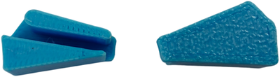
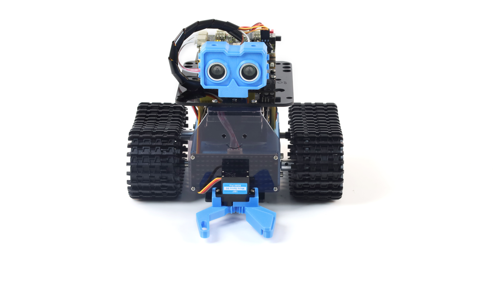
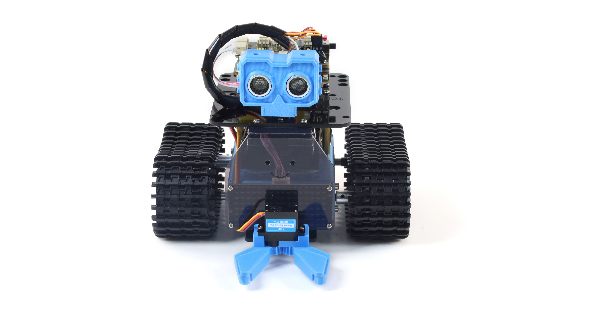
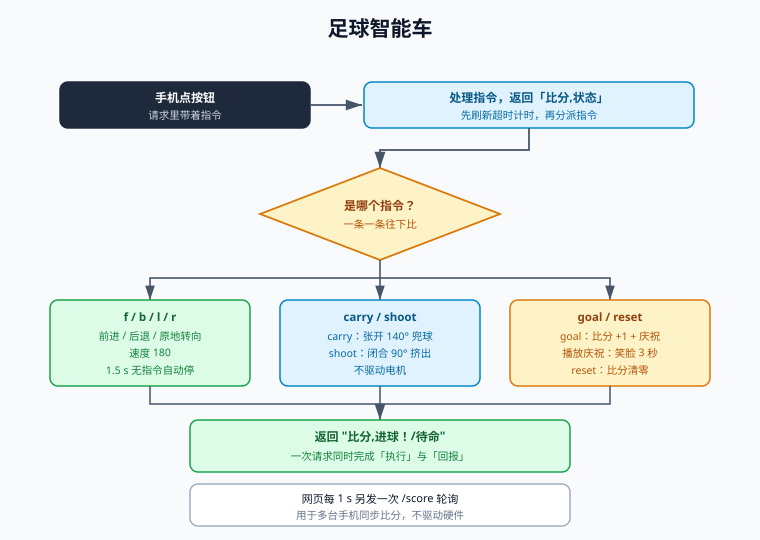

### 项目 16：足球智能车

#### **1. 简介：**

两台车、一颗 3D 打印球、一个球门，这就是一场比赛。这一课做的不是「会跑的车」，而是「会比赛的车」：屏幕上有比分，进一个球点阵跳笑脸，三秒后恢复待机，随时能清零重开。

夹爪在这里的用法和上一课不一样。第 9 课是「张开、夹紧」两个姿态给人看，这一课是**兜球**和**射门**两个动作：张开 140° 时爪子形成一个开口朝前的兜，球被兜在里面可以带着跑；合到 90° 时两片爪往里收，把球从兜里挤出去——这就是射门。所以传球和射门都不是「夹」，是「兜」和「挤」。

比分和表情都在板子上维护，网页只负责显示和发指令。这个设计让比赛能离线进行：路由器断了，车照样能开、能进球，只是手机上看不到分数。


#### **2. 所需清单：**

本课用到的器件：

|     |     |     |
| :---: | :---: | :---: |
| {width=170px}<br><span style="font-size:0.85em">大型机械夹（半成品） ×1</span> | {width=170px}<br><span style="font-size:0.85em">3D 打印足球（直径 31.25mm） ×1</span> | {width=170px}<br><span style="font-size:0.85em">9G 舵机（180°，配十字臂） ×1</span> |
| {width=170px}<br><span style="font-size:0.85em">8×16 LED 点阵屏 ×1</span> | {width=170px}<br><span style="font-size:0.85em">DRV8835 电机扩展板 ×1</span> | {width=170px}<br><span style="font-size:0.85em">ESP32-S3 开发板 ×1</span> |
| {width=170px}<br><span style="font-size:0.85em">大型机械夹-发射套（左、右各一） ×1</span> | <span style="font-size:0.85em">2.4 GHz 无线路由器或手机热点 ×1</span> |  |
> ⚠️ **全部在第 2 章装好，本表只作对照，不用拆；下面的接线说明只标清接线方式，供对照，不必拆装。完整物料见 1.4 套件清单。**

#### **3. 参数：**

| 项目 | 参数 |
| --- | --- |
| 行驶速度 | 180 |
| 原地转速度 | 180 |
| 夹爪张开 | 140°（兜球） |
| 夹爪闭合 | 90°（射门） |
| 指令超时 | 1500 ms |
| 庆祝时长 | 3 s |
| 比分接口 | `/score` 返回「比分,状态」 |
| 网页轮询 | 1 s / 次 |

#### **4. 接线说明：**

| 模块 | 引脚 | 主控 GPIO |
| --- | --- | :---: |
| 左轮 AIN / AEN | 方向 / 调速 | IO38 / IO21 |
| 右轮 BIN / BEN | 方向 / 调速 | IO40 / IO41 |
| 夹爪舵机 | 信号 | IO11 |
| 点阵 | CLK / DIN | IO9 / IO8 |

这一课不用超声波、不用循迹、不用云台，只保留「走 + 夹 + 显示」。


**机械夹安装步骤**





#### **5. 流程图：**

网页发指令、板子执行、回头把比分和表情报给网页，三者构成一个闭环：



#### **6. 测试代码：**

> ⚠️ **上传代码前，先把 `mini_tracked_tank_robot.py`、`mini_tracked_tank_robot_web.py` 上传到板子的 `lib/` 目录**（方法见第 5.5 节），否则导入库时会报 `ImportError`。

```python
# 项目 16：足球智能车
# 接线：电机 40/41/38/21、夹爪舵机 11、点阵 9/8
# 现象：网页控制开车、带球、射门；进球点阵亮笑脸，比分实时同步

import network
import time
from mini_tracked_tank_robot import MiniTrackedTankRobot
from mini_tracked_tank_robot_web import WebServer

WIFI_SSID = '你的WiFi账号'
WIFI_PASS = '你的WiFi密码'

SPEED_RUN = 180
SPEED_TURN = 180
STOP_AFTER = 1500          # 指令超时（ms）自动停车

CLAW_OPEN = 140            # 张开：球兜在爪内
CLAW_CLOSE = 90            # 闭合：把球挤出去

FACE_EYES = 0
FACE_SMILE = 1

eyes = bytes([
    0x00, 0x00, 0x00, 0x00, 0x1C, 0x1C, 0x00, 0x00,
    0x00, 0x00, 0x1C, 0x1C, 0x00, 0x00, 0x00, 0x00
])
smile = bytes([
    0x00, 0x00, 0x1C, 0x02, 0x02, 0x02, 0x5C, 0x40,
    0x40, 0x5C, 0x02, 0x02, 0x02, 0x1C, 0x00, 0x00
])

INDEX_HTML = """<!DOCTYPE html><html><head>
<meta charset="utf-8">
<meta name="viewport" content="width=device-width,initial-scale=1,user-scalable=no">
<title>迷你履带坦克 足球车</title>
<style>
body{font-family:-apple-system,"Microsoft YaHei",sans-serif;text-align:center;
     background:#f2f3f5;margin:0;padding:14px}
.card{background:#fff;border-radius:14px;padding:14px;max-width:420px;margin:0 auto 12px}
h2{margin:2px 0 12px;font-size:19px}
.grid{display:grid;grid-template-columns:repeat(3,1fr);gap:9px}
button{height:66px;font-size:22px;border:none;border-radius:14px;color:#fff;
       user-select:none;-webkit-tap-highlight-color:transparent;touch-action:none}
.f{background:#4caf50}.b{background:#f44336}.l{background:#ff9800}
.r{background:#2196f3}.s{background:#607d8b}
.g{background:#009688}.w{background:#ff5722}.k{background:#795548}
.blank{background:transparent}
.score{font-size:40px;font-weight:700;color:#e53935;margin:6px 0}
p{font-size:13px;color:#888;margin:8px 0 0}
</style></head><body>

<div class="card">
<h2>比分</h2>
<div class="score" id="sc">0</div>
<p id="st">按住方向键开车</p>
</div>

<div class="card">
<h2>开车</h2>
<div class="grid">
<div class="blank"></div>
<button class="f" onpointerdown="go('f')" onpointerup="go('s')" onpointercancel="go('s')" onpointerleave="go('s')">↑</button>
<div class="blank"></div>
<button class="l" onpointerdown="go('l')" onpointerup="go('s')" onpointercancel="go('s')" onpointerleave="go('s')">←</button>
<button class="s" onclick="go('s')">■</button>
<button class="r" onpointerdown="go('r')" onpointerup="go('s')" onpointercancel="go('s')" onpointerleave="go('s')">→</button>
<div class="blank"></div>
<button class="b" onpointerdown="go('b')" onpointerup="go('s')" onpointercancel="go('s')" onpointerleave="go('s')">↓</button>
<div class="blank"></div>
</div>
</div>

<div class="card">
<h2>夹爪</h2>
<div class="grid" style="grid-template-columns:repeat(2,1fr)">
<button class="g" onclick="go('carry')">带球</button>
<button class="w" onclick="go('shoot')">射门</button>
</div>
<div class="grid" style="grid-template-columns:repeat(2,1fr);margin-top:9px">
<button class="k" onclick="go('goal')">记一球</button>
<button class="k" onclick="go('reset')">比分清零</button>
</div>
<p>按「带球」夹爪张开，球兜在爪内；按「射门」夹爪闭合，把球挤出去</p>
</div>

<script>
function go(d){
  fetch('/cmd?d='+d).then(function(r){return r.text();}).then(function(t){
    if(t.indexOf(',')>0){
      var a=t.split(',');
      document.getElementById('sc').innerText=a[0];
      document.getElementById('st').innerText=a[1];
    }
  }).catch(function(){});
}
function tick(){
  fetch('/score').then(function(r){return r.text();}).then(function(t){
    document.getElementById('sc').innerText=t.split(',')[0];
  }).catch(function(){});
}
setInterval(tick,1000);
</script>
</body></html>"""

car = MiniTrackedTankRobot()
car.Motor_init()
car.Claw_init(11)
car.Matrix_init(9, 8)
car.Claw_set_angle(CLAW_OPEN)
car.stop_motor()

score = 0
last_cmd = time.ticks_ms()
smile_until = 0
cur_face = -1

def show_face(face):
    # 只在表情变化时写屏，避免频繁占用总线
    global cur_face
    if face == cur_face:
        return
    cur_face = face
    if face == FACE_EYES:
        car.Matrix_display(eyes)
    else:
        car.Matrix_display(smile)

def face_name():
    return '进球！' if cur_face == FACE_SMILE else '待命'

def run_cmd(d):
    # 返回 "比分,状态"，网页一次请求就能同时刷新两处
    global score, last_cmd, smile_until

    last_cmd = time.ticks_ms()

    if d == 'f':
        car.forward(SPEED_RUN, SPEED_RUN)
    elif d == 'b':
        car.back(SPEED_RUN, SPEED_RUN)
    elif d == 'l':
        car.left(SPEED_TURN, SPEED_TURN)
    elif d == 'r':
        car.right(SPEED_TURN, SPEED_TURN)
    elif d == 'carry':
        car.Claw_set_angle(CLAW_OPEN)
    elif d == 'shoot':
        car.Claw_set_angle(CLAW_CLOSE)
    elif d == 'goal':
        score += 1
        show_face(FACE_SMILE)
        smile_until = time.ticks_ms() + 3000
    elif d == 'reset':
        score = 0
    else:
        car.stop_motor()

    return '{},{}'.format(score, face_name())

def on_index(params):
    return INDEX_HTML

def on_cmd(params):
    return run_cmd(params.get('d', 's'))

def on_score(params):
    return '{},{}'.format(score, face_name())

# ==================== 连接 Wi-Fi ====================
wlan = network.WLAN(network.STA_IF)
wlan.active(True)
print('正在连接', WIFI_SSID)
wlan.connect(WIFI_SSID, WIFI_PASS)
while not wlan.isconnected():
    time.sleep(0.5)
    print('.', end='')
print()
print('板子的 IP：' + wlan.ifconfig()[0])

show_face(FACE_EYES)

server = WebServer(80)
server.route('/', on_index)
server.route('/cmd', on_cmd)
server.route('/score', on_score)

print('足球车已就绪')

while True:
    server.handle()

    # 超时没有指令就停车
    if time.ticks_diff(time.ticks_ms(), last_cmd) > STOP_AFTER:
        car.stop_motor()

    # 笑脸 3 秒后回待机表情
    if smile_until != 0 and time.ticks_ms() > smile_until:
        smile_until = 0
        show_face(FACE_EYES)
```

#### **7. 代码解释：**

**(1) 引入库与参数常量**

```python
import network
import time
from mini_tracked_tank_robot import MiniTrackedTankRobot
from mini_tracked_tank_robot_web import WebServer

WIFI_SSID = '你的WiFi账号'
WIFI_PASS = '你的WiFi密码'

SPEED_RUN = 180
SPEED_TURN = 180
STOP_AFTER = 1500          # 指令超时（ms）自动停车

CLAW_OPEN = 140            # 张开：球兜在爪内
CLAW_CLOSE = 90            # 闭合：把球挤出去

FACE_EYES = 0
FACE_SMILE = 1
```

这课第一次让车联网：`network` 负责连 Wi-Fi，`WebServer` 来自另一个板级库 `mini_tracked_tank_robot_web`，它替我们处理浏览器发来的 HTTP 请求，这两个库文件都要上传到板子的 `lib/`。速度、夹爪角度、表情编号都提成常量，想改手感只动这几个数字，不必到下面的指令分支里翻。`STOP_AFTER` 是失联保护：网页发一次指令只让车动 1.5 秒，之后自动停，避免手机断线后车一直往前冲。

**(2) 两张字模**

```python
eyes = bytes([
    0x00, 0x00, 0x00, 0x00, 0x1C, 0x1C, 0x00, 0x00,
    0x00, 0x00, 0x1C, 0x1C, 0x00, 0x00, 0x00, 0x00
])
smile = bytes([
    0x00, 0x00, 0x1C, 0x02, 0x02, 0x02, 0x5C, 0x40,
    0x40, 0x5C, 0x02, 0x02, 0x02, 0x1C, 0x00, 0x00
])
```

和第 1 课同一套 16 字节字模格式：每字节管一列，bit0 在顶行。`eyes` 是两只方眼（待机），`smile` 是进球笑脸。想换表情只改这 16 个字节，显示逻辑不用动。

**(3) 网页按钮怎么把指令送到板子**

```python
function go(d){
  fetch('/cmd?d='+d).then(function(r){return r.text();}).then(function(t){
    if(t.indexOf(',')>0){
      var a=t.split(',');
      document.getElementById('sc').innerText=a[0];
      document.getElementById('st').innerText=a[1];
    }
  }).catch(function(){});
}
function tick(){
  fetch('/score').then(function(r){return r.text();}).then(function(t){
    document.getElementById('sc').innerText=t.split(',')[0];
  }).catch(function(){});
}
setInterval(tick,1000);
```

网页不靠刷新页面通信，而是用 `fetch` 发请求：方向键的 `onpointerdown` 发动作、`onpointerup` 发停止（`go('s')`），所以是"按住走、松开停"，触屏和鼠标都能用。`go()` 把板子返回的 `比分,状态` 按逗号拆开，一次请求同时刷新比分和提示文字。`tick()` 每秒拉一次 `/score`，这样即使不是自己按键改的比分（比如别处记分），手机屏幕也会跟着更新——去掉这个定时器，比分只在自己按键时才变。

**(4) 建对象、初始化外设**

```python
car = MiniTrackedTankRobot()
car.Motor_init()
car.Claw_init(11)
car.Matrix_init(9, 8)
car.Claw_set_angle(CLAW_OPEN)
car.stop_motor()
```

建好 `car` 后依次初始化电机、夹爪舵机（信号脚 11）、点阵（CLK=9、DIN=8），最后把爪子张开、电机停住，保证上电第一帧是"待命"状态而不是上次的残留。换接线就改 `Claw_init` 和 `Matrix_init` 的参数。

**(5) 表情只在变化时写屏**

```python
def show_face(face):
    # 只在表情变化时写屏，避免频繁占用总线
    global cur_face
    if face == cur_face:
        return
    cur_face = face
    if face == FACE_EYES:
        car.Matrix_display(eyes)
    else:
        car.Matrix_display(smile)

def face_name():
    return '进球！' if cur_face == FACE_SMILE else '待命'
```

`cur_face` 记住当前表情，相同就直接 `return`：主循环每秒跑很多次，若每轮都 `Matrix_display` 会一直占用点阵总线、还可能闪烁。`face_name()` 把表情编号翻译成网页上的中文状态，和比分拼在一起返回。

**(6) 指令总分发 run_cmd**

```python
def run_cmd(d):
    # 返回 "比分,状态"，网页一次请求就能同时刷新两处
    global score, last_cmd, smile_until

    last_cmd = time.ticks_ms()

    if d == 'f':
        car.forward(SPEED_RUN, SPEED_RUN)
    elif d == 'b':
        car.back(SPEED_RUN, SPEED_RUN)
    elif d == 'l':
        car.left(SPEED_TURN, SPEED_TURN)
    elif d == 'r':
        car.right(SPEED_TURN, SPEED_TURN)
    elif d == 'carry':
        car.Claw_set_angle(CLAW_OPEN)
    elif d == 'shoot':
        car.Claw_set_angle(CLAW_CLOSE)
    elif d == 'goal':
        score += 1
        show_face(FACE_SMILE)
        smile_until = time.ticks_ms() + 3000
    elif d == 'reset':
        score = 0
    else:
        car.stop_motor()

    return '{},{}'.format(score, face_name())
```

网页指令在这里分流：`f/b/l/r` 开车；`carry/shoot` 只改夹爪角度——球是靠爪子往里收挤出去的，不是靠电机撞；`goal` 加分、点亮笑脸，并记下 3 秒后的时间点；其余（包括松开时的 `s`）一律停车。每个分支都先刷新 `last_cmd`，让主循环的超时计时从最后一次有效指令重新算。返回字符串的格式是和网页 `go()` 约定好的，改分隔符要两头一起改。

**(7) 连 Wi-Fi、注册三条路由**

```python
wlan = network.WLAN(network.STA_IF)
wlan.active(True)
print('正在连接', WIFI_SSID)
wlan.connect(WIFI_SSID, WIFI_PASS)
while not wlan.isconnected():
    time.sleep(0.5)
    print('.', end='')
print()
print('板子的 IP：' + wlan.ifconfig()[0])

show_face(FACE_EYES)

server = WebServer(80)
server.route('/', on_index)
server.route('/cmd', on_cmd)
server.route('/score', on_score)
```

连网这一段和第 13、14 课相同，不再重复解释。`STA_IF` 表示板子作为设备连进现有 Wi-Fi（不是自己开热点），`connect()` 之后轮询 `isconnected()` 等结果，没连上就一直打印点号。连上后用 `ifconfig()[0]` 打印 IP，手机浏览器要输这个地址。`WebServer(80)` 监听 80 端口，`route()` 把三条路径绑到三个回调：`/` 返回网页、`/cmd` 调 `run_cmd()` 执行动作、`/score` 回报比分。改 Wi-Fi 名称密码只改开头那两个常量。

**(8) 主循环：处理请求 + 两件后台事务**

```python
while True:
    server.handle()

    # 超时没有指令就停车
    if time.ticks_diff(time.ticks_ms(), last_cmd) > STOP_AFTER:
        car.stop_motor()

    # 笑脸 3 秒后回待机表情
    if smile_until != 0 and time.ticks_ms() > smile_until:
        smile_until = 0
        show_face(FACE_EYES)
```

`server.handle()` 必须每轮调用，它检查有没有浏览器请求并分发给路由；不调它网页就是死的。后面两件事都用"时间戳代替延时"：停车用 `ticks_diff()` 算距上次指令过了多久（用 `ticks_ms()` 而不是直接相减，跨计时溢出也安全）；笑脸到期回眼睛同理。这里不能用 `sleep(3)` 等笑脸结束，否则那 3 秒里主循环卡住，网页按键全部失灵。

#### **8. 运行现象：**

Shell 打印 `足球车已就绪`，点阵显示两只方眼（待机）。

| 操作 | 点阵 | 网页 |
| --- | --- | --- |
| 按方向键 | 不变（待机眼睛） | 车动 |
| 按「带球」 | 不变 | 夹爪张开，可兜球 |
| 按「射门」 | 不变 | 夹爪合拢，球被挤出 |
| 按「进球」 | 立即变笑脸，3 s 后回眼睛 | 比分 +1，显示「进球！」 |
| 按「清零」 | 不变 | 比分归 0 |

> 【图片待补】进球瞬间点阵笑脸与手机比分 +1 的同框截图。

比赛时的实际打法：

1. 「带球」张开爪子，把球兜进爪内。
2. 用方向键把球带到球门前，对准。
3. 按「射门」，爪子合拢把球挤出。
4. 球过门线后按「进球」，比分加一、点阵庆祝。

#### **9. 常见问题解决：**

**Wi-Fi 连不上、网页打不开，按这个顺序查：**

(1) **账号密码换了没有**：代码开头的 `WIFI_SSID`、`WIFI_PASS` 还是占位符就运行，一定连不上，改成自己路由器的名称和密码。

(2) **Shell 里一行字都没有**：按一下板子上的 RESET 键再试，可能是上一版程序卡住了。

{width=340px}

(3) **Shell 一直冒点、拿不到 IP**：Wi-Fi 连接失败。路由器必须是 **2.4 GHz**，5 GHz 板子不支持；没有 2.4 G 就开手机热点（热点默认 2.4 G）。

(4) **拿到 IP 但页面打不开**：地址要带 `http://`，IP 以 Shell 打印的为准；手机必须连同一个 Wi-Fi，两边 IP 前三段要一样。

(5) **网段对、还是打不开**：进路由器后台把「AP 隔离」关掉，开了它同一 Wi-Fi 下的设备互相访问不了。

(6) 一运行就报 `ImportError`，说找不到 `mini_tracked_tank_robot` 或 `mini_tracked_tank_robot_web`，是库文件没存到板子的 `lib/` 目录。用 Thonny 把这两个库文件另存到板子文件系统的 `lib/` 下，再「运行/保存到板子」就不会报错了。

(7) 射门时球往侧面跑，是车头没正对球门——夹爪是往里收的，两侧受力不均就会把球推向一边。倒车调整一下角度，正对了再按射门。

(8) 夹爪开合不对，检查 `CLAW_OPEN = 140` 和 `CLAW_CLOSE = 90` 有没有被改过；自己加代码时报 `NameError`，通常是这两个变量还没定义就用上了，回参数区确认一下。
