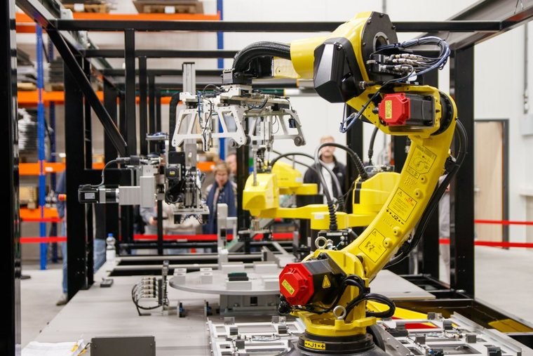
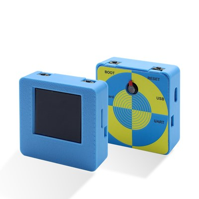
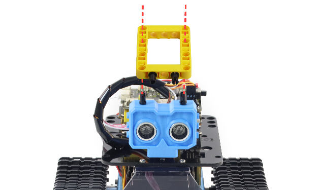
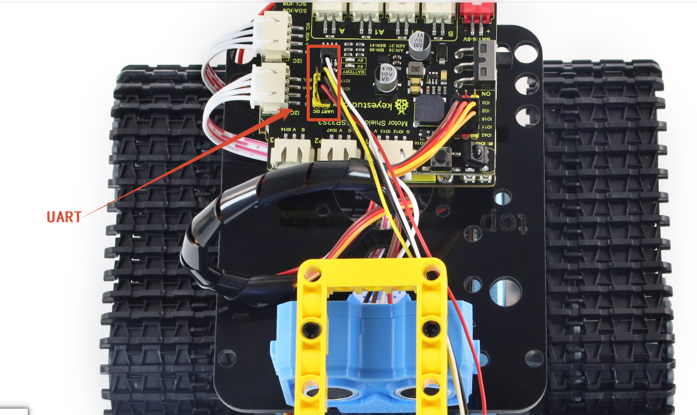
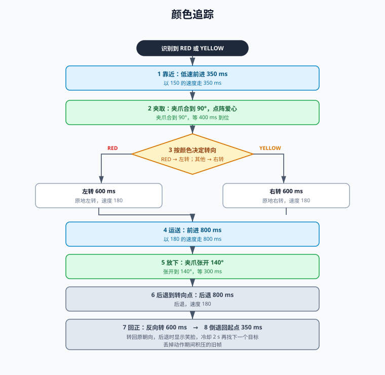

### 项目 17：AI 视觉模块：颜色追踪与抓取

#### **1. 简介：**

{width=520px}

从这一课起，车能看见颜色了。云台上那个小摄像头不是把画面传回来让主控算——它自己就是一台小电脑，识别在模块里做完，Shell 上只回一个词：RED 或者 YELLOW。

这一点决定了整课的样子：主控收到的是一行字，不是一张图，所以一块没有摄像头接口的板子也能做视觉任务。代价是它只说看到什么颜色，不说东西在哪，动作只能靠时间和速度凑。

流程因此是八步定长的：低速靠近 350 毫秒、停下、合爪夹起、按颜色左转或右转 600 毫秒、前进 800 毫秒送到投放区、张爪放下、原路退回、回正，最后再退 350 毫秒回到起点。

红色物块放在车前 20 厘米，车会自己走完这八步；换成黄色，第三步改成右转，其余一样。走完点阵回到笑脸，等下一个物块。

#### **2. 所需清单：**

本课用到的器件：

|     |     |     |
| :---: | :---: | :---: |
| {width=170px}<br><span style="font-size:0.85em">TinyVision AI 视觉摄像头 ×1</span> | {width=170px}<br><span style="font-size:0.85em">9G 舵机（180°） ×2</span> | {width=170px}<br><span style="font-size:0.85em">大型机械夹（半成品） ×1</span> |
| {width=170px}<br><span style="font-size:0.85em">超声波模块（带外壳） ×1</span> | {width=170px}<br><span style="font-size:0.85em">DRV8835 电机扩展板 ×1</span> | {width=170px}<br><span style="font-size:0.85em">8×16 LED 点阵屏 ×1</span> |
| {width=170px}<br><span style="font-size:0.85em">ESP32-S3 开发板 ×1</span> |  |  |

#### **3. 参数：**

| 项目 | 参数 |
| --- | --- |
| 模块 | TinyVision AI 摄像头 |
| 通信 | 硬件串口 2，9600 8N1 |
| 主控 RX / TX | IO18 / IO17 |
| 识别模式 | `color` |
| 回传格式 | `COLOR:RED` / `COLOR:YELLOW` / `COLOR:NONE` |
| 支持颜色 | 红、黄（模块内置） |
| 接近速度 | 150 |
| 转向 / 运送速度 | 180 |
| 接近时长 | 350 ms |
| 转向时长 | 600 ms |
| 运送时长 | 800 ms |

#### **4. 接线说明：**

后四课的模块都装在云台上、都跟着舵机转，只换镜头朝向：第 19、20 课用装法 B，镜头水平朝前；第 17、18 课用装法 A，镜头朝地面。换课前按 2.2.9 重装一次模块即可，UART 线接在扩展板右侧排针上，朝向变了也不用重接。

> **注意**：接线图中的元器件只用于说明接线关系，实际接线时不需要把清单中带外壳的元器件拆开。


| 视觉模块 | 主控 | 说明 |
| --- | :---: | --- |
| TX | IO18 | 模块发，主控收 |
| RX | IO17 | 主控发，模块收 |
| VCC | 5V | 模块供电 |
| GND | GND | 必须共地 |

| 信号 | 主控 GPIO |
| --- | :---: |
| 左轮 AIN / AEN | IO38 / IO21 |
| 右轮 BIN / BEN | IO40 / IO41 |
| 点阵 CLK / DIN | IO9 / IO8 |
| 云台舵机 | IO42 |
| 夹爪舵机 | IO11 |

**装法A：**







TX 接 RX、RX 接 TX，接成 TX-TX 也能通，但模块收不到主控的指令，`setMode()` 全部失效。Shell 打印**发送 -> MODE:COLOR**却毫无反应，就是这里接错了。

#### **5. 流程图：**

识别到颜色后的八步动作是顺序执行的，去程五步、回程三步：



#### **6. 测试代码：**

> ⚠️ **上传代码前，先把 `mini_tracked_tank_robot.py`、`aicam.py` 上传到板子的 `lib/` 目录**（方法见第 5.5 节），否则导入库时会报 `ImportError`。

```python
import time
from mini_tracked_tank_robot import MiniTrackedTankRobot
from aicam import AiCam

SPEED_RUN = 180
SPEED_TURN = 180
SPEED_APPROACH = 150

CLAW_OPEN = 140
CLAW_CLOSE = 90
PAN_CENTER = 90

T_APPROACH = 350           # 接近目标时长（ms）
T_TURN = 600               # 原地转 90° 时长（ms）
T_DELIVER = 800            # 运送时长（ms）

FACE_EYES = 0
FACE_SMILE = 1
FACE_HEART = 2

eyes = bytes([
    0x00, 0x00, 0x00, 0x00, 0x1C, 0x1C, 0x00, 0x00,
    0x00, 0x00, 0x1C, 0x1C, 0x00, 0x00, 0x00, 0x00
])
smile = bytes([
    0x00, 0x00, 0x1C, 0x02, 0x02, 0x02, 0x5C, 0x40,
    0x40, 0x5C, 0x02, 0x02, 0x02, 0x1C, 0x00, 0x00
])
heart = bytes([
    0x00, 0x00, 0x00, 0x00, 0x08, 0x1C, 0x3E, 0x7C,
    0x7C, 0x3E, 0x1C, 0x08, 0x00, 0x00, 0x00, 0x00
])

car = MiniTrackedTankRobot()
car.Motor_init()
car.Servo_init(42)
car.Claw_init(11)
car.Matrix_init(9, 8)

car.Servo_set_angle(PAN_CENTER)
car.Claw_set_angle(CLAW_OPEN)
car.stop_motor()

cam = AiCam()
cam.begin(tx=17, rx=18)
cam.setMode(cam.COLOR)

cur_face = -1


def show_face(face):
    global cur_face
    if face == cur_face:
        return
    cur_face = face
    if face == FACE_EYES:
        car.Matrix_display(eyes)
    elif face == FACE_SMILE:
        car.Matrix_display(smile)
    else:
        car.Matrix_display(heart)


def pick_and_deliver(color):
    # 去程：靠近 → 夹取 → 转向 → 运送 → 放下；回程按相反顺序退回起点
    print('1 低速靠近')
    car.forward(SPEED_APPROACH, SPEED_APPROACH)
    time.sleep_ms(T_APPROACH)
    car.stop_motor()

    print('2 夹取')
    car.Claw_set_angle(CLAW_CLOSE)
    time.sleep_ms(400)
    show_face(FACE_HEART)

    print('3 按颜色转向：红左、黄右')
    if color == 'RED':
        car.left(SPEED_TURN, SPEED_TURN)
    else:
        car.right(SPEED_TURN, SPEED_TURN)
    time.sleep_ms(T_TURN)
    car.stop_motor()

    print('4 运送')
    car.forward(SPEED_RUN, SPEED_RUN)
    time.sleep_ms(T_DELIVER)
    car.stop_motor()

    print('5 松爪卸货')
    car.Claw_set_angle(CLAW_OPEN)
    time.sleep_ms(300)

    print('6 倒回转向点')
    car.back(SPEED_RUN, SPEED_RUN)
    time.sleep_ms(T_DELIVER)
    car.stop_motor()

    print('7 回正')
    if color == 'RED':
        car.right(SPEED_TURN, SPEED_TURN)
    else:
        car.left(SPEED_TURN, SPEED_TURN)
    time.sleep_ms(T_TURN)
    car.stop_motor()

    print('8 倒回起点')
    car.back(SPEED_APPROACH, SPEED_APPROACH)
    time.sleep_ms(T_APPROACH)
    car.stop_motor()

    show_face(FACE_SMILE)
    print('投放完成，已回到起点')


show_face(FACE_EYES)
print('颜色追踪车已就绪，把红色或黄色物块放到车前')
time.sleep(1)

while True:
    cam.read()
    color = cam.color()

    # 没有目标，或不是红黄两色：停车等待
    if color not in ('RED', 'YELLOW'):
        car.stop_motor()
        show_face(FACE_EYES)
        time.sleep_ms(20)
        continue

    print('识别到目标：', color)
    show_face(FACE_SMILE)
    cam.clearColor()

    pick_and_deliver(color)

    cam.flush()                 # 丢掉动作期间积压的数据
    cam.clearColor()
    show_face(FACE_EYES)
    time.sleep(2)               # 冷却 2 秒再找下一个目标
```

#### **7. 代码解释：**

**(1) 引入库与定时参数**

```python
import time
from mini_tracked_tank_robot import MiniTrackedTankRobot
from aicam import AiCam

SPEED_RUN = 180
SPEED_TURN = 180
SPEED_APPROACH = 150

CLAW_OPEN = 140
CLAW_CLOSE = 90
PAN_CENTER = 90

T_APPROACH = 350           # 接近目标时长（ms）
T_TURN = 600               # 原地转 90° 时长（ms）
T_DELIVER = 800            # 运送时长（ms）

FACE_EYES = 0
FACE_SMILE = 1
FACE_HEART = 2
```

这课把视觉模块加进来：`AiCam` 来自 `aicam` 库，负责读取模块识别出的颜色。三个 `T_*` 是整课的关键——所有动作都不靠传感器确认"到了没有"，而是按"走多久、转多久"定时执行；场地尺寸或电池电压变了，主要调这三个数，其中 `T_TURN` 对应原地转 90°。

**(2) 三种表情字模**

```python
eyes = bytes([
    0x00, 0x00, 0x00, 0x00, 0x1C, 0x1C, 0x00, 0x00,
    0x00, 0x00, 0x1C, 0x1C, 0x00, 0x00, 0x00, 0x00
])
smile = bytes([
    0x00, 0x00, 0x1C, 0x02, 0x02, 0x02, 0x5C, 0x40,
    0x40, 0x5C, 0x02, 0x02, 0x02, 0x1C, 0x00, 0x00
])
heart = bytes([
    0x00, 0x00, 0x00, 0x00, 0x08, 0x1C, 0x3E, 0x7C,
    0x7C, 0x3E, 0x1C, 0x08, 0x00, 0x00, 0x00, 0x00
])
```

格式和第 1 课一样：16 字节对应 16 列，每字节 8 位对应一列 8 行。多出来的 `heart` 用于夹到球的瞬间，`smile` 表示任务完成，`eyes` 是待机。

**(3) 初始化板级外设与视觉模块**

```python
car = MiniTrackedTankRobot()
car.Motor_init()
car.Servo_init(42)
car.Claw_init(11)
car.Matrix_init(9, 8)

car.Servo_set_angle(PAN_CENTER)
car.Claw_set_angle(CLAW_OPEN)
car.stop_motor()

cam = AiCam()
cam.begin(tx=17, rx=18)
cam.setMode(cam.COLOR)
```

云台舵机接 42、夹爪接 11，先把云台摆正、爪子张开、电机停住。`cam.begin(tx=17, rx=18)` 配的是控制板一侧的串口脚号；按照上面的接线表交叉相连，模块 TX 接 IO18、模块 RX 接 IO17，波特率 9600。`setMode(cam.COLOR)` 让模块进入颜色识别模式，之后 `cam.color()` 才会返回颜色名——换识别任务就要换这里的模式，返回的数据结构也随之不同。

**(4) 表情显示去重**

```python
def show_face(face):
    global cur_face
    if face == cur_face:
        return
    cur_face = face
    if face == FACE_EYES:
        car.Matrix_display(eyes)
    elif face == FACE_SMILE:
        car.Matrix_display(smile)
    else:
        car.Matrix_display(heart)
```

和上一课同样的套路：`cur_face` 相同就直接返回，避免主循环每轮都写屏占用总线。三个编号分别选三张字模，else 兜底到爱心。

**(5) 定长搬运流程 pick_and_deliver**

```python
def pick_and_deliver(color):
    # 去程：靠近 → 夹取 → 转向 → 运送 → 放下；回程按相反顺序退回起点
    print('1 低速靠近')
    car.forward(SPEED_APPROACH, SPEED_APPROACH)
    time.sleep_ms(T_APPROACH)
    car.stop_motor()

    print('2 夹取')
    car.Claw_set_angle(CLAW_CLOSE)
    time.sleep_ms(400)
    show_face(FACE_HEART)

    print('3 按颜色转向：红左、黄右')
    if color == 'RED':
        car.left(SPEED_TURN, SPEED_TURN)
    else:
        car.right(SPEED_TURN, SPEED_TURN)
    time.sleep_ms(T_TURN)
    car.stop_motor()

    print('4 运送')
    car.forward(SPEED_RUN, SPEED_RUN)
    time.sleep_ms(T_DELIVER)
    car.stop_motor()

    print('5 松爪卸货')
    car.Claw_set_angle(CLAW_OPEN)
    time.sleep_ms(300)

    print('6 倒回转向点')
    car.back(SPEED_RUN, SPEED_RUN)
    time.sleep_ms(T_DELIVER)
    car.stop_motor()

    print('7 回正')
    if color == 'RED':
        car.right(SPEED_TURN, SPEED_TURN)
    else:
        car.left(SPEED_TURN, SPEED_TURN)
    time.sleep_ms(T_TURN)
    car.stop_motor()

    print('8 倒回起点')
    car.back(SPEED_APPROACH, SPEED_APPROACH)
    time.sleep_ms(T_APPROACH)
    car.stop_motor()

    show_face(FACE_SMILE)
    print('投放完成，已回到起点')
```

这是整课的核心：去程是"低速靠近 → 夹爪闭合 → 按颜色左/右转 → 前进运送 → 松爪卸货"，回程把去程倒着走一遍——后退、反向转回正、再后退到起点，这样车能回到出发位置接着找下一个球。每步靠 `sleep_ms(T_*)` 定时，没有用传感器确认"真夹到了/真到了目的地"，所以场地和摩擦变了要调那几个时长常量；夹爪闭合后那 400 ms 是专门留给舵机转动的。红球左转、黄球右转由 `color == 'RED'` 决定，想改颜色分工就改这两处判断（第 3 步和第 7 步要一起改，否则回不了正）。

**(6) 主循环：只认红黄两色**

```python
while True:
    cam.read()
    color = cam.color()

    # 没有目标，或不是红黄两色：停车等待
    if color not in ('RED', 'YELLOW'):
        car.stop_motor()
        show_face(FACE_EYES)
        time.sleep_ms(20)
        continue

    print('识别到目标：', color)
    show_face(FACE_SMILE)
    cam.clearColor()
```

每轮先 `cam.read()` 取模块这一帧的数据，再用 `cam.color()` 拿颜色结果。`clearColor()` 不能省：模块会把上次识别结果一直保留，不清掉的话球搬走后还会读到旧颜色，车会反复执行同一个任务。只放行 `RED` 和 `YELLOW`，其他颜色或没识别到就停车待命。

**(7) 执行后的清理与冷却**

```python
    pick_and_deliver(color)

    cam.flush()                 # 丢掉动作期间积压的数据
    cam.clearColor()
    show_face(FACE_EYES)
    time.sleep(2)               # 冷却 2 秒再找下一个目标
```

整套动作要两三秒，这期间模块仍在不停回传数据。`cam.flush()` 把积压的帧丢掉，否则回来第一帧读到的是动作途中的旧画面；再 `clearColor()` 清掉旧颜色、恢复待机表情、`sleep(2)` 冷却，避免刚放下就立刻扑向同一个球。

#### **8. 运行现象：**

上电后Shell 打印：

```text
视觉模块串口已启动
发送 -> GET:MODE
发送 -> GET:OUTPUT
发送 -> MODE:COLOR
颜色追踪车已就绪，把红色或黄色物块放到车前
```

把红色物块放到车前 20 cm，车会：

| 步骤 | 串口 | 动作 |
| --- | --- | --- |
| 1 | 识别到目标：RED | 点阵笑脸，低速前进 350 ms |
| 2 | 1 靠近 | 停 |
| 3 | 2 夹取 | 夹爪合到 90°，点阵爱心 |
| 4 | 3 转向投放区 | 左转 600 ms |
| 5 | 4 运送 | 前进 800 ms |
| 6 | 5 放下 | 夹爪张开 |
| 7 | 6 后退到转向点 | 后退 800 ms |
| 8 | 7 回正 | 右转 600 ms |
| 9 | 8 后退回起点 | 后退 350 ms |
| 10 | 投放完成，已回到起点 | 点阵笑脸 |

黄色物块走同样的流程，只是第三步改成右转。

> 【图片待补】Shell 打印完整十步流程的截图。

#### **9. 常见问题解决：**

(1) Thonny 下方的 Shell 一直看不到识别结果，或者 `AiCam` 初始化就报错、Shell 读不到数据，先别急着改代码——检查视觉模块的 TX 接没接 IO18、RX 接没接 IO17，两根要交叉接，波特率 9600。模块完全没回复、报 `OSError: [Errno 19] ENODEV`，多半是线松了或接反了；如果报的是 `OSError` 说引脚被占用，那是 IO18/IO17 被别处复用，把那处去掉再**运行/保存到板子**。

(2) Shell 一直打印**识别到目标**车却不动，看看 `T_APPROACH` 是不是被改成了 0，接近动作没时长车自然不走；再量量电池，电压不够电机带不动，换块满电的试试。

(3) 抓空是 `T_APPROACH = 350` 这个定长动作的老毛病——地毯上摩擦大，350 ms 走不到位，可以加到 500 ms 再试。它本质是按时间估距离，想更稳得加超声波做闭环。

(4) 认错颜色是模块对光照敏感，暖色灯下黄色容易被当成红色。换成白光灯或拿到自然光下再测，别在偏色灯光旁边跑。
