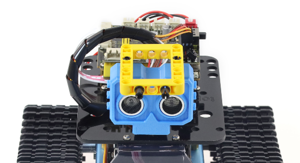
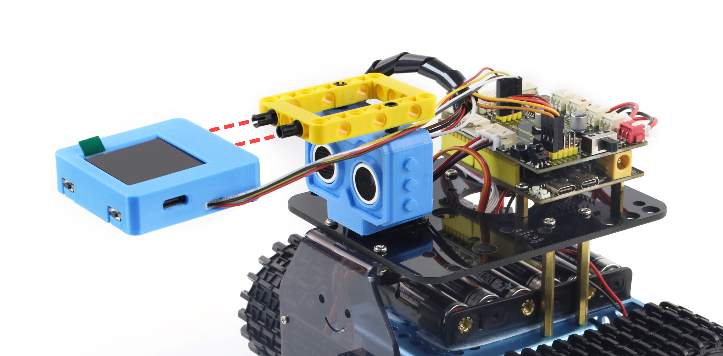
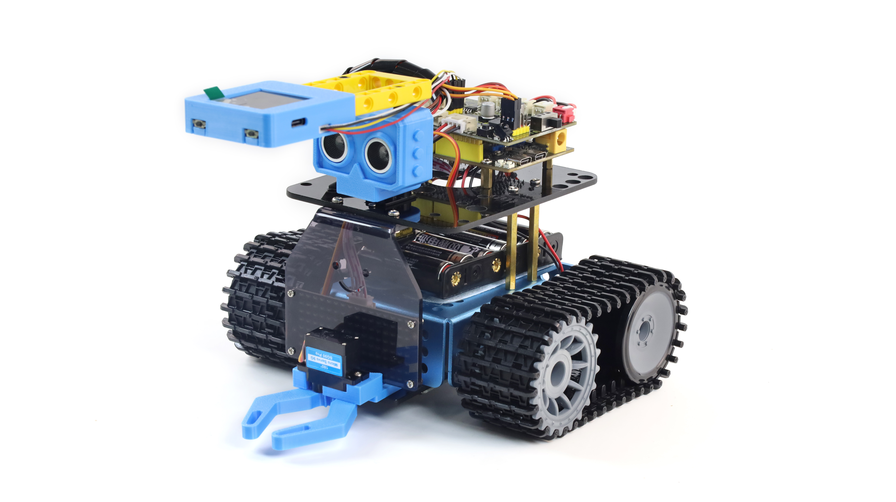
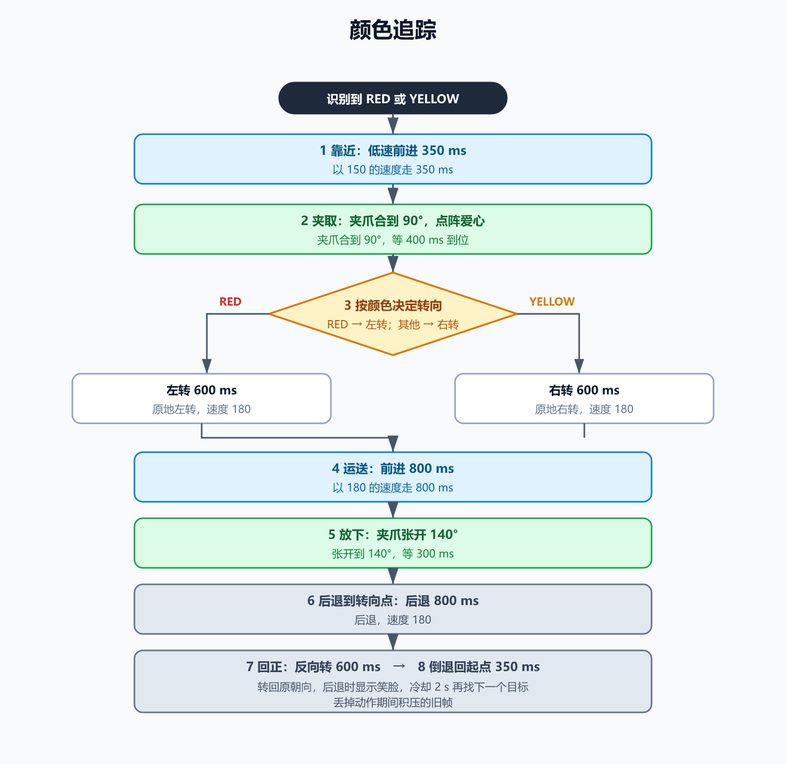

### Project 17: AI Vision Module: Color Tracking and Picking

#### **1. Introduction:**


From this lesson on, the car can see colors. The small camera on the pan-tilt does not send the picture back for the controller to process — it is a small computer in its own right, doing the recognition inside the module and returning a single word to the Shell: RED or YELLOW.

This shapes the whole lesson: the controller receives a line of text, not an image, so even a board without a camera interface can do vision tasks. The price is that the module only says which color it sees, not where the object is, so the motions can only be approximated with time and speed.

The sequence is therefore eight fixed-length steps: approach slowly for 350 milliseconds, stop, close the claw to grip, turn left or right for 600 milliseconds depending on the color, drive forward for 800 milliseconds to the drop zone, open the claw to release, reverse back along the same path, straighten up, and finally reverse for another 350 milliseconds to the starting point.

Place a red block 20 cm in front of the car and it will run through these eight steps by itself; with a yellow block the third step becomes a right turn and everything else is the same. When it finishes, the matrix returns to a smiley and waits for the next block.

#### **2. Parts List:**
Components used in this lesson:

|     |     |     |
| :---: | :---: | :---: |
| <br><span style="font-size:0.85em">TinyVision AI vision camera ×1</span> | <br><span style="font-size:0.85em">9G servo (180°) ×2</span> | <br><span style="font-size:0.85em">Large mechanical claw (semi-finished) ×1</span> |
| <br><span style="font-size:0.85em">Ultrasonic module ×1</span> | <br><span style="font-size:0.85em">DRV8835 motor expansion board ×1</span> | <br><span style="font-size:0.85em">8×16 LED dot matrix display ×1</span> |
| <br><span style="font-size:0.85em">ESP32-S3 development board ×1</span> |  |  |

#### **3. Parameters:**
| Item | Parameter |
| --- | --- |
| Module | TinyVision AI camera |
| Communication | Hardware serial port 2, 9600 8N1 |
| Controller RX / TX | IO18 / IO17 |
| Recognition mode | `color` |
| Return format | `COLOR:RED` / `COLOR:YELLOW` / `COLOR:NONE` |
| Approach speed | 150 |
| Turning / delivery speed | 180 |
| Approach duration | 350 ms |
| Turning duration | 600 ms |
| Delivery duration | 800 ms |

#### **4. Wiring:**

The modules of the last four lessons are all mounted on the pan-tilt and turn with the servo, and only the lens direction changes: Lessons 19 and 20 use mounting method B with the lens facing horizontally forward, while Lessons 17 and 18 use mounting method A with the lens facing the ground. Remount the module as described in 2.2.9 when switching lessons, and the UART wires stay on the pin header on the right side of the expansion board, so they do not need reconnecting when the orientation changes.

> **Note**: the components in the wiring diagram only illustrate the connections; there is no need to take a cased module apart for the actual wiring.


| Vision module | Controller | Description |
| --- | :---: | --- |
| TX | IO18 | Module sends, controller receives |
| RX | IO17 | Controller sends, module receives |
| VCC | 5V | Module power supply |
| GND | GND | Common ground required |

| Signal | Controller GPIO |
| --- | :---: |
| Left wheel AIN / AEN | IO38 / IO21 |
| Right wheel BIN / BEN | IO40 / IO41 |
| Matrix CLK / DIN | IO9 / IO8 |
| Pan servo | IO42 |
| Claw servo | IO11 |

**Mounting method A:**









TX goes to RX and RX to TX. A TX-to-TX connection also links up, but the module never receives the controller's commands and every `setMode()` call is silently lost. Calling `cam.setMode(cam.COLOR)` with no reaction from the module at all is the sign of this mistake.

#### **5. Flowchart:**

Once a color is recognized the eight steps run in sequence, five on the way out and three on the way back:



#### **6. Test Code:**
> ⚠️ **Before uploading the code, upload `mini_tracked_tank_robot.py` and `aicam.py` to the `lib/` directory on the board** (see Section 5.5), otherwise importing the library raises `ImportError`.

```python
import time
from mini_tracked_tank_robot import MiniTrackedTankRobot
from aicam import AiCam

SPEED_RUN = 180
SPEED_TURN = 180
SPEED_APPROACH = 150

CLAW_OPEN = 140
CLAW_CLOSE = 90
PAN_CENTER = 90

T_APPROACH = 350           # Approach time (ms)
T_TURN = 600               # Time to turn 90 deg in place (ms)
T_DELIVER = 800            # Delivery time (ms)

FACE_EYES = 0
FACE_SMILE = 1
FACE_HEART = 2

eyes = bytes([
    0x00, 0x00, 0x00, 0x00, 0x1C, 0x1C, 0x00, 0x00,
    0x00, 0x00, 0x1C, 0x1C, 0x00, 0x00, 0x00, 0x00
])
smile = bytes([
    0x00, 0x00, 0x1C, 0x02, 0x02, 0x02, 0x5C, 0x40,
    0x40, 0x5C, 0x02, 0x02, 0x02, 0x1C, 0x00, 0x00
])
heart = bytes([
    0x00, 0x00, 0x00, 0x00, 0x08, 0x1C, 0x3E, 0x7C,
    0x7C, 0x3E, 0x1C, 0x08, 0x00, 0x00, 0x00, 0x00
])

car = MiniTrackedTankRobot()
car.Motor_init()
car.Servo_init(42)
car.Claw_init(11)
car.Matrix_init(9, 8)

car.Servo_set_angle(PAN_CENTER)
car.Claw_set_angle(CLAW_OPEN)
car.stop_motor()

cam = AiCam()
cam.begin(tx=17, rx=18)
cam.setMode(cam.COLOR)

cur_face = -1


def show_face(face):
    global cur_face
    if face == cur_face:
        return
    cur_face = face
    if face == FACE_EYES:
        car.Matrix_display(eyes)
    elif face == FACE_SMILE:
        car.Matrix_display(smile)
    else:
        car.Matrix_display(heart)


def pick_and_deliver(color):
    # Outbound: approach -> grab -> turn -> deliver -> release; return to the start in reverse order
    print('1 Approaching slowly')
    car.forward(SPEED_APPROACH, SPEED_APPROACH)
    time.sleep_ms(T_APPROACH)
    car.stop_motor()

    print('2 Grabbing')
    car.Claw_set_angle(CLAW_CLOSE)
    time.sleep_ms(400)
    show_face(FACE_HEART)

    print('3 Turning by color: red left, yellow right')
    if color == 'RED':
        car.left(SPEED_TURN, SPEED_TURN)
    else:
        car.right(SPEED_TURN, SPEED_TURN)
    time.sleep_ms(T_TURN)
    car.stop_motor()

    print('4 Delivering')
    car.forward(SPEED_RUN, SPEED_RUN)
    time.sleep_ms(T_DELIVER)
    car.stop_motor()

    print('5 Opening the claw to unload')
    car.Claw_set_angle(CLAW_OPEN)
    time.sleep_ms(300)

    print('6 Reversing to the turning point')
    car.back(SPEED_RUN, SPEED_RUN)
    time.sleep_ms(T_DELIVER)
    car.stop_motor()

    print('7 Turning back straight')
    if color == 'RED':
        car.right(SPEED_TURN, SPEED_TURN)
    else:
        car.left(SPEED_TURN, SPEED_TURN)
    time.sleep_ms(T_TURN)
    car.stop_motor()

    print('8 Reversing to the start')
    car.back(SPEED_APPROACH, SPEED_APPROACH)
    time.sleep_ms(T_APPROACH)
    car.stop_motor()

    show_face(FACE_SMILE)
    print('Delivery finished, back at the start')


show_face(FACE_EYES)
print('Color tracking car ready, place a red or yellow block in front of the car')
time.sleep(1)

while True:
    cam.read()
    color = cam.color()

    # No target, or not red or yellow: stop and wait
    if color not in ('RED', 'YELLOW'):
        car.stop_motor()
        show_face(FACE_EYES)
        time.sleep_ms(20)
        continue

    print('Target detected: ', color)
    show_face(FACE_SMILE)
    cam.clearColor()

    pick_and_deliver(color)

    cam.flush()                 # Discard the data buffered during the manoeuvre
    cam.clearColor()
    show_face(FACE_EYES)
    time.sleep(2)               # Cool down for 2 seconds before looking for the next target
```

#### **7. Code Explanation:**
**(1) Importing the libraries and the timing parameters**

```python
import time
from mini_tracked_tank_robot import MiniTrackedTankRobot
from aicam import AiCam

SPEED_RUN = 180
SPEED_TURN = 180
SPEED_APPROACH = 150

CLAW_OPEN = 140
CLAW_CLOSE = 90
PAN_CENTER = 90

T_APPROACH = 350           # Approach time (ms)
T_TURN = 600               # Time to turn 90 deg in place (ms)
T_DELIVER = 800            # Delivery time (ms)

FACE_EYES = 0
FACE_SMILE = 1
FACE_HEART = 2
```

This lesson adds the vision module: `AiCam` comes from the `aicam` library and reads the color the module has recognized. The three `T_*` values are the key to the whole lesson — no motion is confirmed by a sensor ("have I arrived?"), everything is timed as "drive this long, turn that long"; if the field size or the battery voltage changes, these three numbers are the main thing to tune, and `T_TURN` corresponds to a 90° pivot.

**(2) Three expression bitmaps**

```python
eyes = bytes([
    0x00, 0x00, 0x00, 0x00, 0x1C, 0x1C, 0x00, 0x00,
    0x00, 0x00, 0x1C, 0x1C, 0x00, 0x00, 0x00, 0x00
])
smile = bytes([
    0x00, 0x00, 0x1C, 0x02, 0x02, 0x02, 0x5C, 0x40,
    0x40, 0x5C, 0x02, 0x02, 0x02, 0x1C, 0x00, 0x00
])
heart = bytes([
    0x00, 0x00, 0x00, 0x00, 0x08, 0x1C, 0x3E, 0x7C,
    0x7C, 0x3E, 0x1C, 0x08, 0x00, 0x00, 0x00, 0x00
])
```

The format is the same as in Lesson 1: 16 bytes for 16 columns, with the 8 bits of each byte covering the 8 rows of a column. The extra `heart` is for the moment the block is gripped, `smile` means the task is complete and `eyes` is standby.

**(3) Initializing the board-level peripherals and the vision module**

```python
car = MiniTrackedTankRobot()
car.Motor_init()
car.Servo_init(42)
car.Claw_init(11)
car.Matrix_init(9, 8)

car.Servo_set_angle(PAN_CENTER)
car.Claw_set_angle(CLAW_OPEN)
car.stop_motor()

cam = AiCam()
cam.begin(tx=17, rx=18)
cam.setMode(cam.COLOR)
```

The pan servo is on 42 and the claw on 11, and the pan is centered, the claw opened and the motors stopped first. `cam.begin(tx=17, rx=18)` takes the serial pin numbers on the controller side; with the crossing wiring in the table above, the module's TX goes to IO18 and its RX to IO17, at 9600 baud. `setMode(cam.COLOR)` puts the module into color recognition mode, and only then does `cam.color()` return a color name — a different recognition task means a different mode here, and the returned data structure changes with it.

**(4) Deduplicating the expression display**

```python
def show_face(face):
    global cur_face
    if face == cur_face:
        return
    cur_face = face
    if face == FACE_EYES:
        car.Matrix_display(eyes)
    elif face == FACE_SMILE:
        car.Matrix_display(smile)
    else:
        car.Matrix_display(heart)
```

Same approach as the previous lesson: return straight away when `cur_face` is unchanged, so the main loop does not occupy the bus by writing to the display every round. The three codes pick three bitmaps, with the `else` branch falling back to the heart.

**(5) The fixed-length handling routine pick_and_deliver**

```python
def pick_and_deliver(color):
    # Outbound: approach -> grab -> turn -> deliver -> release; return to the start in reverse order
    print('1 Approaching slowly')
    car.forward(SPEED_APPROACH, SPEED_APPROACH)
    time.sleep_ms(T_APPROACH)
    car.stop_motor()

    print('2 Grabbing')
    car.Claw_set_angle(CLAW_CLOSE)
    time.sleep_ms(400)
    show_face(FACE_HEART)

    print('3 Turning by color: red left, yellow right')
    if color == 'RED':
        car.left(SPEED_TURN, SPEED_TURN)
    else:
        car.right(SPEED_TURN, SPEED_TURN)
    time.sleep_ms(T_TURN)
    car.stop_motor()

    print('4 Delivering')
    car.forward(SPEED_RUN, SPEED_RUN)
    time.sleep_ms(T_DELIVER)
    car.stop_motor()

    print('5 Opening the claw to unload')
    car.Claw_set_angle(CLAW_OPEN)
    time.sleep_ms(300)

    print('6 Reversing to the turning point')
    car.back(SPEED_RUN, SPEED_RUN)
    time.sleep_ms(T_DELIVER)
    car.stop_motor()

    print('7 Turning back straight')
    if color == 'RED':
        car.right(SPEED_TURN, SPEED_TURN)
    else:
        car.left(SPEED_TURN, SPEED_TURN)
    time.sleep_ms(T_TURN)
    car.stop_motor()

    print('8 Reversing to the start')
    car.back(SPEED_APPROACH, SPEED_APPROACH)
    time.sleep_ms(T_APPROACH)
    car.stop_motor()

    show_face(FACE_SMILE)
    print('Delivery finished, back at the start')
```

This is the core of the lesson: the outbound trip is "approach slowly, close the claw, turn left or right by color, drive forward to deliver, open the claw"; the return trip walks the outbound trip backwards — reverse, turn back the other way to straighten up, reverse again to the start — so the car ends up at its starting position and can look for the next block. Every step is timed with `sleep_ms(T_*)`, and no sensor confirms "did I really grip it" or "am I really there", so if the surface or friction changes these duration constants need adjusting; the 400 ms after closing the claw is set aside for the servo to travel. Red turning left and yellow turning right is decided by `color == 'RED'`, so to swap the color duties change both checks (steps 3 and 7 must change together, otherwise the car cannot straighten up).

**(6) The main loop: accepting only red and yellow**

```python
while True:
    cam.read()
    color = cam.color()

    # No target, or not red or yellow: stop and wait
    if color not in ('RED', 'YELLOW'):
        car.stop_motor()
        show_face(FACE_EYES)
        time.sleep_ms(20)
        continue

    print('Target detected: ', color)
    show_face(FACE_SMILE)
    cam.clearColor()
```

Each round calls `cam.read()` to fetch the module's frame and then `cam.color()` for the color result. `clearColor()` cannot be skipped: the module keeps the last recognition result, so without clearing it the car would still read the old color after the block is gone and would repeat the same task forever. Only `RED` and `YELLOW` are accepted; anything else, or nothing recognized, stops the car in standby.

**(7) Clean-up and cool-down after each run**

```python
    pick_and_deliver(color)

    cam.flush()                 # Discard the data buffered during the manoeuvre
    cam.clearColor()
    show_face(FACE_EYES)
    time.sleep(2)               # Cool down for 2 seconds before looking for the next target
```

The whole sequence takes two or three seconds, during which the module keeps streaming data. `cam.flush()` throws away the backlog, otherwise the first frame read afterwards would be a stale picture from mid-motion; then `clearColor()` drops the old color, the standby expression returns and `sleep(2)` cools down, so the car does not pounce on the same block it has just released.

#### **8. Expected Behavior:**
The Shell prints after power-on:

```text
Color tracking car ready, place a red or yellow block in front of the car
```

With a red block 20 cm in front of the car, the following sequence runs:

| Step | Shell output | Action |
| --- | --- | --- |
| 1 | Target detected:  RED | Smiley on the matrix, creep forward for 350 ms |
| 2 | 1 Approaching slowly | Stop |
| 3 | 2 Grabbing | Claw closes to 90°, heart on the matrix |
| 4 | 3 Turning by color: red left, yellow right | Turn left for 600 ms |
| 5 | 4 Delivering | Drive forward for 800 ms |
| 6 | 5 Opening the claw to unload | Claw opens |
| 7 | 6 Reversing to the turning point | Reverse for 800 ms |
| 8 | 7 Straightening up | Turn right for 600 ms |
| 9 | 8 Reversing to start | Reverse for 350 ms |
| 10 | Delivery complete, back at start | Smiley on the matrix |

A yellow block goes through the same sequence, except that step 3 turns right.

> [Image to be added] A screenshot of the Shell printing the complete ten-step sequence.

#### **9. Troubleshooting:**

(1) If the Shell below Thonny never shows a recognition result, or `AiCam` raises an error on initialization and no data arrives, do not start editing the code — check first that the vision module's TX goes to IO18 and its RX to IO17, that the two wires are crossed, and that the baud rate is 9600. A module that never replies and reports `OSError: [Errno 19] ENODEV` is usually a loose or reversed wire; an `OSError` saying the pin is in use means IO18/IO17 are used elsewhere, so remove that and **Run/Save to the board** again.

(2) If the Shell keeps printing **Target detected** but the car does not move, check whether `T_APPROACH` has been set to 0 — with no duration the approach never runs; then check the battery, since the motors cannot move at low voltage, and try a fully charged pack.

(3) Missing the block is the old weakness of the fixed `T_APPROACH = 350` step: on carpet the friction is higher and 350 ms is not enough, so try 500 ms. It is essentially estimating distance by time; closing the loop with the ultrasonic sensor would be steadier.

(4) Recognizing the wrong color means the module is sensitive to lighting, and yellow is easily taken for red under warm lamps. Test under white light or daylight, and do not run it next to strongly tinted lighting.
