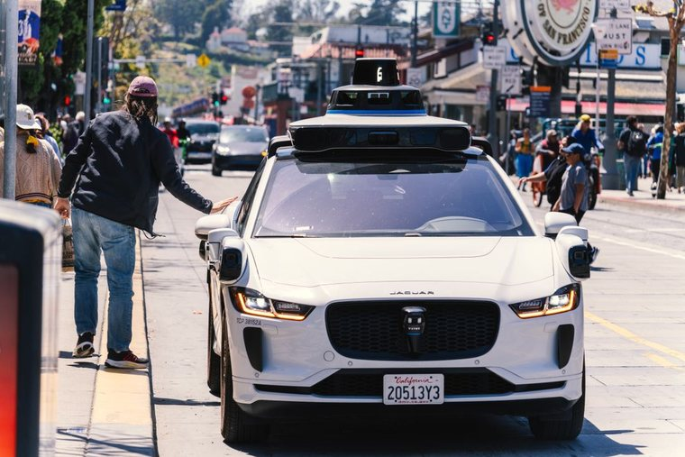
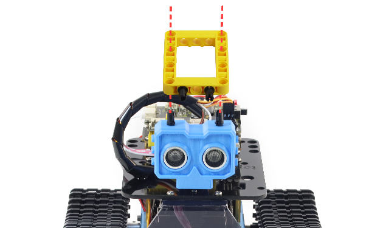
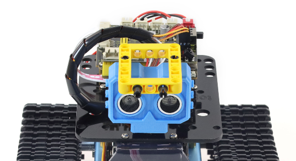
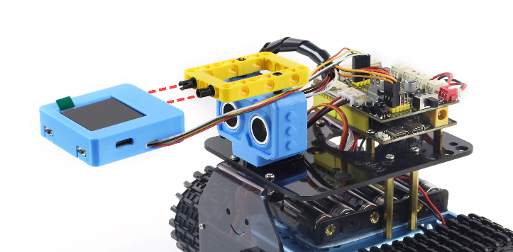
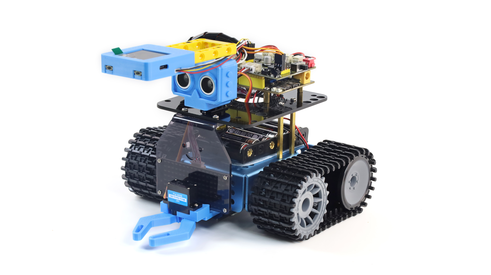
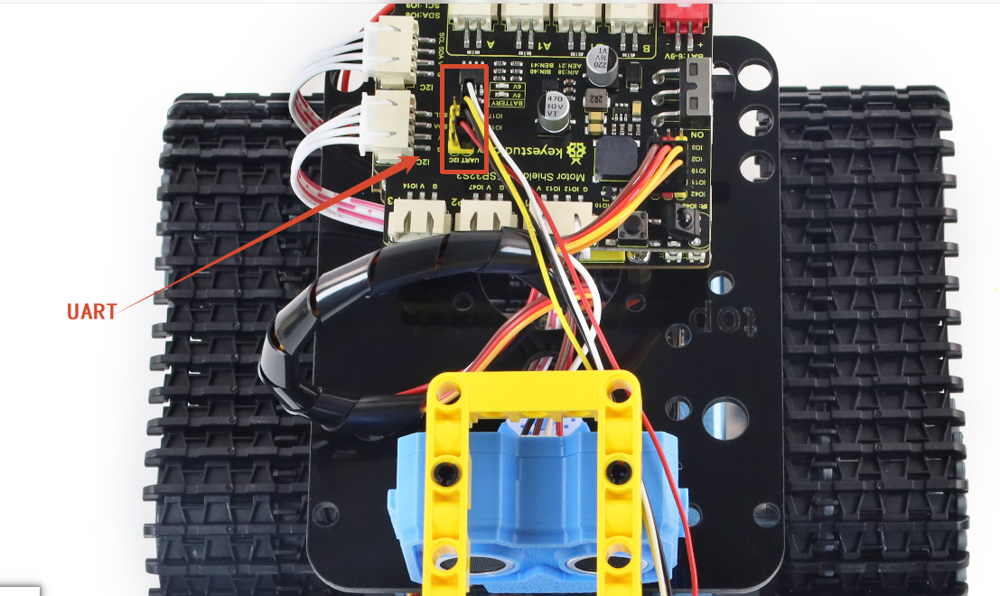
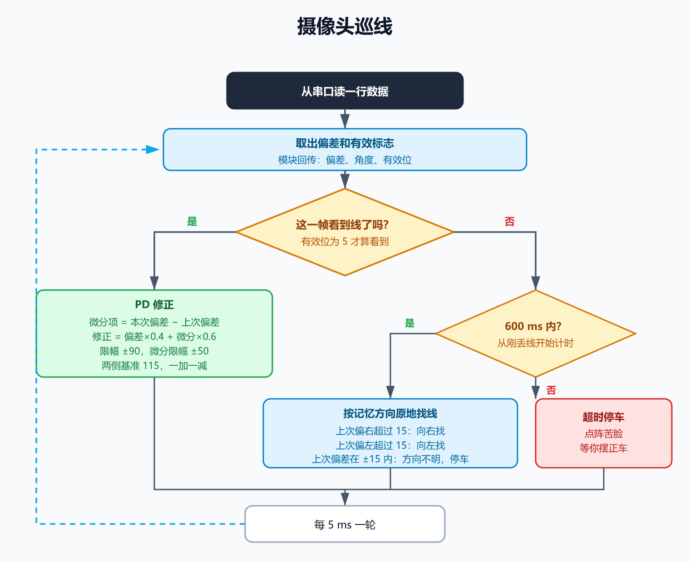

### Project 18: AI Vision Module: Camera Line Following

#### **1. Introduction:**



Lesson 7 followed the line with five infrared probes mounted close to the ground; here the eyes are lifted — a camera looks at the line instead. With the lens facing the ground it sees the line a dozen centimetres ahead of the car, further than probes mounted down low, so it can start steering earlier.

What the module returns is not an image but three numbers: offset, angle and a valid flag. The offset says how far the line is from the center of the picture, the angle says how much the line is skewed and a valid flag of 5 means this frame really did see the line. With those two quantities we can work out how much the wheel speeds have to differ.

The correction is proportional plus derivative: a large offset means steering harder, a small offset means a gentle nudge; one more term looks at how fast the offset is changing and damps it early, so the body does not overshoot the center line and swing back and forth. The straight-line base speed is 130 and the correction is capped at ±90.

After power-on the matrix shows a pair of eyes and only turns into a smiley and starts following once the line enters the view; when the line leaves the picture it searches in place in the remembered direction, carries on if it finds the line again, and otherwise stops and switches to a sad face.

#### **2. Parts List:**
Components used in this lesson:

|     |     |     |
| :---: | :---: | :---: |
| <br><span style="font-size:0.85em">TinyVision AI vision camera ×1</span> | <br><span style="font-size:0.85em">DRV8835 motor expansion board ×1</span> | <br><span style="font-size:0.85em">Mini Tracked Tank Robot chassis kit ×1</span> |
| <br><span style="font-size:0.85em">8×16 LED dot matrix display ×1</span> | <br><span style="font-size:0.85em">ESP32-S3 development board ×1</span> |  |

#### **3. Parameters:**
| Item | Parameter |
| --- | --- |
| Recognition mode | `line` |
| Return format | `LINE:offset,angle,valid` |
| Valid flag | 5 = line recognized |
| Straight-line base speed | 130 |
| Search timeout | 600 ms |
| Control period | 5 ms |

#### **4. Wiring:**

| Vision module | Controller | Description |
| --- | :---: | --- |
| TX | IO18 | Returns the offset data |
| RX | IO17 | Receives the mode commands |
| VCC / GND | 5V / GND | Power supply and common ground |

| Signal | Controller GPIO |
| --- | :---: |
| Left wheel AIN / AEN | IO38 / IO21 |
| Right wheel BIN / BEN | IO40 / IO41 |
| Matrix CLK / DIN | IO9 / IO8 |


**Mounting method A:**












#### **5. Flowchart:**

Having a line and having lost it are two completely different paths, and **the valid flag** decides which one is taken:



#### **6. Test Code:**
> ⚠️ **Before uploading the code, upload `mini_tracked_tank_robot.py` and `aicam.py` to the `lib/` directory on the board** (see Section 5.5), otherwise importing the library raises `ImportError`.

```python
import time
from mini_tracked_tank_robot import MiniTrackedTankRobot
from aicam import AiCam

BASE_SPEED = 130           # Base speed for driving straight
KP = 0.4                   # Proportional gain
KD = 0.6                   # Derivative gain, damps overshoot
TURN_MAX = 90              # Maximum correction on one side
D_MAX = 50                 # Derivative term limit

SEARCH_SPEED = 90          # Search rotation speed
SEARCH_DEAD = 15           # Search dead zone
LOST_TIMEOUT = 600         # Line search timeout (ms)

LINE_OK = 5                # A value of 5 in the module's third field means the line is detected

DEBUG = False              # Debug switch: set to True to print the line data reported by the vision module

FACE_EYES = 0
FACE_SMILE = 1
FACE_SURPRISE = 2
FACE_SAD = 3

eyes = bytes([
    0x00, 0x00, 0x00, 0x00, 0x1C, 0x1C, 0x00, 0x00,
    0x00, 0x00, 0x1C, 0x1C, 0x00, 0x00, 0x00, 0x00
])
smile = bytes([
    0x00, 0x00, 0x1C, 0x02, 0x02, 0x02, 0x5C, 0x40,
    0x40, 0x5C, 0x02, 0x02, 0x02, 0x1C, 0x00, 0x00
])
surprise = bytes([
    0x00, 0x00, 0x00, 0x00, 0x3E, 0x3E, 0x00, 0xC0,
    0xC0, 0x00, 0x3E, 0x3E, 0x00, 0x00, 0x00, 0x00
])
sad = bytes([
    0x00, 0x00, 0x00, 0x00, 0x08, 0x08, 0x80, 0x40,
    0x40, 0x80, 0x08, 0x08, 0x00, 0x00, 0x00, 0x00
])

car = MiniTrackedTankRobot()
car.Motor_init()
car.Matrix_init(9, 8)
car.stop_motor()

cam = AiCam()
cam.begin(tx=17, rx=18)
cam.setMode(cam.LINE)

cur_face = -1
last_error = 0
has_last = False
lost_start = 0
dbg_prev = None            # Last printed line data, printed once per new sample


def show_face(face):
    global cur_face
    if face == cur_face:
        return
    cur_face = face
    if face == FACE_EYES:
        car.Matrix_display(eyes)
    elif face == FACE_SMILE:
        car.Matrix_display(smile)
    elif face == FACE_SURPRISE:
        car.Matrix_display(surprise)
    else:
        car.Matrix_display(sad)


show_face(FACE_EYES)
time.sleep(1)              # Wait for the module to finish switching mode

while True:
    cam.read()

    offset = cam.lineOffset()      # Negative means the line is on the left, positive on the right
    valid = cam.lineValid()

    if DEBUG:
        cur = (offset, valid, cam.lineAngle())
        if cur != dbg_prev:
            print('Line data: offset=%d angle=%d valid=%d' % (cur[0], cur[2], cur[1]))
            dbg_prev = cur

    if valid == LINE_OK:
        # Line detected: convert the PD output into a speed difference
        lost_start = 0
        show_face(FACE_SMILE)

        error = offset

        d_error = 0
        if has_last:
            d_error = error - last_error
            if d_error > D_MAX:
                d_error = D_MAX
            elif d_error < -D_MAX:
                d_error = -D_MAX

        correction = int(error * KP + d_error * KD)

        if correction > TURN_MAX:
            correction = TURN_MAX
        elif correction < -TURN_MAX:
            correction = -TURN_MAX

        car.drive(BASE_SPEED + correction, BASE_SPEED - correction)

        last_error = error
        has_last = True

    else:
        # Line lost: search in the direction of the last offset
        if lost_start == 0:
            lost_start = time.ticks_ms()

        if time.ticks_diff(time.ticks_ms(), lost_start) < LOST_TIMEOUT:
            show_face(FACE_SURPRISE)
            if last_error > SEARCH_DEAD:
                car.drive(SEARCH_SPEED, -SEARCH_SPEED)     # The line was on the right
            elif last_error < -SEARCH_DEAD:
                car.drive(-SEARCH_SPEED, SEARCH_SPEED)     # The line was on the left
            else:
                car.stop_motor()                           # Direction unknown
        else:
            show_face(FACE_SAD)
            car.stop_motor()

    time.sleep_ms(5)
```

#### **7. Code Explanation:**
**(1) Importing the libraries and the PD parameters**

```python
import time
from mini_tracked_tank_robot import MiniTrackedTankRobot
from aicam import AiCam

BASE_SPEED = 130           # Base speed for driving straight
KP = 0.4                   # Proportional gain
KD = 0.6                   # Derivative gain, damps overshoot
TURN_MAX = 90              # Maximum correction on one side
D_MAX = 50                 # Derivative term limit

SEARCH_SPEED = 90          # Search rotation speed
SEARCH_DEAD = 15           # Search dead zone
LOST_TIMEOUT = 600         # Line search timeout (ms)

LINE_OK = 5                # A value of 5 in the module's third field means the line is detected

DEBUG = False              # Debug switch: set to True to print the line data reported by the vision module
```

`KP` converts "how far off" into steering strength, and `KD` looks at the trend of the offset and is there specifically to suppress overshooting when the car comes back to the line. The two `*_MAX` values are the safety net: however large the correction, one wheel must not be pushed to its limit, or the tracks spin in place and the line is lost instead. `LINE_OK = 5` is the "line recognized" state agreed with the vision module, not an ordinary true/false. Tune `KP` first and `KD` afterwards; setting `DEBUG` to `True` prints the raw data from the module, so remember to set it back to `False` when you are done.

**(2) Four expression bitmaps**

```python
eyes = bytes([
    0x00, 0x00, 0x00, 0x00, 0x1C, 0x1C, 0x00, 0x00,
    0x00, 0x00, 0x1C, 0x1C, 0x00, 0x00, 0x00, 0x00
])
smile = bytes([
    0x00, 0x00, 0x1C, 0x02, 0x02, 0x02, 0x5C, 0x40,
    0x40, 0x5C, 0x02, 0x02, 0x02, 0x1C, 0x00, 0x00
])
surprise = bytes([
    0x00, 0x00, 0x00, 0x00, 0x3E, 0x3E, 0x00, 0xC0,
    0xC0, 0x00, 0x3E, 0x3E, 0x00, 0x00, 0x00, 0x00
])
sad = bytes([
    0x00, 0x00, 0x00, 0x00, 0x08, 0x08, 0x80, 0x40,
    0x40, 0x80, 0x08, 0x08, 0x00, 0x00, 0x00, 0x00
])
```

Same bitmap format as Lesson 1. Four expressions report the car's own judgement here: smiley = following the line steadily, surprise = line lost and searching, sad = search timed out and stopped, eyes = standby after power-on.

**(3) Initialization and state variables**

```python
car = MiniTrackedTankRobot()
car.Motor_init()
car.Matrix_init(9, 8)
car.stop_motor()

cam = AiCam()
cam.begin(tx=17, rx=18)
cam.setMode(cam.LINE)

cur_face = -1
last_error = 0
has_last = False
lost_start = 0
dbg_prev = None            # Last printed line data, printed once per new sample
```

The vision module is switched to `LINE` (line following) mode, with the same serial pins as in the previous lesson. `last_error` and `has_last` hold the "previous frame offset" needed by the derivative term — there is no derivative on the first frame because there is no previous frame; `lost_start` records when the line was lost; `dbg_prev` makes the debug print appear once per new frame instead of flooding the Shell.

**(4) Reading the line data returned by the module**

```python
while True:
    cam.read()

    offset = cam.lineOffset()      # Negative means the line is on the left, positive on the right
    valid = cam.lineValid()

    if DEBUG:
        cur = (offset, valid, cam.lineAngle())
        if cur != dbg_prev:
            print('Line data: offset=%d angle=%d valid=%d' % (cur[0], cur[2], cur[1]))
            dbg_prev = cur
```

`offset` is the lateral distance between the line and the center of the picture, negative on the left and positive on the right; `valid` says whether this frame saw the line reliably, and only the value `LINE_OK` counts. `lineAngle()` is used only for the debug print here — only `offset` takes part in the control, so there is no need to worry about the angle while tuning `KP/KD`.

**(5) Turning PD into a wheel speed difference**

```python
    if valid == LINE_OK:
        # Line detected: convert the PD output into a speed difference
        lost_start = 0
        show_face(FACE_SMILE)

        error = offset

        d_error = 0
        if has_last:
            d_error = error - last_error
            if d_error > D_MAX:
                d_error = D_MAX
            elif d_error < -D_MAX:
                d_error = -D_MAX

        correction = int(error * KP + d_error * KD)

        if correction > TURN_MAX:
            correction = TURN_MAX
        elif correction < -TURN_MAX:
            correction = -TURN_MAX

        car.drive(BASE_SPEED + correction, BASE_SPEED - correction)

        last_error = error
        has_last = True
```

Seeing the line clears `lost_start` first (the line is not lost any more). The P term `error * KP`: if the line is to the right, the left wheel speeds up and the right wheel slows down and the car corrects to the right; the D term `d_error * KD` is how much the offset changed between this frame and the last, so as the offset shrinks quickly it counters part of the correction and stops the car from swinging back and forth after crossing the line, while `D_MAX` stops a single noisy frame from blowing the D term up. `correction` is then limited by `TURN_MAX`, and `car.drive(BASE + correction, BASE - correction)` applies the speed difference — the sum of the two wheel speeds stays constant and only the difference changes, which is what makes the car turn along a smooth arc instead of jerking between fast and slow. The last two lines store this frame's error for the next frame's derivative.

**(6) Line lost: search in the remembered direction, stop on timeout**

```python
    else:
        # Line lost: search in the direction of the last offset
        if lost_start == 0:
            lost_start = time.ticks_ms()

        if time.ticks_diff(time.ticks_ms(), lost_start) < LOST_TIMEOUT:
            show_face(FACE_SURPRISE)
            if last_error > SEARCH_DEAD:
                car.drive(SEARCH_SPEED, -SEARCH_SPEED)     # The line was on the right
            elif last_error < -SEARCH_DEAD:
                car.drive(-SEARCH_SPEED, SEARCH_SPEED)     # The line was on the left
            else:
                car.stop_motor()                           # Direction unknown
        else:
            show_face(FACE_SAD)
            car.stop_motor()

    time.sleep_ms(5)
```

Losing the line does not mean stopping at once: `last_error` remembers which side the line was on, so the car pivots in place towards that side (the two wheels in opposite directions) and looks for up to `LOST_TIMEOUT` (600 ms). `SEARCH_DEAD` is a dead zone: an offset that small means the direction is unknown, and turning anyway would just make a mess, so the car stays put. If the line has still not been found after 600 ms the car stops for good and shows the sad face. The closing `sleep_ms(5)` sets the main loop rhythm: too long and it cannot keep up with the line, too short and it burns CPU for nothing.

#### **8. Expected Behavior:**
The Shell below Thonny prints nothing by default (`DEBUG = False`); if you change `DEBUG` to `True` at the top of the script, it prints a line like `Line data: offset=... angle=... valid=...` whenever the line-tracking data changes.

| State | Dot matrix | Behavior |
| --- | --- | --- |
| Standby (just powered up) | Eyes | Waiting for the line to enter the view |
| Line recognized | Smiley | PD line following at speed 130 |
| Line lost, searching | Staring eyes | Pivoting in the remembered direction |
| Search timed out | Sad face | Stopped |

> [Image to be added] Photos of the car following the line by camera through a full lap (one on a straight and one in a curve).

Tune in this order:

1. **Tune KP first.** Set KD to 0 and raise KP from 0.2 until the car follows the line but weaves through the curves.
2. **Then add KD.** Start at 0.3 and watch whether the weaving settles. Too much KD and the car shakes — every correction is too violent, like a twitch.
3. **Tune the speed last.** Raise `BASE_SPEED` from 130 to 150; if the car runs wide in the curves, the speed exceeds what the field of view can cover, so bring it back.

Camera line following is far more sensitive to light than infrared. Reflections off the floor and the edges of shadows can all be taken for the line. Test under even incandescent light or daylight, and do not run it next to a window with strong reflections.

#### **9. Troubleshooting:**

(1) An `ImportError` as soon as it starts, saying `aicam` or `mini_tracked_tank_robot` cannot be found, means the library files are not in the board's `lib/`. Use Thonny to save `aicam.py` and `mini_tracked_tank_robot.py` into the `lib/` directory on the board's file system, then run it again.

(2) If `AiCam` hangs on initialization and no picture data arrives in the Shell, check the wiring first: the vision module's TX to IO18 and RX to IO17, the two wires crossed, at 9600 baud. A module that does not respond at all shows up as `OSError: [Errno 19] ENODEV`, which is almost always a loose or reversed wire — sort that out and **Run/Save to the board** again.

(3) If the car weaves and swings left and right through the curves, tune `KP` and `KD`. The current values are `KP = 0.4` and `KD = 0.6`: hold KD and lower KP until the car follows the line, then add KD to settle the weaving; too much KD makes the car shiver like a twitch, so back off a little.

(4) If it keeps losing the line and cannot find it again, look at `SEARCH_DEAD = 15`, `SEARCH_SPEED = 90` and `LOST_TIMEOUT = 600`: too small a dead zone and the car searches back and forth, too short a timeout and it simply stops. Reflections off the floor and shadow edges are also often taken for the line, so test under even white light.
