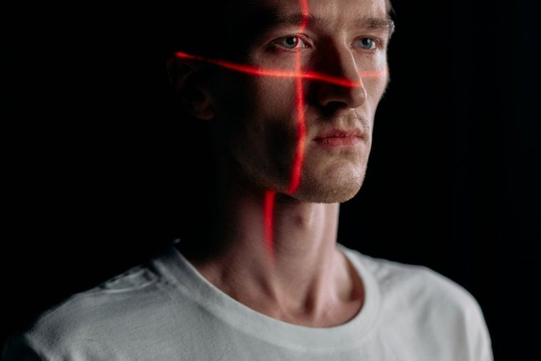
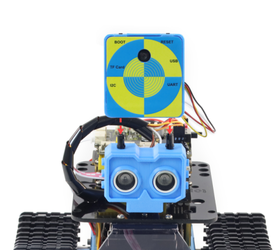
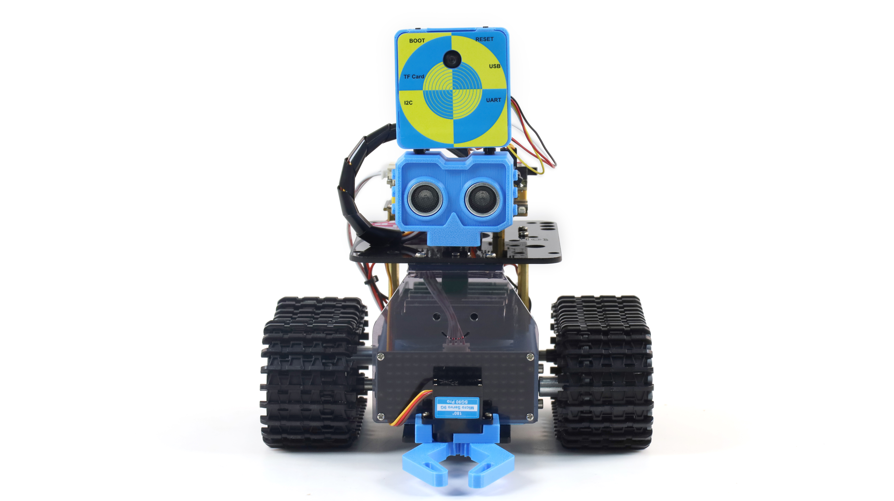
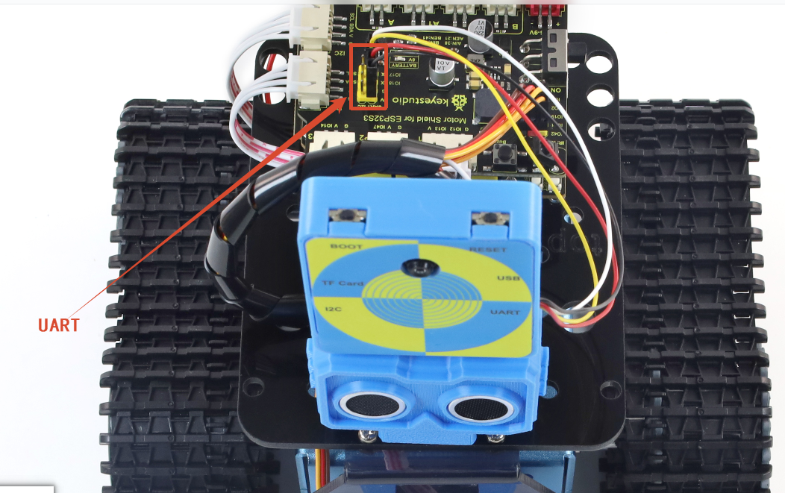
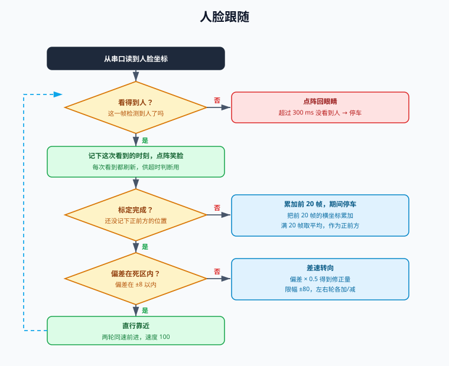

### 项目 19：AI 视觉模块：人脸跟随

#### **1. 简介：**

{width=520px}

站到车前，车会转过来看着你；你往左走，它往左转；你走远了，它跟上来。第 5 课用超声波跟随，只知道前面有没有东西、离多远；换成摄像头以后，能知道人在画面的哪一边。

人脸模式比颜色模式多回一样东西：坐标。模块给出人脸中心在画面里的横坐标，人偏左还是偏右一目了然，左右轮的差速就照这个偏差算。

麻烦在量程。不同固件给出的坐标范围不一样，有的到 100，有的到 320 像素，写死一个中心值，换一只模块就偏。做法是上电后站到镜头正前方一秒，车把前二十帧的横坐标取平均，把这个平均值当作正前方，之后所有偏差都相对它算。

站正前方，车直行靠近；往左移，左轮慢、右轮快，车跟着左转；走出画面，300 毫秒后它停下，点阵从笑脸换回眼睛。

#### **2. 所需清单：**

本课用到的器件：

|     |     |     |
| :---: | :---: | :---: |
| {width=170px}<br><span style="font-size:0.85em">TinyVision AI 视觉摄像头 ×1</span> | {width=170px}<br><span style="font-size:0.85em">9G 舵机（180°） ×1</span> | {width=170px}<br><span style="font-size:0.85em">DRV8835 电机扩展板 ×1</span> |
| {width=170px}<br><span style="font-size:0.85em">履带底盘总成 ×1</span> | {width=170px}<br><span style="font-size:0.85em">8×16 LED 点阵屏 ×1</span> | {width=170px}<br><span style="font-size:0.85em">ESP32-S3 开发板 ×1</span> |

#### **3. 参数：**

| 项目 | 参数 |
| --- | --- |
| 识别模式 | `face` |
| 回传格式 | `FACE:x,y` |
| 跟随速度 | 100 |
| 比例系数 KP | 0.5 |
| 修正上限 | ±80 |
| 对准死区 | ±8 |
| 标定帧数 | 20 |
| 丢失停车延时 | 300 ms |
| 云台角度 | 90°（固定，不参与跟随） |

#### **4. 接线说明：**

本课回到装法 B：模块在云台上，镜头朝正前方，按 2.2.9 与云台支架一起锁死。程序开头用 `car.Servo_set_angle(PAN_CENTER)` 把云台转到 90° 就停在那里，左右跟随交给两侧轮子的差速——目标偏在画面哪一边，车就往哪一边修正。


| 视觉模块 | 主控 | 说明 |
| --- | :---: | --- |
| TX | IO18 | 回传人脸坐标 |
| RX | IO17 | 下发模式指令 |
| VCC / GND | 5V / GND | 供电与共地 |

| 信号 | 主控 GPIO |
| --- | :---: |
| 云台舵机 | IO42（固定 90°） |
| 左轮 AIN / AEN | IO38 / IO21 |
| 右轮 BIN / BEN | IO40 / IO41 |
| 点阵 CLK / DIN | IO9 / IO8 |


**装法B：**








#### **5. 流程图：**

上电先标定 20 帧，标定完才开始跟随：



#### **6. 测试代码：**

> ⚠️ **上传代码前，先把 `mini_tracked_tank_robot.py`、`aicam.py` 上传到板子的 `lib/` 目录**（方法见第 5.5 节），否则导入库时会报 `ImportError`。

```python
import time
from mini_tracked_tank_robot import MiniTrackedTankRobot
from aicam import AiCam

PAN_CENTER = 90
FOLLOW_SPEED = 100         # 跟随前进速度
KP = 0.5                   # 比例系数
TURN_MAX = 80              # 单侧修正上限
DEAD_ZONE = 8              # 对准死区
CALI_FRAMES = 20           # 标定帧数
LOST_STOP = 300            # 丢失超时（ms）

FACE_EYES = 0
FACE_SMILE = 1

eyes = bytes([
    0x00, 0x00, 0x00, 0x00, 0x1C, 0x1C, 0x00, 0x00,
    0x00, 0x00, 0x1C, 0x1C, 0x00, 0x00, 0x00, 0x00
])
smile = bytes([
    0x00, 0x00, 0x1C, 0x02, 0x02, 0x02, 0x5C, 0x40,
    0x40, 0x5C, 0x02, 0x02, 0x02, 0x1C, 0x00, 0x00
])

car = MiniTrackedTankRobot()
car.Motor_init()
car.Servo_init(42)
car.Matrix_init(9, 8)

car.Servo_set_angle(PAN_CENTER)
car.stop_motor()

cam = AiCam()
cam.begin(tx=17, rx=18)
cam.setMode(cam.FACE)

cur_face = -1
center_x = -1              # 标定中心，-1 表示未完成
sum_x = 0
cali_count = 0
last_seen = 0


def show_face(face):
    global cur_face
    if face == cur_face:
        return
    cur_face = face
    if face == FACE_EYES:
        car.Matrix_display(eyes)
    else:
        car.Matrix_display(smile)


show_face(FACE_EYES)
time.sleep_ms(500)         # 等模块切换模式完成

while True:
    cam.read()

    if not cam.faceDetected():
        # 没看到人：超时停车
        show_face(FACE_EYES)
        if time.ticks_diff(time.ticks_ms(), last_seen) > LOST_STOP:
            car.stop_motor()
        time.sleep_ms(20)
        continue

    last_seen = time.ticks_ms()
    show_face(FACE_SMILE)

    x = cam.faceX()

    # 上电先标定正前方：取前 20 帧 X 的平均值
    if center_x < 0:
        sum_x += x
        cali_count += 1
        car.stop_motor()       # 标定期间不动

        if cali_count >= CALI_FRAMES:
            center_x = sum_x // cali_count
            print('画面中心已锁定：', center_x)

        time.sleep_ms(20)
        continue

    # 跟随：偏差换算成差速
    err = x - center_x         # 正在右，负在左

    if -DEAD_ZONE <= err <= DEAD_ZONE:
        car.forward(FOLLOW_SPEED, FOLLOW_SPEED)
    else:
        correction = int(err * KP)
        if correction > TURN_MAX:
            correction = TURN_MAX
        elif correction < -TURN_MAX:
            correction = -TURN_MAX
        car.drive(FOLLOW_SPEED + correction, FOLLOW_SPEED - correction)

    time.sleep_ms(20)
```

#### **7. 代码解释：**

**(1) 引入库与跟随参数**

```python
import time
from mini_tracked_tank_robot import MiniTrackedTankRobot
from aicam import AiCam

PAN_CENTER = 90
FOLLOW_SPEED = 100         # 跟随前进速度
KP = 0.5                   # 比例系数
TURN_MAX = 80              # 单侧修正上限
DEAD_ZONE = 8              # 对准死区
CALI_FRAMES = 20           # 标定帧数
LOST_STOP = 300            # 丢失超时（ms）
```

视觉模块切到 `FACE` 模式后，`faceX()` 给出人脸在画面里的横坐标。这课没有微分项，只用一个 P：`KP` 把偏差换成转向力度，`DEAD_ZONE` 是"已经对准"的容差——偏差小于 8 像素就别修，否则车会在中线附近左右抖。`CALI_FRAMES` 是标定取样的帧数，`LOST_STOP` 是人走开后延迟停车的时间。

**(2) 表情字模**

```python
eyes = bytes([
    0x00, 0x00, 0x00, 0x00, 0x1C, 0x1C, 0x00, 0x00,
    0x00, 0x00, 0x1C, 0x1C, 0x00, 0x00, 0x00, 0x00
])
smile = bytes([
    0x00, 0x00, 0x1C, 0x02, 0x02, 0x02, 0x5C, 0x40,
    0x40, 0x5C, 0x02, 0x02, 0x02, 0x1C, 0x00, 0x00
])
```

格式同第 1 课：`eyes` 是没看到人时的待机眼，`smile` 是锁到人脸后的笑脸。

**(3) 初始化云台与视觉模块**

```python
car = MiniTrackedTankRobot()
car.Motor_init()
car.Servo_init(42)
car.Matrix_init(9, 8)

car.Servo_set_angle(PAN_CENTER)
car.stop_motor()

cam = AiCam()
cam.begin(tx=17, rx=18)
cam.setMode(cam.FACE)

cur_face = -1
center_x = -1              # 标定中心，-1 表示未完成
sum_x = 0
cali_count = 0
last_seen = 0
```

云台固定在正前 90°，不跟着人转——跟随靠车体差速转向实现。`center_x = -1` 是个哨兵值，表示"还没标定"；`sum_x` 和 `cali_count` 用来求平均；`last_seen` 记最后一次看到人的时间，供超时停车判断。

**(4) 没看到人：延迟停车**

```python
while True:
    cam.read()

    if not cam.faceDetected():
        # 没看到人：超时停车
        show_face(FACE_EYES)
        if time.ticks_diff(time.ticks_ms(), last_seen) > LOST_STOP:
            car.stop_motor()
        time.sleep_ms(20)
        continue
```

`faceDetected()` 判断这一帧有没有人脸。看不到人先显示待机眼，但不马上停车——留 300 ms 宽限，人暂时被挡住或转身时车不会急停；真超过 `LOST_STOP` 才停。看到人时主循环会把 `last_seen` 刷成当前时间（下一节第一行），所以只要人还在，这个计时就不会到点。`continue` 跳过本轮后面的人脸处理。

**(5) 上电先用前 20 帧标定正前方**

```python
    last_seen = time.ticks_ms()
    show_face(FACE_SMILE)

    x = cam.faceX()

    # 上电先标定正前方：取前 20 帧 X 的平均值
    if center_x < 0:
        sum_x += x
        cali_count += 1
        car.stop_motor()       # 标定期间不动

        if cali_count >= CALI_FRAMES:
            center_x = sum_x // cali_count
            print('画面中心已锁定：', center_x)

        time.sleep_ms(20)
        continue
```

模块给的 `x` 是画面坐标，而"正前方"未必正好是画面中点，所以让人站在车前，取前 20 帧的平均值当作中心。用平均而不是单帧是为了滤掉检测抖动；标定期间车不动，避免边走边标定把中心算歪。标定完成后 `center_x` 不再是 -1，主循环才会走进跟随分支。想改标定快慢就调 `CALI_FRAMES`。

**(6) 跟随：把偏差换成差速**

```python
    # 跟随：偏差换算成差速
    err = x - center_x         # 正在右，负在左

    if -DEAD_ZONE <= err <= DEAD_ZONE:
        car.forward(FOLLOW_SPEED, FOLLOW_SPEED)
    else:
        correction = int(err * KP)
        if correction > TURN_MAX:
            correction = TURN_MAX
        elif correction < -TURN_MAX:
            correction = -TURN_MAX
        car.drive(FOLLOW_SPEED + correction, FOLLOW_SPEED - correction)

    time.sleep_ms(20)
```

`err` 是人脸相对标定中心的偏移：人在右（`err` 为正）就往右修。落在死区里直接 `forward` 直线靠近、不做修正——这是防抖的关键。出了死区才用 `KP` 算修正并限幅，通过差速边走边转，所以人往哪边偏车就往哪边画弧靠近，而不是停在原地转。`KP` 调大转向更急但容易过冲，`TURN_MAX` 限制最大修正量防止甩头。

#### **8. 运行现象：**

打开 `DEBUG_OUT`，Shell 打印：

```text
视觉模块串口已启动
发送 -> GET:MODE
发送 -> GET:OUTPUT
发送 -> MODE:FACE
画面中心已锁定：78
```

`78` 就是这一台模块在当前位置的**正前方**坐标。

| 你的动作 | 点阵 | 车 |
| --- | --- | --- |
| 正对镜头站 1 s | 笑脸 | 停（标定阶段） |
| 站在正前方 | 笑脸 | 直行靠近 |
| 向左移动 | 笑脸 | 左轮慢、右轮快，向左转 |
| 向右移动 | 笑脸 | 右转 |
| 走出画面 | 眼睛 | 300 ms 后停 |

> 【图片待补】Shell 打印**画面中心已锁定**的截图。

#### **9. 常见问题解决：**

(1) Shell 里读不到人脸坐标、`AiCam` 初始化没反应，先查视觉模块接线：TX 接 IO18、RX 接 IO17，交叉接、波特率 9600。模块没回应按 `OSError: [Errno 19] ENODEV` 想，先确认线没松没接反，再**运行/保存到板子**。

(2) 车跟得太急、左右摆，把 `KP = 0.5` 降到 0.3，或者把 `DEAD_ZONE = 8` 加到 15，留大点死区它就不抖了。反过来人走了才慢吞吞动，就把 KP 提到 0.8，或把 `FOLLOW_SPEED = 100` 提到 130。

(3) 标定那步别省。站在镜头前不动，等 Shell 打出**画面中心已锁定**再走动；标定期间人在晃，中心值就偏了，后面车会一直斜着看你。

(4) 人走出画面后车还往前冲，`LOST_STOP = 300` 是丢失后多久停车的毫秒数，嫌它停得慢就把这个数调小。
