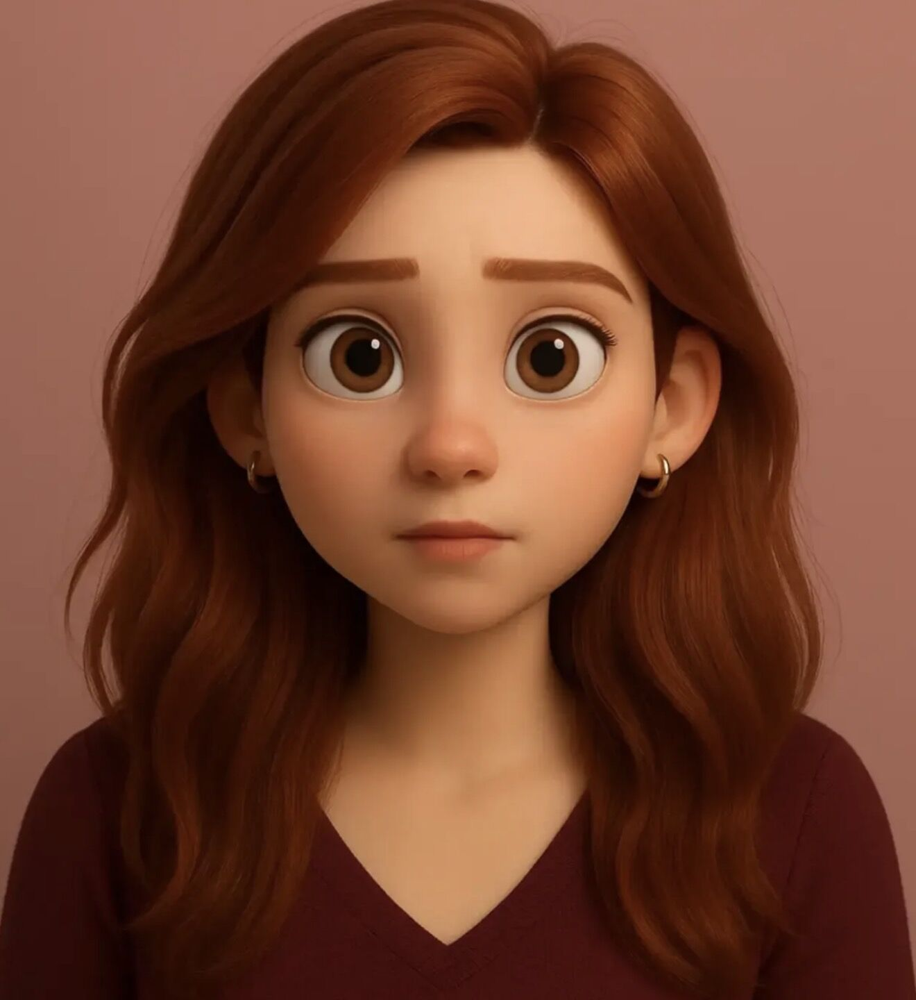

### Project 19: AI Vision Module: Face Following

#### **1. Introduction:**

{width=520px}

Stand in front of the car and it turns to look at you; walk to the left and it turns left; step away and it follows. Lesson 5 followed with ultrasound, which only knows whether something is in front and how far away it is; with a camera we also know which side of the picture the person is on.

Face mode returns one thing that color mode does not: a coordinate. The module gives the horizontal coordinate of the face center in the picture, so which side the person is on is obvious, and the speed difference between the left and right wheels is worked out from that offset.

The trouble is the range. Different firmware returns different coordinate ranges — some up to 100, some up to 320 pixels — so a hard-coded center value is off with the next module. The way round it: after power-on, stand right in front of the lens for a second while the car averages the horizontal coordinate of the first twenty frames and takes that average as "straight ahead"; every offset after that is measured against it.

Stand straight ahead and the car drives up to you; move left and the left wheel slows while the right wheel speeds up and the car turns left; step out of the picture and it stops after 300 milliseconds, the dot matrix going from the smiley back to the eyes.

#### **2. Parts List:**
Components used in this lesson:

|     |     |     |
| :---: | :---: | :---: |
| {width=170px}<br><span style="font-size:0.85em">TinyVision AI vision camera ×1</span> | {width=170px}<br><span style="font-size:0.85em">9G servo (180°) ×1</span> | {width=170px}<br><span style="font-size:0.85em">DRV8835 motor expansion board ×1</span> |
| {width=170px}<br><span style="font-size:0.85em">Mini Tracked Tank Robot chassis kit ×1</span> | {width=170px}<br><span style="font-size:0.85em">8×16 LED dot matrix display ×1</span> | {width=170px}<br><span style="font-size:0.85em">ESP32-S3 development board ×1</span> |

#### **3. Parameters:**
| Item | Parameter |
| --- | --- |
| Recognition mode | `face` |
| Return format | `FACE:x,y` |
| Following speed | 100 |
| Calibration frames | 20 |
| Stop delay after loss | 300 ms |
| Pan-tilt angle | 90° (fixed, not used for following) |

#### **4. Wiring:**

This lesson goes back to mounting method B: the module sits on the pan-tilt with the lens facing straight ahead and is locked together with the pan-tilt bracket as described in 2.2.9. At the start of the program `car.Servo_set_angle(PAN_CENTER)` turns the pan-tilt to 90° and leaves it there, and left/right following is left to the speed difference between the two wheels — whichever side of the picture the target is on, that is the side the car corrects towards.


| Vision module | Controller | Description |
| --- | :---: | --- |
| TX | IO18 | Returns the face coordinates |
| RX | IO17 | Receives the mode commands |
| VCC / GND | 5V / GND | Power supply and common ground |

| Signal | Controller GPIO |
| --- | :---: |
| Pan-tilt servo | IO42 (fixed at 90°) |
| Left wheel AIN / AEN | IO38 / IO21 |
| Right wheel BIN / BEN | IO40 / IO41 |
| Matrix CLK / DIN | IO9 / IO8 |


**Mounting method B:**


#### **5. Flowchart:**

Calibrate 20 frames first after power-on, and only start following when calibration is done:


#### **6. Test Code:**
> ⚠️ **Before uploading the code, upload `mini_tracked_tank_robot.py` and `aicam.py` to the `lib/` directory on the board** (see Section 5.5), otherwise importing the library raises `ImportError`.

```python
import time
from mini_tracked_tank_robot import MiniTrackedTankRobot
from aicam import AiCam

PAN_CENTER = 90
FOLLOW_SPEED = 100         # Following speed
KP = 0.5                   # Proportional gain
TURN_MAX = 80              # Maximum correction on one side
DEAD_ZONE = 8              # Alignment dead zone
CALI_FRAMES = 20           # Number of calibration frames
LOST_STOP = 300            # Lost target timeout (ms)

FACE_EYES = 0
FACE_SMILE = 1

eyes = bytes([
    0x00, 0x00, 0x00, 0x00, 0x1C, 0x1C, 0x00, 0x00,
    0x00, 0x00, 0x1C, 0x1C, 0x00, 0x00, 0x00, 0x00
])
smile = bytes([
    0x00, 0x00, 0x1C, 0x02, 0x02, 0x02, 0x5C, 0x40,
    0x40, 0x5C, 0x02, 0x02, 0x02, 0x1C, 0x00, 0x00
])

car = MiniTrackedTankRobot()
car.Motor_init()
car.Servo_init(42)
car.Matrix_init(9, 8)

car.Servo_set_angle(PAN_CENTER)
car.stop_motor()

cam = AiCam()
cam.begin(tx=17, rx=18)
cam.setMode(cam.FACE)

cur_face = -1
center_x = -1              # Calibrated center, -1 means not calibrated yet
sum_x = 0
cali_count = 0
last_seen = 0


def show_face(face):
    global cur_face
    if face == cur_face:
        return
    cur_face = face
    if face == FACE_EYES:
        car.Matrix_display(eyes)
    else:
        car.Matrix_display(smile)


show_face(FACE_EYES)
time.sleep_ms(500)         # Wait for the module to finish switching mode

while True:
    cam.read()

    if not cam.faceDetected():
        # No face: stop after the timeout
        show_face(FACE_EYES)
        if time.ticks_diff(time.ticks_ms(), last_seen) > LOST_STOP:
            car.stop_motor()
        time.sleep_ms(20)
        continue

    last_seen = time.ticks_ms()
    show_face(FACE_SMILE)

    x = cam.faceX()

    # Calibrate straight ahead at power-on: average the X value of the first 20 frames
    if center_x < 0:
        sum_x += x
        cali_count += 1
        car.stop_motor()       # Stay still while calibrating

        if cali_count >= CALI_FRAMES:
            center_x = sum_x // cali_count
            print('Frame center locked: ', center_x)

        time.sleep_ms(20)
        continue

    # Following: convert the offset into a speed difference
    err = x - center_x         # Positive means right, negative means left

    if -DEAD_ZONE <= err <= DEAD_ZONE:
        car.forward(FOLLOW_SPEED, FOLLOW_SPEED)
    else:
        correction = int(err * KP)
        if correction > TURN_MAX:
            correction = TURN_MAX
        elif correction < -TURN_MAX:
            correction = -TURN_MAX
        car.drive(FOLLOW_SPEED + correction, FOLLOW_SPEED - correction)

    time.sleep_ms(20)
```

#### **7. Code Explanation:**
**(1) Importing the libraries and the six parameters**

```python
import time
from mini_tracked_tank_robot import MiniTrackedTankRobot
from aicam import AiCam

PAN_CENTER = 90
FOLLOW_SPEED = 100         # Following speed
KP = 0.5                   # Proportional gain
TURN_MAX = 80              # Maximum correction on one side
DEAD_ZONE = 8              # Alignment dead zone
CALI_FRAMES = 20           # Number of calibration frames
LOST_STOP = 300            # Lost target timeout (ms)
```

`FOLLOW_SPEED = 100` is half of the 180 used in the remote-control lesson — following a person does not need speed. `KP = 0.5` is the only proportional term, with no derivative: following a person is simpler than line tracking, and the error itself is continuous, so there is no overshoot for a derivative term to damp. The remaining four parameters are all for protection and calibration, and each one is covered below.

**(2) Expression bitmaps**

```python
eyes = bytes([
    0x00, 0x00, 0x00, 0x00, 0x1C, 0x1C, 0x00, 0x00,
    0x00, 0x00, 0x1C, 0x1C, 0x00, 0x00, 0x00, 0x00
])
smile = bytes([
    0x00, 0x00, 0x1C, 0x02, 0x02, 0x02, 0x5C, 0x40,
    0x40, 0x5C, 0x02, 0x02, 0x02, 0x1C, 0x00, 0x00
])
```

Same format as Lesson 1: 16 bytes for 16 columns, the 8 bits of each byte covering the 8 rows of one column, with `bit0` at the top. `eyes` is the standby face when nobody is in view, `smile` is the smiley once a face is locked.

**(3) Initializing the pan-tilt and the vision module**

```python
car = MiniTrackedTankRobot()
car.Motor_init()
car.Servo_init(42)
car.Matrix_init(9, 8)

car.Servo_set_angle(PAN_CENTER)
car.stop_motor()

cam = AiCam()
cam.begin(tx=17, rx=18)
cam.setMode(cam.FACE)

cur_face = -1
center_x = -1              # Calibrated center, -1 means not calibrated yet
sum_x = 0
cali_count = 0
last_seen = 0
```

The pan-tilt is fixed at 90° straight ahead and does not turn with the person — following is done by steering the body with a speed difference. The initial `-1` of `center_x` doubles as the "not calibrated yet" flag, which is why the test below is `center_x < 0` rather than a comparison against some concrete coordinate. `sum_x` and `cali_count` are only used while calibrating and nobody looks at them once it is done. `last_seen` is the starting point of the loss grace timer and `cur_face` deduplicates the expressions, `-1` meaning nothing has been shown yet.

After the pan-tilt is set to 90° the program waits `time.sleep_ms(500)` before entering the main loop (that line is in the next snippet): the servo takes a while to swing over from wherever it was, and without waiting the first few frames would be of the lens still moving.

**(4) Top of the main loop: handle "no one in view" first**

```python
while True:
    cam.read()

    if not cam.faceDetected():
        # No face: stop after the timeout
        show_face(FACE_EYES)
        if time.ticks_diff(time.ticks_ms(), last_seen) > LOST_STOP:
            car.stop_motor()
        time.sleep_ms(20)
        continue
```

When no face is detected the car does **not** stop at once; it looks at how long it has been since the face was last seen. `continue` ends the round immediately, so not a single line of the calibration or following logic is touched.

`show_face(FACE_EYES)` sits outside the timeout test, so the expression changes the moment the face is lost instead of waiting out the 300 ms.

**(5) The 300 ms grace: a hand waving across the face should not stop the car**

```python
        if time.ticks_diff(time.ticks_ms(), last_seen) > LOST_STOP:
            car.stop_motor()
```

The module occasionally misses a frame or two — a slight turn of the head or a change in the light is enough. Stopping instantly would make the car creep forward in lurches; a 300 ms grace (about 15 frames at 50 Hz) filters out most momentary misses. During those 300 ms the program sends no commands at all and the motors keep the speed from the previous round.

`time.ticks_diff()` is used instead of subtracting directly: `ticks_ms()` is a 30-bit counter that wraps back to 0 after the board has been running for days, and a direct subtraction would give a huge positive number and stop the car for no reason. `ticks_diff` computes a signed difference, which is right even across the wrap.

**(6) Refresh the timestamp whenever a face is detected**

```python
    last_seen = time.ticks_ms()
    show_face(FACE_SMILE)

    x = cam.faceX()
```

`last_seen` is refreshed every time a face is seen, so the 300 ms measures "how long since the last sighting", not "how long since the face was first lost". These lines sit after the validity test, so they only run on frames that really did see a face.

**(7) Calibration: average the first 20 frames**

```python
    # Calibrate straight ahead at power-on: average the X value of the first 20 frames
    if center_x < 0:
        sum_x += x
        cali_count += 1
        car.stop_motor()       # Stay still while calibrating

        if cali_count >= CALI_FRAMES:
            center_x = sum_x // cali_count
            print('Frame center locked: ', center_x)

        time.sleep_ms(20)
        continue
```

The `x` the module returns is "the coordinate of the face center in the picture", but **there is no standard for the range** — some firmware gives 0 to 100, some gives 0 to 320 pixels. Hard-coding `center_x = 160` is completely wrong with a different module.

So instead, someone stands straight ahead at power-on and the average of the first 20 frames becomes the center. 20 frames is about 0.4 s, enough to filter out single-frame jitter; any more and you have to stand there longer, which feels worse. `//` is integer division and the result is an integer by nature — integers save memory compared with floats in MicroPython, and a coordinate has no need for decimals.

Both `car.stop_motor()` and `continue` are inside the calibration branch: the car stays still while calibrating and the following logic does not run for that round.

Why this step cannot be skipped: the camera sits on the pan-tilt, and 90° on the pan-tilt is not necessarily the center of the picture; add lens distortion and the "centered" position of a face is often a dozen pixels off the midpoint. Hard-coding the midpoint makes the car drift to one side even though the person is standing dead ahead.

**(8) Dead zone: stop correcting once aligned**

```python
    # Following: convert the offset into a speed difference
    err = x - center_x         # Positive means right, negative means left

    if -DEAD_ZONE <= err <= DEAD_ZONE:
        car.forward(FOLLOW_SPEED, FOLLOW_SPEED)
```

`DEAD_ZONE = 8`: an offset within ±8 counts as aligned and the car simply drives forward.

What happens without a dead zone? The face coordinate jumps every frame; even with the person standing still `x` wanders by about ±3. The car would keep correcting a little left, a little right, swaying in place and never getting anywhere. The dead zone swallows those few pixels of noise.

`-DEAD_ZONE <= err <= DEAD_ZONE` is Python's chained comparison, writing both bounds in one go; it is equivalent to `err >= -DEAD_ZONE and err <= DEAD_ZONE` but `err` is evaluated only once.

**(9) Speed difference and clamping**

```python
    else:
        correction = int(err * KP)
        if correction > TURN_MAX:
            correction = TURN_MAX
        elif correction < -TURN_MAX:
            correction = -TURN_MAX
        car.drive(FOLLOW_SPEED + correction, FOLLOW_SPEED - correction)
```

A person on the right of the picture (`err` positive) means the car is pointing left and has to turn right — speed the left wheel up and the right wheel down, and `+ correction` on the left wheel is exactly that direction.

Python has no `constrain()`, so clamping has to be written as three branches; more verbose than the C version, same logic. `TURN_MAX = 80` leaves headroom for `FOLLOW_SPEED = 100`: a correction of 100 would give a negative speed and reverse one side, so limiting it to 80 keeps both sides turning forward and the car "turns a corner" rather than "spins on the spot".

`int(err * KP)` truncates towards zero rather than rounding: with `err = 3`, `3 * 0.5 = 1.5` truncates to 1, right direction but slightly weak. The smaller the offset the more noticeable that gap, so if the car feels sluggish to react raise `KP` — do not expect `int()` to make it up.

**(10) `sleep_ms(20)`: 50 Hz**

```python
    time.sleep_ms(20)
```

A 20 ms round is 50 Hz, close to the real frame rate of face detection. Faster just re-reads the same frame and wastes CPU; slower cannot keep up with a moving person and the car follows in lurches.

The skeleton of this lesson is nearly the same as line following in Lesson 18: `cam.read()` → check validity → compute the offset → apply the speed difference → `sleep_ms()`. Three things differ:

| | Lesson 18 line following | Lesson 19 following |
| --- | --- | --- |
| Validity flag | `valid == LINE_OK` | `cam.faceDetected()` |
| Center value | The module gives the offset directly | Calibrated at power-on by averaging 20 frames |
| Handling a lost target | Search in place in the remembered direction, 600 ms | Keep driving 300 ms, then stop |

Lesson 18 has to "search" when the line is lost because a line does not move; Lesson 19 has to "stop" when the person is lost, because a person who has walked off cannot be caught and chasing them is dangerous.

#### **8. Expected Behavior:**
> The tests for this project used an AI face image



The Shell prints:

```text
Frame center locked:  78
```

`78` is this particular module's **straight-ahead** coordinate at its current position.

| Your action | Dot matrix | Car |
| --- | --- | --- |
| Face the lens and stand for 1 s | Smiley | Stopped (calibration) |
| Stand straight ahead | Smiley | Drives straight up to you |
| Move left | Smiley | Left wheel slow, right wheel fast, turns left |
| Move right | Smiley | Turns right |
| Step out of the picture | Eyes | Stops after 300 ms |

> [Image to be added] A screenshot of the Shell printing **Frame center locked**.

#### **9. Troubleshooting:**

(1) If no face coordinates can be read in the Shell and `AiCam` does not respond when initialized, check the vision module wiring first: TX to IO18, RX to IO17, crossed, at 9600 baud. A module that does not respond at all shows up as `OSError: [Errno 19] ENODEV` — check that the wire is not loose or reversed, then **Run/Save to the board** again.

(2) If the car follows too eagerly and sways left and right, lower `KP = 0.5` to 0.3, or raise `DEAD_ZONE = 8` to 15 — a slightly bigger dead zone stops the shivering. If instead it only moves sluggishly after the person has gone, raise KP to 0.8 or `FOLLOW_SPEED = 100` to 130.

(3) Do not skip the calibration step. Stand still in front of the lens and only walk around after the Shell prints **Frame center locked**; if you sway while calibrating the center value is off and the car will keep looking at you sideways afterwards.

(4) If the car keeps charging forward after the person leaves the picture, note that `LOST_STOP = 300` is the number of milliseconds before it stops after losing the face — lower it if the stop feels too slow.
