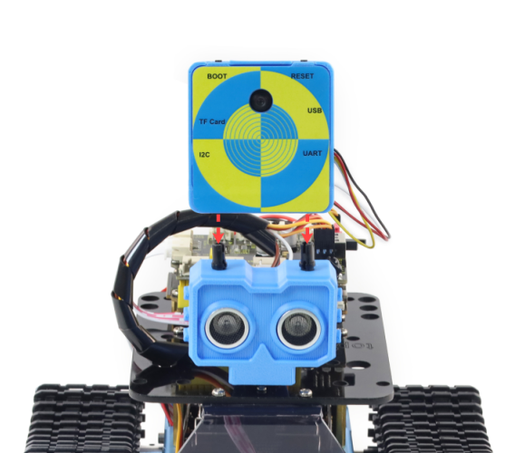

### 项目 20：AI 视觉模块：二维码任务卡

#### **1. 简介：**

{width=520px}

举一张印着二维码的卡片在车前晃一下，车扫一眼就往前走一秒；换一张，它便向左画个弧。四张卡片各藏着一条指令——FORWARD、BACKWARD、LEFT、RIGHT，从卡片表面看不出来，得车扫过才知道。

有意思的是，车会因为太听话而出问题。摄像头每秒回传十几帧，同一张卡在视野里会被连续读到几十次；每次都执行的话，车就一直往前冲，停不下来。真正要解决的，是让它认住刚才那张卡，移开以后才接受下一条。

卡片里的指令用英文单词，不加空格、不换行——模块读回来的内容要和写进去的逐字对上。

上电后云台转到 90°、点阵显示眼睛。举卡对准车头 10 到 25 厘米，点阵变笑脸，车按卡片走一秒；卡移开，点阵回到眼睛，等着下一张。

#### **2. 所需清单：**

本课用到的器件：

|     |     |     |
| :---: | :---: | :---: |
| {width=170px}<br><span style="font-size:0.85em">TinyVision AI 视觉摄像头 ×1</span> | {width=170px}<br><span style="font-size:0.85em">9G 舵机（180°） ×1</span> | {width=170px}<br><span style="font-size:0.85em">DRV8835 电机扩展板 ×1</span> |
| {width=170px}<br><span style="font-size:0.85em">履带底盘总成 ×1</span> | {width=170px}<br><span style="font-size:0.85em">8×16 LED 点阵屏 ×1</span> | {width=170px}<br><span style="font-size:0.85em">ESP32-S3 开发板 ×1</span> |

#### **3. 参数：**

| 项目 | 参数 |
| --- | --- |
| 识别模式 | `qr` |
| 回传格式 | `QR:内容` |
| 卡片内容 | `FORWARD` / `BACKWARD` / `LEFT` / `RIGHT` |
| 直行速度 | 150 |
| 转向外侧轮 | 150 |
| 转向内侧轮 | 50 |
| 单卡动作时长 | 1000 ms |
| 云台角度 | 90°（固定） |
| 去重依据 | `lastQr` 与当前内容比较 |

#### **4. 接线说明：**

本课仍用装法 B：模块在云台上，镜头朝正前方，程序开头用 `car.Servo_set_angle(PAN_CENTER)` 把云台转到 90° 把镜头摆正，之后不再转。扫卡时由人把卡片举到镜头正前方，车不主动去找卡。

| 视觉模块 | 主控 | 说明 |
| --- | :---: | --- |
| TX | IO18 | 回传二维码内容 |
| RX | IO17 | 下发模式指令 |
| VCC / GND | 5V / GND | 供电与共地 |

| 信号 | 主控 GPIO |
| --- | :---: |
| 云台舵机 | IO42 |
| 左轮 AIN / AEN | IO38 / IO21 |
| 右轮 BIN / BEN | IO40 / IO41 |
| 点阵 CLK / DIN | IO9 / IO8 |


**装法B：**





> 【图片待补】手持卡片与摄像头的距离实拍图，说明多远能扫到（约 10～25 cm）。

#### **5. 流程图：**

每轮只做三件事：读卡、判断是不是新卡、执行：


#### **6. 测试代码：**

> ⚠️ **上传代码前，先把 `mini_tracked_tank_robot.py`、`aicam.py` 上传到板子的 `lib/` 目录**（方法见第 5.5 节），否则导入库时会报 `ImportError`。

```python
import time
from mini_tracked_tank_robot import MiniTrackedTankRobot
from aicam import AiCam

PAN_CENTER = 90

SPEED_MOVE = 150           # 直行 / 后退速度
SPEED_TURN_OUT = 150       # 转向弧线外侧轮速度
SPEED_TURN_IN = 50         # 转向弧线内侧轮速度
ACTION_TIME = 1000         # 每张卡走多久（ms）

FACE_EYES = 0
FACE_SMILE = 1

eyes = bytes([
    0x00, 0x00, 0x00, 0x00, 0x1C, 0x1C, 0x00, 0x00,
    0x00, 0x00, 0x1C, 0x1C, 0x00, 0x00, 0x00, 0x00
])
smile = bytes([
    0x00, 0x00, 0x1C, 0x02, 0x02, 0x02, 0x5C, 0x40,
    0x40, 0x5C, 0x02, 0x02, 0x02, 0x1C, 0x00, 0x00
])

car = MiniTrackedTankRobot()
car.Motor_init()
car.Servo_init(42)
car.Matrix_init(9, 8)

car.Servo_set_angle(PAN_CENTER)
car.stop_motor()
time.sleep_ms(300)

cam = AiCam()
cam.begin(tx=17, rx=18)
cam.setMode(cam.QR)

cur_face = -1
last_qr = ''


def show_face(face):
    global cur_face
    if face == cur_face:
        return
    cur_face = face
    if face == FACE_EYES:
        car.Matrix_display(eyes)
    else:
        car.Matrix_display(smile)


def do_task(qr):
    show_face(FACE_SMILE)

    key = qr.strip().upper()

    if key == 'FORWARD':
        car.forward(SPEED_MOVE, SPEED_MOVE)                    # 直行一段
    elif key == 'BACKWARD':
        car.back(SPEED_MOVE, SPEED_MOVE)                       # 后退一段
    elif key == 'LEFT':
        car.drive(SPEED_TURN_IN, SPEED_TURN_OUT)               # 左慢右快，向左画弧
    elif key == 'RIGHT':
        car.drive(SPEED_TURN_OUT, SPEED_TURN_IN)               # 左快右慢，向右画弧
    else:
        return                                                 # 不是这四张卡，不做动作

    time.sleep_ms(ACTION_TIME)
    car.stop_motor()


show_face(FACE_EYES)
print('二维码任务卡已就绪')
time.sleep(1)              # 等模块切换模式完成

while True:
    cam.read()
    qr = cam.qr()

    # 画面里没有卡：清空 last_qr 解除锁定
    if qr == '':
        last_qr = ''
        car.stop_motor()
        show_face(FACE_EYES)
        time.sleep_ms(20)
        continue

    # 同一张卡一直举着：跳过，不重复执行
    if qr == last_qr:
        time.sleep_ms(20)
        continue

    # 新卡：先记录再执行，避免执行期间重复触发
    last_qr = qr
    print('扫到二维码：', qr, ' 字节数 ', len(qr))
    do_task(qr)

    time.sleep_ms(20)
```

#### **7. 代码解释：**

**(1) 引入库与动作参数**

```python
import time
from mini_tracked_tank_robot import MiniTrackedTankRobot
from aicam import AiCam

PAN_CENTER = 90

SPEED_MOVE = 150           # 直行 / 后退速度
SPEED_TURN_OUT = 150       # 转向弧线外侧轮速度
SPEED_TURN_IN = 50         # 转向弧线内侧轮速度
ACTION_TIME = 1000         # 每张卡走多久（ms）
```

视觉模块进 `QR` 模式，`cam.qr()` 返回卡片上的文字。这里转向不用原地转，而是让内外轮速度不同（150 对 50）画一条弧线，走起来更顺；`ACTION_TIME` 固定每张卡执行 1 秒，想让车走远一点就调它。

**(2) 表情字模**

```python
eyes = bytes([
    0x00, 0x00, 0x00, 0x00, 0x1C, 0x1C, 0x00, 0x00,
    0x00, 0x00, 0x1C, 0x1C, 0x00, 0x00, 0x00, 0x00
])
smile = bytes([
    0x00, 0x00, 0x1C, 0x02, 0x02, 0x02, 0x5C, 0x40,
    0x40, 0x5C, 0x02, 0x02, 0x02, 0x1C, 0x00, 0x00
])
```

字模格式同第 1 课：`eyes` 是待机，`smile` 表示正在执行某张卡的任务。

**(3) 初始化与去重变量**

```python
car = MiniTrackedTankRobot()
car.Motor_init()
car.Servo_init(42)
car.Matrix_init(9, 8)

car.Servo_set_angle(PAN_CENTER)
car.stop_motor()
time.sleep_ms(300)

cam = AiCam()
cam.begin(tx=17, rx=18)
cam.setMode(cam.QR)

cur_face = -1
last_qr = ''
```

云台摆到正前 90° 后 `sleep_ms(300)`，给舵机转动留时间，免得还没摆正就开始扫卡。`last_qr` 是这课的"去重开关"，记住上一张卡的内容，空字符串表示当前画面没卡——后面两节都围着它转。

**(4) 四张卡对应四个动作**

```python
def do_task(qr):
    show_face(FACE_SMILE)

    key = qr.strip().upper()

    if key == 'FORWARD':
        car.forward(SPEED_MOVE, SPEED_MOVE)                    # 直行一段
    elif key == 'BACKWARD':
        car.back(SPEED_MOVE, SPEED_MOVE)                       # 后退一段
    elif key == 'LEFT':
        car.drive(SPEED_TURN_IN, SPEED_TURN_OUT)               # 左慢右快，向左画弧
    elif key == 'RIGHT':
        car.drive(SPEED_TURN_OUT, SPEED_TURN_IN)               # 左快右慢，向右画弧
    else:
        return                                                 # 不是这四张卡，不做动作

    time.sleep_ms(ACTION_TIME)
    car.stop_motor()
```

`strip()` 去掉扫码带进来的空格和换行，`upper()` 统一成大写，所以卡上写 `forward`、`Forward` 都能认出来。只认四张卡：前进、后退、左转、右转；左转是左轮慢右轮快、车往左画弧，右转正好反过来。不认识的卡直接 `return`，车不动也不计时。所有动作都靠 `sleep_ms(ACTION_TIME)` 定时停车，没有位置反馈——卡走得准不准取决于这个时长和地面情况。

**(5) 画面没卡时解锁**

```python
while True:
    cam.read()
    qr = cam.qr()

    # 画面里没有卡：清空 last_qr 解除锁定
    if qr == '':
        last_qr = ''
        car.stop_motor()
        show_face(FACE_EYES)
        time.sleep_ms(20)
        continue
```

`qr == ''` 表示镜头里没有卡。这时要把 `last_qr` 清空——这一步是"解锁"的关键：只有卡片离开视野，再次出现时才会被当成新卡重新执行。同时停车、恢复待机表情，然后 `continue` 跳过本轮后面的处理。

**(6) 去重：先记录再执行**

```python
    # 同一张卡一直举着：跳过，不重复执行
    if qr == last_qr:
        time.sleep_ms(20)
        continue

    # 新卡：先记录再执行，避免执行期间重复触发
    last_qr = qr
    print('扫到二维码：', qr, ' 字节数 ', len(qr))
    do_task(qr)

    time.sleep_ms(20)
```

只要卡片还举在镜头前，每轮读到的都是同一串内容，`if qr == last_qr` 就 `continue`——所以同一张卡举再久也只执行一次。新卡来了必须先 `last_qr = qr` 再 `do_task()`，顺序不能反：`do_task()` 会占住 1 秒，这期间模块还在回传这张卡，若不先记下来，下一轮就会把它当新卡再跑一遍。想再次触发同一张卡，得先移出画面解锁（上一节），再放回来。

#### **8. 运行现象：**

上电后云台先转到 90°，点阵显示眼睛，Shell 打印 `视觉模块串口已启动`。

举卡对准车头 10～25 cm：

```text
扫到二维码：FORWARD  字节数 7
（车前进 1 s，点阵笑脸）
（把卡移开，点阵回眼睛）
扫到二维码：LEFT  字节数 4
（车向左画弧 1 s）
```

| 卡片 | 字节数 | 动作 |
| --- | :---: | --- |
| `FORWARD` | 7 | 两轮同速正转 1 s |
| `BACKWARD` | 8 | 两轮同速反转 1 s |
| `LEFT` | 4 | 左慢右快，向左画弧 1 s |
| `RIGHT` | 5 | 左快右慢，向右画弧 1 s |

> 【图片待补】串口依次打印四张卡内容与字节数的截图。

#### **9. 常见问题解决：**

(1) `AiCam` 初始化没输出、Shell 读不到二维码，先查视觉模块接线：TX 接 IO18、RX 接 IO17，交叉接、波特率 9600。完全没回复按 `OSError: [Errno 19] ENODEV` 查，把线重新插一遍再**运行/保存到板子**。

(2) 卡片举着不动，车只走一次就不动了——这是正常的，代码做了去重，同一张卡不会重复触发。想再走一次，把卡移开让画面空一下，再举回来。

(3) 扫不到卡先看距离和光照：太近小于 5 cm 对不上焦，太远大于 30 cm 码太小，10～25 cm 最稳；逆光或阴影会让黑白对比糊掉，让光从你背后照向卡片。

(4) 内容要纯英文、不带空格。用手机扫一下自己打印的卡确认，末尾多空格可以用 `.strip()` 去掉、全小写用 `.upper()` 转大写；但印成 `Forward!` 这种带符号的就救不回来了，只能重做卡。
