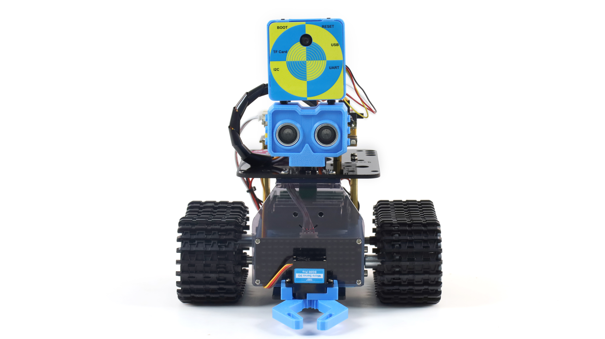
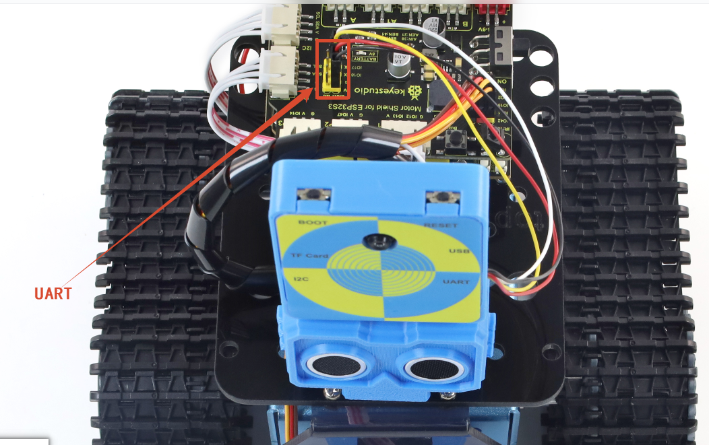
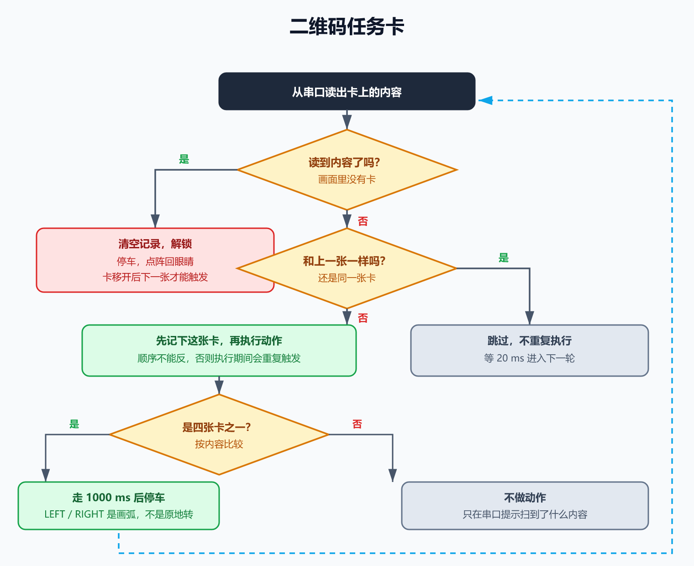

### Project 20: AI Vision Module: QR Code Task Cards

#### **1. Introduction:**


Hold a card with a QR code in front of the car, wave it once, and the car takes a look and drives forward for a second; swap the card and it traces an arc to the left. Four cards each hide one command — FORWARD, BACKWARD, LEFT, RIGHT — nothing on the card surface gives it away, only the car knows once it has scanned.

The interesting part is that the car gets into trouble by being too obedient. The camera returns a dozen or more frames a second, so the same card in view is read dozens of times in a row; if it executed every time, the car would charge forward and never stop. What actually has to be solved is making it remember the card it just saw and only accept the next command after the card has been taken away.

The commands on the cards are English words with no spaces and no line breaks — what the module reads back has to match what was written, character for character.

After power-on the pan-tilt turns to 90° and the matrix shows a pair of eyes. Hold a card 10 to 25 centimetres in front of the car and the matrix turns into a smiley and the car does what the card says for one second; take the card away and the matrix goes back to the eyes, waiting for the next one.

#### **2. Parts List:**
Components used in this lesson:

| TinyVision AI vision camera ×1 | 9G servo (180°) ×1 | DRV8835 motor expansion board ×1 |
| :---: | :---: | :---: |
|  |  |  |
| Mini Tracked Tank Robot chassis kit ×1 | 8×16 LED dot matrix display ×1 | ESP32-S3 development board ×1 |
|  |  |  |

#### **3. Parameters:**
| Item | Parameter |
| --- | --- |
| Recognition mode | `qr` |
| Return format | `QR:content` |
| Card content | `FORWARD` / `BACKWARD` / `LEFT` / `RIGHT` |
| Straight-line speed | 150 |
| Turning outer wheel | 150 |
| Turning inner wheel | 50 |
| Action duration per card | 1000 ms |
| Pan-tilt angle | 90° (fixed) |
| Deduplication basis | `last_qr` compared with the current content |

#### **4. Wiring:**

This lesson still uses mounting method B: the module sits on the pan-tilt with the lens facing straight ahead, and at the start of the program `car.Servo_set_angle(PAN_CENTER)` turns the pan-tilt to 90° to line the lens up, after which it does not turn again. When scanning, a person holds the card in front of the lens; the car does not go looking for cards on its own.

| Vision module | Controller | Description |
| --- | :---: | --- |
| TX | IO18 | Returns the QR code content |
| RX | IO17 | Receives the mode commands |
| VCC / GND | 5V / GND | Power supply and common ground |

| Signal | Controller GPIO |
| --- | :---: |
| Pan-tilt servo | IO42 |
| Left wheel AIN / AEN | IO38 / IO21 |
| Right wheel BIN / BEN | IO40 / IO41 |
| Matrix CLK / DIN | IO9 / IO8 |


**Mounting method B:**






> [Image to be added] A real photo of a hand holding a card at a distance from the camera, showing how far it can be scanned (about 10 to 25 cm).

#### **5. Flowchart:**

Each round does three things only: read the card, decide whether it is a new card, execute:



#### **6. Test Code:**
> ⚠️ **Before uploading the code, upload `mini_tracked_tank_robot.py` and `aicam.py` to the `lib/` directory on the board** (see Section 5.5), otherwise importing the library raises `ImportError`.

```python
import time
from mini_tracked_tank_robot import MiniTrackedTankRobot
from aicam import AiCam

PAN_CENTER = 90

SPEED_MOVE = 150           # Forward / backward speed
SPEED_TURN_OUT = 150       # Outer wheel speed for arc turns
SPEED_TURN_IN = 50         # Inner wheel speed for arc turns
ACTION_TIME = 1000         # Duration of each card action (ms)

FACE_EYES = 0
FACE_SMILE = 1

eyes = bytes([
    0x00, 0x00, 0x00, 0x00, 0x1C, 0x1C, 0x00, 0x00,
    0x00, 0x00, 0x1C, 0x1C, 0x00, 0x00, 0x00, 0x00
])
smile = bytes([
    0x00, 0x00, 0x1C, 0x02, 0x02, 0x02, 0x5C, 0x40,
    0x40, 0x5C, 0x02, 0x02, 0x02, 0x1C, 0x00, 0x00
])

car = MiniTrackedTankRobot()
car.Motor_init()
car.Servo_init(42)
car.Matrix_init(9, 8)

car.Servo_set_angle(PAN_CENTER)
car.stop_motor()
time.sleep_ms(300)

cam = AiCam()
cam.begin(tx=17, rx=18)
cam.setMode(cam.QR)

cur_face = -1
last_qr = ''


def show_face(face):
    global cur_face
    if face == cur_face:
        return
    cur_face = face
    if face == FACE_EYES:
        car.Matrix_display(eyes)
    else:
        car.Matrix_display(smile)


def do_task(qr):
    show_face(FACE_SMILE)

    key = qr.strip().upper()

    if key == 'FORWARD':
        car.forward(SPEED_MOVE, SPEED_MOVE)                    # Drive straight for a while
    elif key == 'BACKWARD':
        car.back(SPEED_MOVE, SPEED_MOVE)                       # Reverse for a while
    elif key == 'LEFT':
        car.drive(SPEED_TURN_IN, SPEED_TURN_OUT)               # Slow left and fast right: arc to the left
    elif key == 'RIGHT':
        car.drive(SPEED_TURN_OUT, SPEED_TURN_IN)               # Fast left and slow right: arc to the right
    else:
        return                                                 # Not one of these four cards: do nothing

    time.sleep_ms(ACTION_TIME)
    car.stop_motor()


show_face(FACE_EYES)
print('QR task cards ready')
time.sleep(1)              # Wait for the module to finish switching mode

while True:
    cam.read()
    qr = cam.qr()

    # No card in view: clear last_qr to unlock
    if qr == '':
        last_qr = ''
        car.stop_motor()
        show_face(FACE_EYES)
        time.sleep_ms(20)
        continue

    # The same card is still held: skip so the action is not repeated
    if qr == last_qr:
        time.sleep_ms(20)
        continue

    # New card: record it before acting so it is not triggered again during the action
    last_qr = qr
    print('QR code scanned: ', qr, ' bytes ', len(qr))
    do_task(qr)

    time.sleep_ms(20)
```

#### **7. Code Explanation:**
**(1) Importing the libraries and the four parameters**

```python
import time
from mini_tracked_tank_robot import MiniTrackedTankRobot
from aicam import AiCam

PAN_CENTER = 90

SPEED_MOVE = 150           # Forward / backward speed
SPEED_TURN_OUT = 150       # Outer wheel speed for arc turns
SPEED_TURN_IN = 50         # Inner wheel speed for arc turns
ACTION_TIME = 1000         # Duration of each card action (ms)
```

The vision module goes into `QR` mode and `cam.qr()` returns the text on the card. `SPEED_MOVE = 150` is a little slower than the 180 in the remote-control lesson, so you can see where the car goes after a scan. The 150 / 50 difference between the outer and inner wheels is what produces the "arc". `ACTION_TIME` is the fixed duration for each card, stopping automatically when it expires, so no command can drive the car off indefinitely.

**(2) Expression bitmaps**

```python
eyes = bytes([
    0x00, 0x00, 0x00, 0x00, 0x1C, 0x1C, 0x00, 0x00,
    0x00, 0x00, 0x1C, 0x1C, 0x00, 0x00, 0x00, 0x00
])
smile = bytes([
    0x00, 0x00, 0x1C, 0x02, 0x02, 0x02, 0x5C, 0x40,
    0x40, 0x5C, 0x02, 0x02, 0x02, 0x1C, 0x00, 0x00
])
```

Same bitmap format as Lesson 1: `eyes` is standby, `smile` means a card command is being carried out.

**(3) Initialization and the two global state variables**

```python
car = MiniTrackedTankRobot()
car.Motor_init()
car.Servo_init(42)
car.Matrix_init(9, 8)

car.Servo_set_angle(PAN_CENTER)
car.stop_motor()
time.sleep_ms(300)

cam = AiCam()
cam.begin(tx=17, rx=18)
cam.setMode(cam.QR)

cur_face = -1
last_qr = ''
```

After the pan-tilt is set to 90° straight ahead there is a `sleep_ms(300)` to give the servo time to turn, so that scanning does not start while the lens is still swinging.

`last_qr` is this lesson's "deduplication switch": it remembers the content of the previous card, and an empty string means there is no card in view. `cur_face` deduplicates the expressions, as in Lessons 18 and 19, with `-1` meaning nothing has been shown yet.

**(4) Main loop: read the serial port, then take the content**

```python
while True:
    cam.read()
    qr = cam.qr()
```

An empty string from `cam.qr()` means there is no card in the lens; anything else is the string decoded from this frame. Using the empty string as the "no card" signal lets every later test be written as `qr == ''`, with no extra flag needed.

As in Lessons 18 and 19, each round calls `read()` before taking a value: `read()` drains the bytes accumulated in the serial port and updates the internal buffer, while `qr()` only reads the buffer and never touches the serial port.

**(5) Debug print: show the raw text together with the byte count**

```python
    print('QR code scanned: ', qr, ' bytes ', len(qr))
```

The byte count is printed to tell two "look identical" situations apart: the content is right but there is a trailing newline (one byte more), or the content really is wrong. Without that number it is very hard to spot a hidden `\r` at the end just by looking at the printed text.

Note that Python's `len()` counts **characters**, not bytes: all four cards are plain English, so the character count happens to equal the byte count (7 / 8 / 4 / 5). If a card really did hold Chinese, `len()` would be smaller than the actual byte count, and you would have to switch to `len(qr.encode())` to match the length actually received on the serial port.

**(6) No card: release the lock**

```python
    # No card in view: clear last_qr to unlock
    if qr == '':
        last_qr = ''
        car.stop_motor()
        show_face(FACE_EYES)
        time.sleep_ms(20)
        continue
```

The camera scans a dozen or more times a second, so the same card in view is read over and over. `last_qr` remembers "which card was executed last" and identical content is skipped — that is why one action only runs once.

**After the card is taken away `last_qr` must be cleared**, otherwise putting the same card back gives the same string again and nothing ever triggers. That is what `last_qr = ''` does: no card means unlocked. At the same time the car stops and the standby expression comes back, and `continue` skips the rest of the round.

**(7) The same card: skip**

```python
    # The same card is still held: skip so the action is not repeated
    if qr == last_qr:
        time.sleep_ms(20)
        continue
```

The card is still in view and the content has not changed, so skip it. The `sleep_ms(20)` cannot be dropped — without a delay before `continue`, `while True` spins tens of thousands of times a second and eats the whole CPU, and the vision module's serial data never gets processed. Lessons 18 and 19 work on the same principle.

**(8) Record first, then execute**

```python
    # New card: record it before acting so it is not triggered again during the action
    last_qr = qr
    print('QR code scanned: ', qr, ' bytes ', len(qr))
    do_task(qr)

    time.sleep_ms(20)
```

What happens if the order is reversed? `sleep_ms(ACTION_TIME)` inside `do_task()` holds for 1 second, and the serial port keeps receiving throughout that second, filling the buffer with the same card. If `last_qr` were only recorded after `do_task` returned, `qr == last_qr` would still be false for those rounds in between and the action would fire again — two or three times in a row.

Recording before executing is the equivalent of "lock the door on the way in".

**(9) `do_task()`: clean the value before comparing**

```python
def do_task(qr):
    show_face(FACE_SMILE)

    key = qr.strip().upper()
```

The QR code holds uppercase English such as `FORWARD`, but the generating tool or a copy-paste can attach leading/trailing whitespace or a newline. `strip()` removes the surrounding whitespace and `upper()` normalizes the case, so content that is actually the same does not fail to match.

Note that the work is done on the copy `key`, and `qr` itself is untouched — `last_qr` still holds exactly what the module returned, so the deduplication comparison is unaffected. Written as `qr = qr.strip().upper()` the printed text would no longer be the module's own wording, and problems such as a trailing space would become invisible.

The card content also has to be English. The vision module outputs ASCII strings; Chinese is multi-byte once encoded over the serial port, `strip()` and `upper()` handle it unreliably and `==` comparisons easily mismatch. Sticking to English is the simplest rule for this lesson.

**(10) Four cards, two ways of turning**

```python
    if key == 'FORWARD':
        car.forward(SPEED_MOVE, SPEED_MOVE)                    # Drive straight for a while
    elif key == 'BACKWARD':
        car.back(SPEED_MOVE, SPEED_MOVE)                       # Reverse for a while
    elif key == 'LEFT':
        car.drive(SPEED_TURN_IN, SPEED_TURN_OUT)               # Slow left and fast right: arc to the left
    elif key == 'RIGHT':
        car.drive(SPEED_TURN_OUT, SPEED_TURN_IN)               # Fast left and slow right: arc to the right
```

With `SPEED_TURN_IN = 50` and `SPEED_TURN_OUT = 150`, **both sides turn forward, only at different speeds** — so the car traces an arc rather than spinning in place. Spinning on the spot (one side reversed) easily knocks the ball away on a narrow pitch; an arc is closer to how a person carries the ball.

`car.forward()` and `car.back()` are both wrappers for "both wheels at the same speed" and call `drive()` internally; only turning needs separate speeds for the left and right wheels. To change an arc into a spin on the spot, make `SPEED_TURN_IN` negative — one side negative and the other positive in `drive()` makes the car turn on the spot.

**(11) An unknown card neither drives nor waits**

```python
    else:
        return                                                 # Not one of these four cards: do nothing
```

When a card you printed yourself with content outside the four is scanned, the car just shows the smiley and does not move. `return` ends the whole function immediately, so the `sleep_ms(ACTION_TIME)` and `stop_motor()` further down never run — otherwise you would get the odd behavior of "scan an invalid card and the car pauses for a moment".

If the `return` were left out and the flow fell through to the end of the function, an invalid card would also make the car drive a full second and then stop — it did not recognize anything, yet behaved as if it had executed a command.

**(12) `sleep_ms(20)`: 50 Hz**

```python
        time.sleep_ms(20)
```

A 20 ms round is 50 Hz, higher than the vision module's frame rate, so every frame is read and none are missed. The rhythm matches Lesson 19.

#### **8. Expected Behavior:**
This lesson needs four task cards: print the four below and cut them out (leave a white margin all round, do not cut into the code), or simply display them on a phone or computer screen for the car to scan.

> Search for "QR code generator" online and you will find plenty of free tools. Use whichever you like to generate the QR images you need (keep each code within about 10 characters).

|     |     |
| :---: | :---: |
| <br><span style="font-size:0.85em">FORWARD</span> | <br><span style="font-size:0.85em">BACKWARD</span> |
| <br><span style="font-size:0.85em">LEFT</span> | <br><span style="font-size:0.85em">RIGHT</span> |

After power-on the pan-tilt turns to 90° first, the matrix shows the eyes and the Shell prints `QR task cards ready`.

With a card held 10 to 25 cm in front of the car, the Shell prints:

```text
QR code scanned:  FORWARD  bytes  7
(the car drives forward 1 s, matrix shows the smile)
(take the card away, the matrix goes back to the eyes)
QR code scanned:  LEFT  bytes  4
(the car traces an arc to the left for 1 s)
```

| Card | Bytes | Action |
| --- | :---: | --- |
| `FORWARD` | 7 | Both wheels forward at the same speed for 1 s |
| `BACKWARD` | 8 | Both wheels reversed at the same speed for 1 s |
| `LEFT` | 4 | Left slow, right fast, arc to the left for 1 s |
| `RIGHT` | 5 | Left fast, right slow, arc to the right for 1 s |

> [Image to be added] A screenshot of the Shell printing the content and byte count of the four cards in turn.

#### **9. Troubleshooting:**

(1) If `AiCam` prints nothing when initialized and the Shell cannot read QR codes, check the vision module wiring first: TX to IO18, RX to IO17, crossed, at 9600 baud. With no response at all, look up `OSError: [Errno 19] ENODEV`, reseat the wires and then **Run/Save to the board**.

(2) If the card is held still and the car only moves once and then stops, that is normal — the code deduplicates and the same card does not retrigger. To make it move again, take the card away so the view is empty for a moment, then hold it back up.

(3) If the card cannot be scanned, check distance and lighting first: closer than 5 cm it cannot focus, farther than 30 cm the code is too small, and 10 to 25 cm is the most reliable range; backlighting or shadow washes out the black-and-white contrast, so let the light fall on the card from behind you.

(4) The content must be plain English with no spaces. Confirm by scanning your own printed card with a phone; a trailing space can be removed with `.strip()` and lowercase can be converted with `.upper()`, but something printed as `Forward!` with a symbol cannot be salvaged and the card has to be remade.
