# 1. 产品介绍

## 1.1 简介

ESP32-S3 迷你履带坦克的主控是乐鑫 ESP32-S3，底盘是左右两条履带，能原地转向，过坎爬坡比轮式稳。除了循迹、避障、跟随、Wi-Fi 遥控这些常见功能，还多了一个前置夹爪和一颗 AI 视觉模块，抓取、颜色追踪、摄像头巡线、人脸跟随和二维码读取交给它们。车头一块 8×16 点阵屏显示表情和状态，程序跑到哪一步不连电脑也看得出来。电机驱动板提供 3A 电流输出，带动两只履带电机和云台、夹爪上的舵机不成问题，外接其他模块也有余量。

它的安装很简单，大部分组件用螺丝和铜柱固定，扩展板直接叠插在主控排针上，全程不用焊接。照着几个步骤装完，循迹、避障、超声波测距、电机驱动和无线遥控这些基本概念也就走了一遍。Arduino 和 MicroPython 两条教程线各 20 课，由浅入深：前 16 课把整车功能逐项做完，后 4 课接上 AI 视觉模块。学完能把几个功能拼起来，做出避障车、循迹车、遥控车或者足球机器人。

下图是各模块与主控的连接关系：

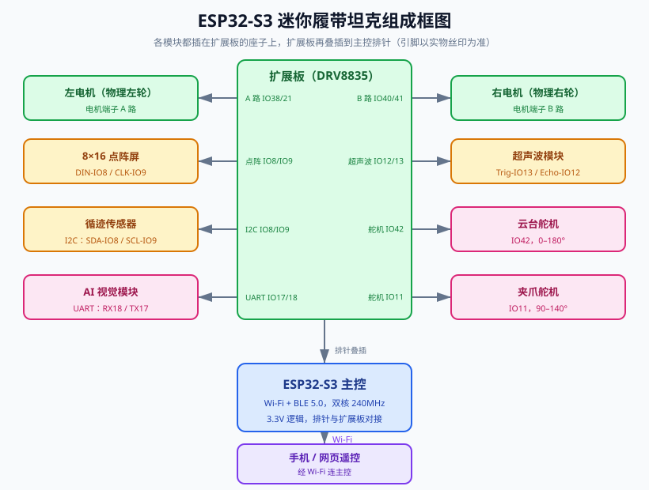

> 【图片待补】整车 45° 视角成品图，需同时看清履带、点阵屏、超声波云台、前置夹爪与 AI 视觉模块，作为本章题图。

## 1.2 特点

1. **主控带无线**：ESP32-S3 跑控制逻辑，板载 Wi-Fi 和 BLE，程序用一根 USB 线下载并做串口调试，不用另配烧录器。
2. **履带底盘**：左右履带各由一只电机驱动，能原地转向；过坎、爬坡比轮式稳，重心低，不容易侧翻。
3. **状态看得见**：8×16 点阵屏直接显示表情和方向图标，程序跑到哪一步不用连电脑看串口也能知道。
4. **感知够用**：超声波测距、红外循迹打底，进阶再加 AI 视觉模块，测到什么就让车做什么。
5. **能动手**：云台舵机带着超声波和摄像头转头扫描，前置夹爪抓取物件，颜色分拣、目标搬运这类任务都做得下来。
6. **手机遥控**：手机和小车连上同一个Wi-Fi，用浏览器输入IP地址打开网页就能遥控，不用再装 App 或加模块。
7. **两种语言**：同一套硬件配 Arduino（C/C++）和 MicroPython 两条教程线，按自己熟悉的语言选就行。

## 1.3 参数

- 主控芯片：ESP32-S3
- 工作电压：3.3-5V
- 输入电压：7-9V
- 最大输出电流：3A
- 逻辑电平：3.3V
- 电机驱动方式：双H桥驱动（DRV8835）
- 超声波检测距离：2厘米-300厘米
- 红外遥控距离：5米

> 【图片待补】主控板与扩展板叠装后的侧面特写，用于展示整机供电与信号连接关系。

## 1.4 套件清单

| 序号 | 名称 | 数量 | 图片 |
| :---: | --- | :---: | :---: |
| 1 | 6mm 单头开口扳手 | 1 | 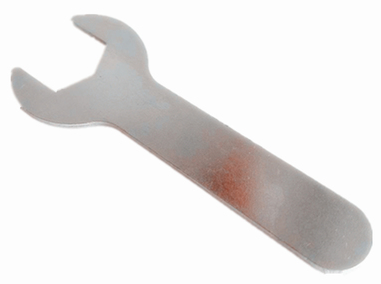 |
| 2 | 履带底盘总成（履带 + 电机 + 循迹传感器 + 轮子） | 1 |  |
| 3 | ESP32-S3 开发板 | 1 |  |
| 4 | DRV8835 电机扩展板 | 1 |  |
| 5 | 超声波模块（带外壳） | 1 |  |
| 6 | 8×16 LED 点阵屏 | 1 |  |
| 7 | 机械夹发射套（左、右各一） | 1 | 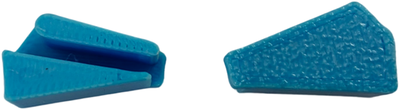 |
| 8 | 大型机械夹（半成品） | 1 |  |
| 9 | TinyVision AI 视觉摄像头 | 1 |  |
| 10 | 8×16 点阵固定折弯亚克力板（茶色半透明，T=3mm） | 1 | 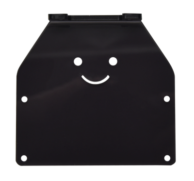 |
| 11 | 顶部亚克力板（带超声波固定孔，黑色，T=4mm） | 1 | 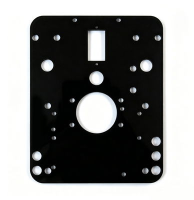 |
| 12 | 17 键红外遥控器（JMFP-4） | 1 |  |
| 13 | 9G 舵机（180°，配十字臂） | 1 |  |
| 14 | 缠绕管（黑色，直径 8mm） | 1 | 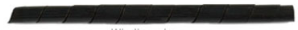 |
| 15 | 6 节 5 号电池盒（XH2.54 端子） | 1 | 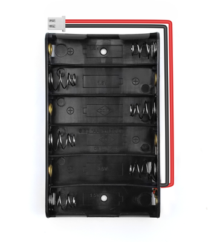 |
| 16 | 18650 双节电池盒 + 线材 | 1 | 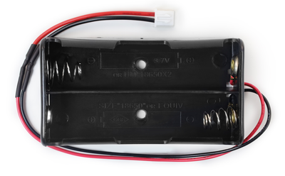 |
| 17 | 3.0×40mm 十字螺丝刀 | 1 | 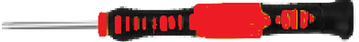 |
| 18 | 扎带（3×100mm，黑色） | 5 |  |
| 19 | USB Type-C 数据线（1m） | 1 |  |
| 20 | M2+M3 小扳手 | 1 | 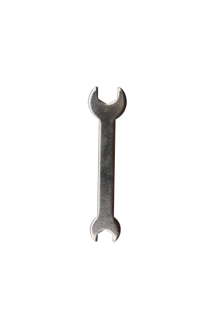 |
| 21 | 4P 双头 XH2.54 连接线（200mm） | 2 | 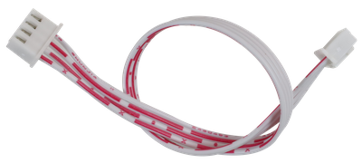 |
| 22 | 4P 双头 HX-2.54 连接线（200mm） | 1 | 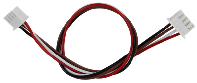 |
| 23 | 乐高科技件 64179（5×7 框架孔臂，黄色） | 1 | 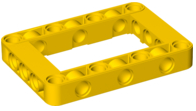 |
| 24 | 乐高科技件 2780（摩擦栓，黑色） | 4 | 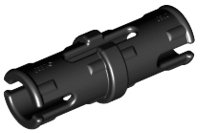 |
| 25 | MX1.25 转杜邦母线（150mm） | 1 | 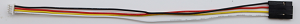 |
| 26 | 魔术贴（25×1000mm，裁成 80mm 三份） | 3 份 |  |
| 27 | 3D 打印足球（直径 31.25mm） | 1 | 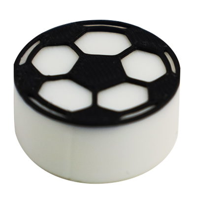 |
| 28 | 寻迹跑道（A2，420×594mm） | 1 | 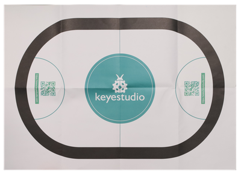 |
| 29 | M2 螺母 | 8 |  |
| 30 | M2×8mm 圆头十字螺钉 | 8 |  |
| 31 | M1.2×5mm 圆头自攻螺钉 | 6 |  |
| 32 | M3×6mm 圆头十字螺钉 | 19 | 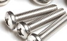 |
| 33 | M3×10mm 圆头十字螺钉 | 3 |  |
| 34 | M3×10mm 平头十字螺钉 | 3 | 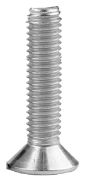 |
| 35 | M3 螺母 | 3 |  |
| 36 | M3×10mm 六角铜柱（双通） | 4 | 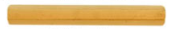 |
| 37 | M3×45mm 六角铜柱（双通） | 4 | 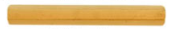 |

## 1.5 主控板介绍（ESP32-S3）

主控板使用的是ESP32-S3，板子中间贴着的是 ESP32-S3-WROOM-1 模组，主频 240 MHz，16 MB Flash。写程序时它主要做三件事：读传感器、算下一步怎么做、把电平送到电机和舵机上。下载程序用板上的 USB 口，同一根线还能打开串口监视器看打印信息，不用额外准备下载器。

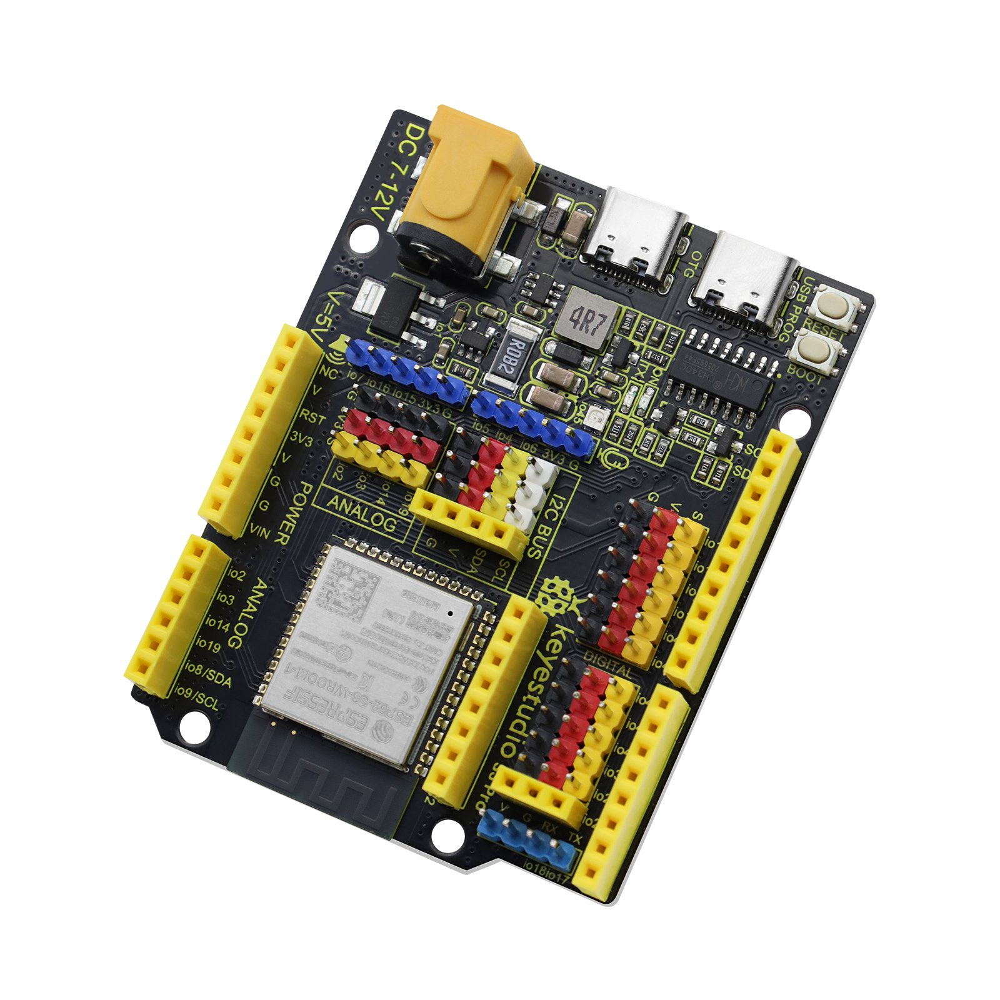

板上的接口，按接线时会用到的顺序过一遍：

- **两个 USB-C 口**：丝印 `USB PROG` 那个用来下载程序和看串口；另一个标 `OTG`，做 USB 主机用，本套件用不到。下载口旁边那颗芯片是 CH340，负责 USB 转串口，第 3 章装的驱动就是给它的。
- **DC 电源座**（旁边丝印 `DC 7-12V`）：外接电源从这里进，套件配的 6 节 5 号电池盒就接这个口。
- **RESET / BOOT 按键**：RESET 复位重启；BOOT 配合复位进下载模式，正常烧录不用按。
- **两侧排针**：数字口、模拟口、I2C、串口都单独引出，板上用 `DIGITAL` / `ANALOG` / `POWER` / `I2C BUS` 分区丝印标好了，编号看下面那张引脚图。

供电有两条路：DC 座吃 7-12V，USB 口吃 5V。套件走的是 6 节 5 号电池盒（碱性约 9V、镍氢约 7.2V），所以 1.3 表里写 7-9V；板子本身能吃到 12V，是套件没配那么高的电源。空载电流约 80mA，不跑程序也在耗电，长时间不用把电池取下来。

引脚定义看这张图，2.3 节每一张接线表都能在上面找到对应的丝印：

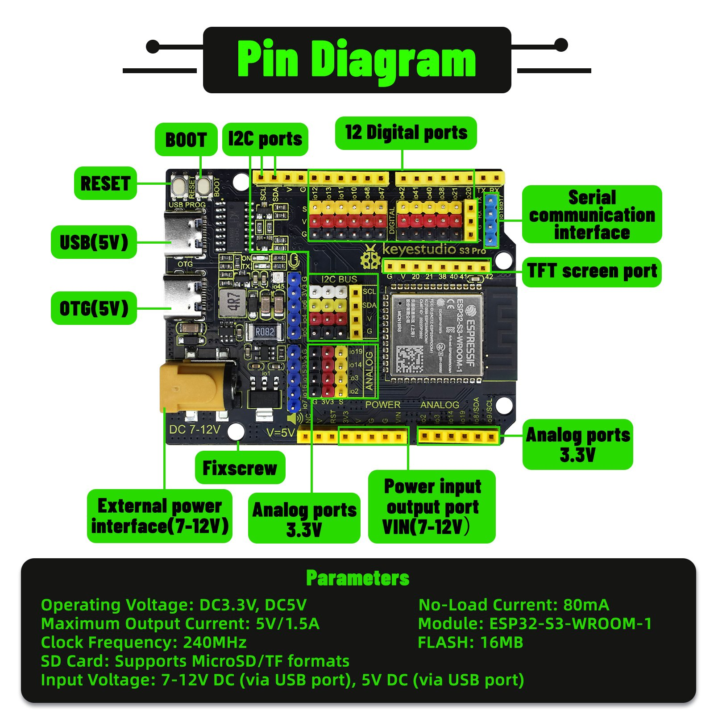

这里挑本套件经常用到的几组说清楚：

| 图上标注 | 引脚 | 本套件接什么 |
| --- | --- | --- |
| 数字口 `io38` `io21` | IO38 / IO21 | 左电机（经扩展板 A 路） |
| 数字口 `io40` `io41` | IO40 / IO41 | 右电机（经扩展板 B 路） |
| 数字口 `io12` `io13` | IO12 / IO13 | 超声波 Echo / Trig |
| 数字口 `io42` | IO42 | 云台舵机信号 |
| 数字口 `io11` | IO11 | 夹爪舵机信号 |
| 模拟口 `io8/SDA` `io9/SCL` | IO8 / IO9 | 点阵屏 DIN / CLK，循迹 I2C 也走这两根 |
| 串口 `TX` `RX` | IO17 / IO18 | AI 视觉模块 |
| I2C `SCL` `SDA` `V` `G` | IO9 / IO8 | 循迹传感器（PCF8574，地址 0x20），座子在扩展板上 |

## 1.6 扩展板介绍（DRV8835）

扩展板叠插在主控板上。它干三件事：把电机的大电流接过去、把主控上密密麻麻的排针变成能插线的座子、把电池的电分给电机和舵机。

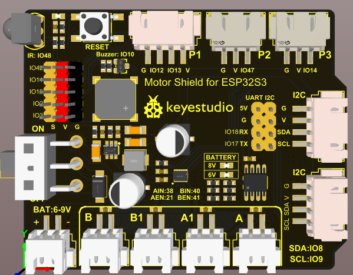

驱动芯片是 DRV8835，两路 H 桥，一路管一只履带电机的方向和转速。电机电流从扩展板走、不从主控 GPIO 走，堵转时不会把主控拖复位。

板上每个接口都印了丝印，对着这张标注图看：

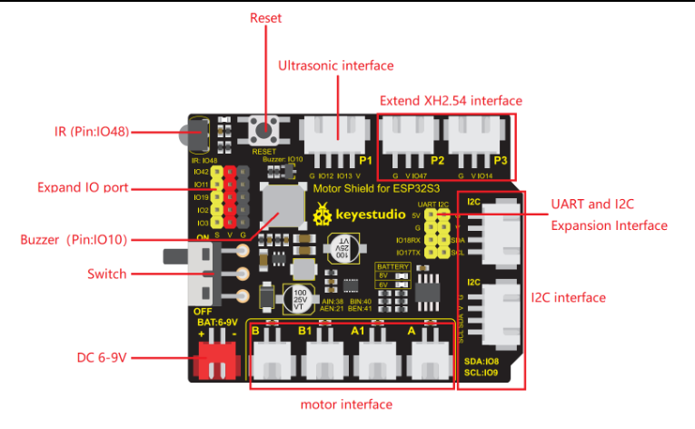

对照表：

| 位置 | 板上丝印 | 干什么用 |
| --- | --- | --- |
| 底部四组电机座 | `B` `B1` `A1` `A` | 两路 H 桥各引出两个并联口，这台坦克只占 `A`、`B` |
| 电机控制脚 | `AIN:38` `BIN:40` `AEN:21` `BEN:41` | 对应主控 IO38 / IO40 和 IO21 / IO41 |
| 左下红色端子 | `BAT:6-9V` `+` `-` | 电池从这里进，整机总电源 |
| 左侧拨动开关 | `ON` | 整板通断，长时间不用拨到断开 |
| 顶部 4P 座 | `G` `IO12` `IO13` `V` | 超声波专口，四根线照这个顺序插|
| 顶部三组 3P 座 | `P1` `P2` `P3`，每组 `G` `V` 加一路空闲 IO（`IO47`、`IO14`） | XH2.54 扩展口，套件里空着 |
| 左上红外接收头 | `IR: IO48` | 板载，配红外遥控器用 |
| 左侧蜂鸣器 | `Buzzer: IO10` | 板载无源蜂鸣器，教程里没用到，想加提示音自己调 |
| 右侧双排针 | `UART I2C`：`5V` `G` `IO18RX` `IO17TX` / `G` `V` `SDA` `SCL` | 串口（含 5V、G）和 I2C 各引一份出来，备用 |
| 右侧两个 4P 座 | `I2C`：`SCL` `SDA` `V` `G`（`SDA:IO8` `SCL:IO9`） | 循迹传感器的四芯线插这里 |

程序里用一个带符号的数表示速度：正数正转、负数反转、0 停车，方向脚决定往哪边转，PWM 脚决定转多快。

**主控板和拓展板组装效果图：**

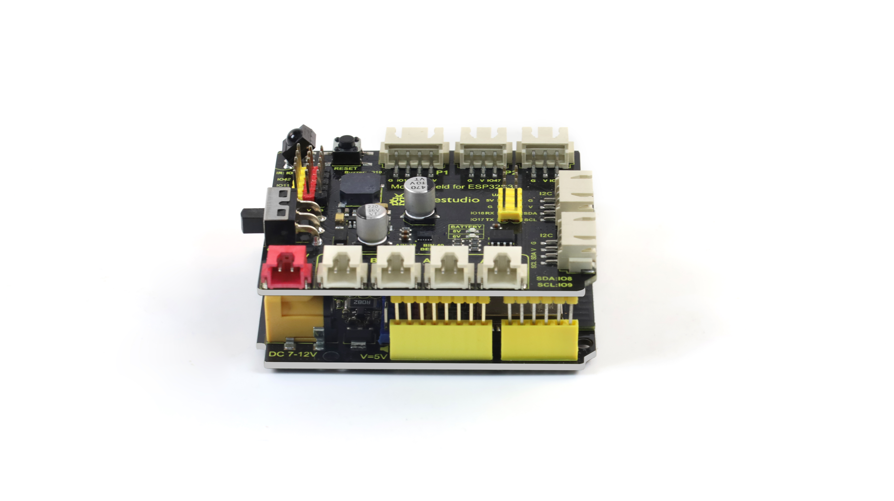

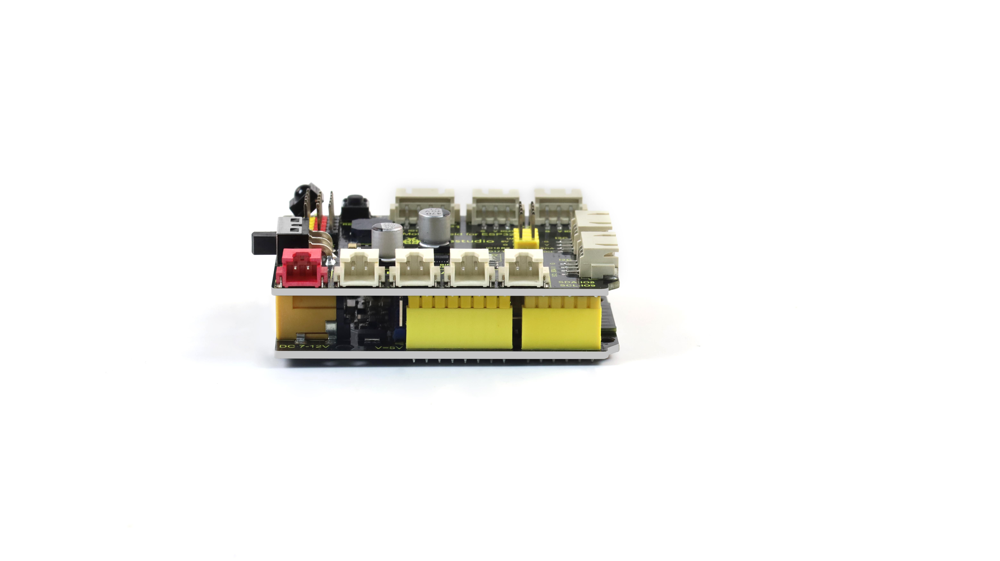

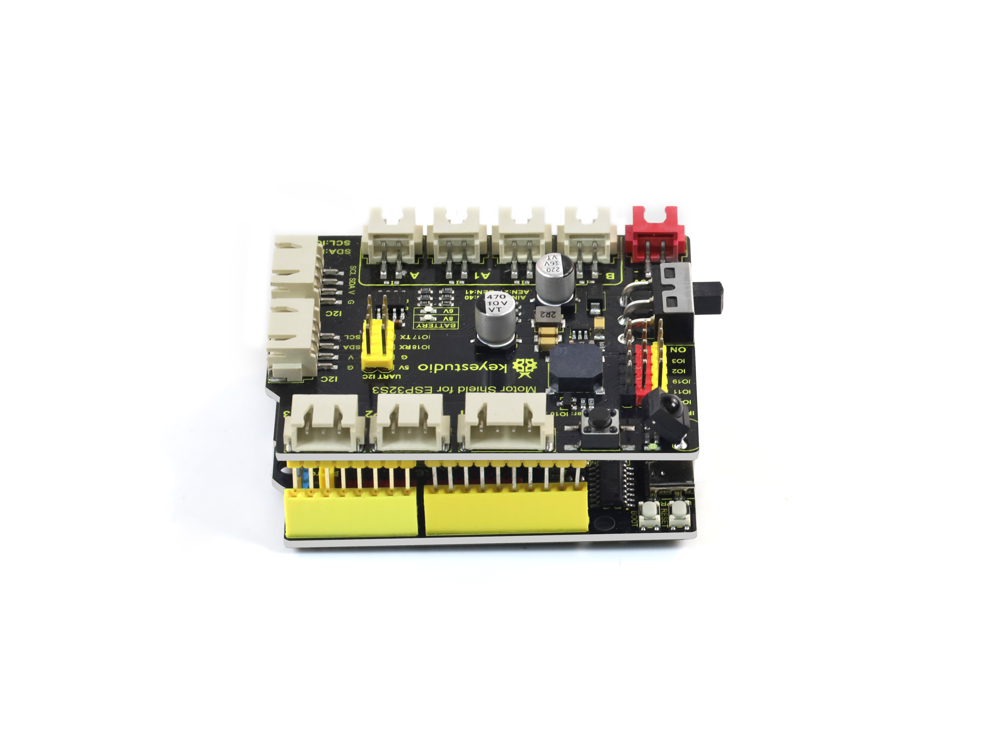

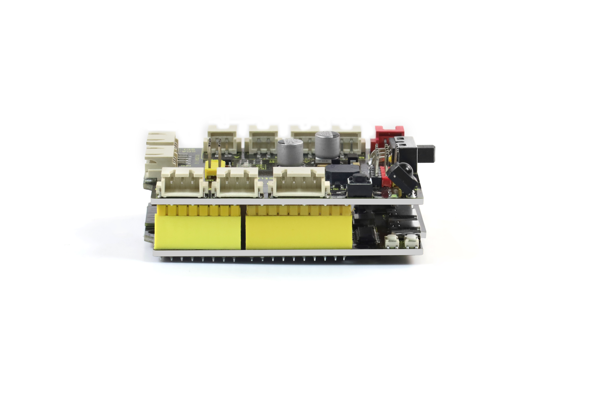

## 1.7 AI 视觉模块介绍

AI 视觉模块是 52×54 mm 的方形盒子，正面中间是摄像头，背面一块小 LCD。

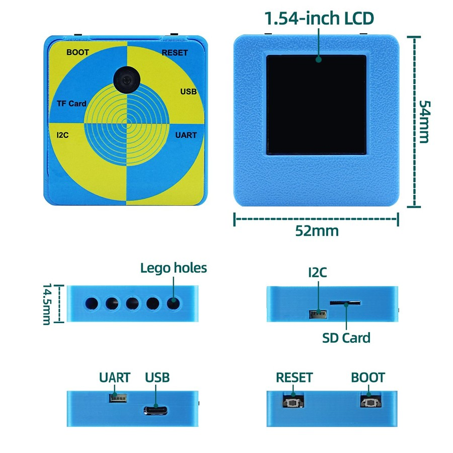

摄像头采集和识别都在模块里做完，它只把结果按一帧文本从串口发给主控，主控读到什么再决定车怎么动。主控这边不跑图像算法，接一根串口线就能用。

侧面的接口对一遍（图里的英文是板厂原图）：

| 侧面丝印 | 干什么用 |
| --- | --- |
| `UART` | 4P 座，和主控通信用，本套件接这根 |
| `I2C` | 4P 座，本套件没接，主控和模块之间只走串口 |
| `USB` | 给模块自己烧固件用，本套件不接 |
| `SD Card` | TF 卡槽，套件里没配卡 |
| `RESET` `BOOT` | 复位、下载模式 |
| `Lego holes` | 一排乐高孔，用乐高销固定 |

背面是一块 1.54 英寸的 LCD。

接线走硬件串口 2，9600 8N1，交叉接：主控 RX 接模块 TX（IO18）、主控 TX 接模块 RX（IO17）。

镜头朝向分两种装法，两种都装在云台上、都随舵机转：装法 A 镜头朝地面，适合巡线；装法 B 镜头朝正前方，适合颜色追踪、人脸跟随和二维码任务。它是选装件，第 1–16 课用不到，可以先不装；做到第 17 课再按其中一种装法装上，步骤见 2.2.9 节，接线见 2.3.8 节。教程后 4 课用它做颜色追踪与抓取、摄像头巡线、人脸跟随和二维码任务卡。

> 【图片待补】视觉模块两种装法对比图：装法 A 镜头朝地面、装法 B 镜头朝正前方，各一张侧视图。
