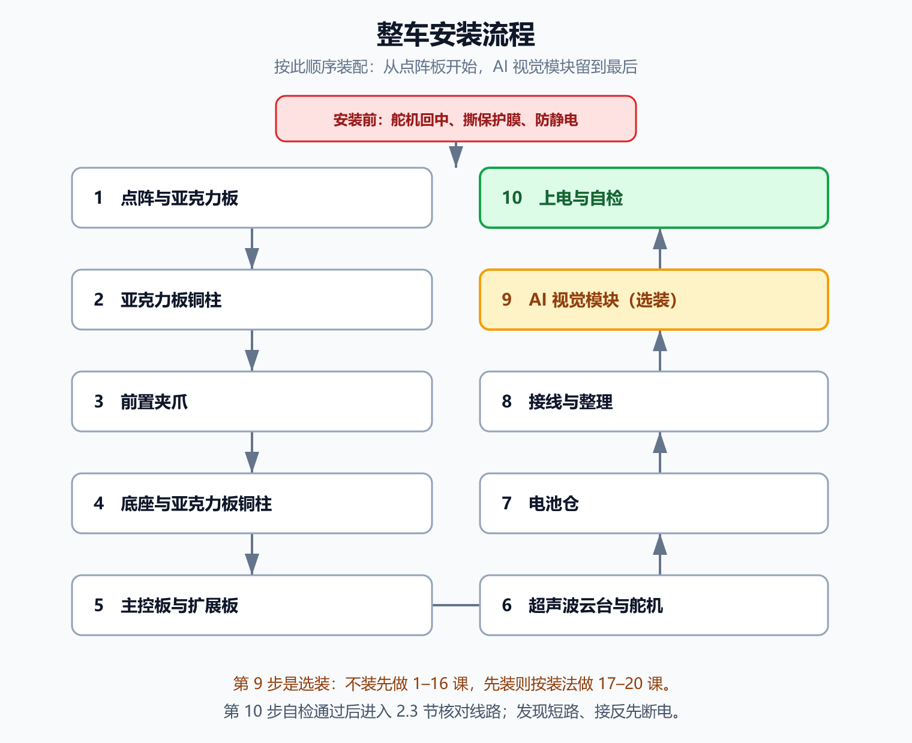

# 2. 产品安装

> 本章图片位置以**【图片待补】**标出，并注明了需要拍摄的内容与角度。拍摄后把图片放进同目录的 `media/` 文件夹，再按占位说明替换即可。
- 舵机调正代码：
   - [Arduino 调中代码：Servo_return_to_center_90.ino](./Servo_return_to_center_90.7z)
   - [MicroPython 调中代码：Servo_return_to_center_90.py](./Servo_return_to_center_90.7z)

下图是整车安装的完整流程：

## 2.1 安装前注意

开始装配前，请务必阅读以下事项，可避免返工和损坏模块：

1. **舵机先回中**：安装前给云台舵机和夹爪舵机通电并回到中位（90°），再装舵盘和连杆。若在上电状态下直接安装，舵盘角度可能与机械中位不一致，装好后会出现转向不到位或卡滞。
2. **撕掉保护膜**：亚克力板两面、点阵屏表面、电机与传感器上的保护膜全部撕净，否则装配后既影响外观，也会导致贴胶不牢。
3. **防静电**：ESP32-S3 主控板与 AI 视觉模块为静电敏感器件，操作前先触摸接地金属释放人体静电，尽量拿板边、不碰芯片和排针。
4. **清点零件**：对照 1.4 节套件清单核对零件是否齐全，螺丝、铜柱按规格分开放置，避免混用导致滑丝。
5. **暂不装电池**：装配和接线全程不要装入电池，全部检查完毕后再供电。本套件不提供电池，需自行购买。

**舵机调中位的做法**：用手转舵盘对不准 90°，用下面这份调中代码让舵机自己停在中位，压舵盘时它一直保持力矩，装出来才是正的。

> 【图片待补】安装前零件全家福：所有部件分类平铺俯拍，作为装配起点的对照图。

> 【图片待补】舵机回中操作图：舵机接上调试线、舵盘处于中位的特写。

## 2.2 安装步骤

> 履带底盘总成出厂已装好履带、电机、轮子和循迹传感器，本章从点阵开始往车身上装。第一次跑线前看一眼循迹探头离地的间隙：太高识别不到黑线，太低会刮地。

> **AI 视觉模块最后装**：第 1–16 课都用不到它，做完第 8 步（接线与整理）和第 10 步（上电自检）就能开始上课；想先做后面 4 课，在第 9 步装上就行。

### 2.2.1 步骤一：点阵与亚克力板

把 8×16 点阵屏装进亚克力板的窗口，点阵正面朝车外、字模方向朝上，用配的螺丝从背面固定。装好后把点阵的 CLK、DIN 两根线从板后引出，稍后接主控 IO9、IO8。

> 【图片待补】点阵嵌入亚克力板窗口的正面图，需能看清点阵安装方向。

> 【图片待补】点阵背面用螺丝固定的局部图，能看清螺丝位与出线方向。

### 2.2.2 步骤二：亚克力板的铜柱

按亚克力板上的孔位把铜柱拧上，铜柱的高度决定主控板离板面多远。手拧到底后拿扳手轻带一下就行，亚克力吃不住大力，拧过头会崩边或开裂。

> 【图片待补】铜柱拧到亚克力板孔位上的局部图，需能看清铜柱规格与所在孔位。

### 2.2.3 步骤三：前置夹爪

把夹爪舵机装到车头，装好夹爪连杆与爪臂。装之前先用 2.1 的调中代码把舵机停到 90°，夹爪摆到半开状态再压舵盘，否则装好后爪子张不到头也合不拢。夹爪的动作范围：90° 夹紧、140° 张开，脉宽 500–2500 µs。

> 【图片待补】夹爪舵机装到车头的图，侧视角度。

> 【图片待补】夹爪张开（140°）与夹紧（90°）两个状态的对比图。

### 2.2.4 步骤四：底座与亚克力板的连接铜柱

把铜柱拧进底座（chassis）的安装孔，再把亚克力板对准铜柱压下去，另一面用螺丝锁住。四角交替着拧，别先把一个角拧死，不然板子会翘、孔位也会错开。

> 【图片待补】底座与亚克力板之间的铜柱连接图，侧视角度，能看清铜柱数量与位置。

> 【图片待补】四角交替锁紧的俯视示意图。

### 2.2.5 步骤五：主控板与扩展板

先用螺丝把 ESP32-S3 主控板固定到亚克力板的铜柱上，USB 口朝方便插线的方向；再把 DRV8835 扩展板对准主控的排针往下压，四角均匀受力，不要单边硬按，针脚压弯了很难修。

> 【图片待补】主控板固定到亚克力板铜柱上的图，俯视角度。

> 【图片待补】扩展板对准主控排针准备叠插的图，斜侧角度，能看到针脚对齐情况。

> 【图片待补】主控与扩展板叠装完成后的整车俯视图，能看清 USB 口与电源座的朝向。

### 2.2.6 步骤六：超声波云台与舵机

装之前先用 2.1 的调中代码把云台舵机停到 90° 中位。舵盘的花键是分档的，不在中位压上去，后面写程序让它扫 0–180° 时，超声波就不是正对前方，左右摆幅也不对称。调好后把舵机固定在车头，套上舵盘与云台支架，再把超声波模块装到云台上，探头朝正前方、保持水平。

若这一步就要装 AI 视觉模块（装法 A 或 B，见 2.2.9），云台支架先不要压紧，等模块固定好再一起锁死。

> 【图片待补】舵机接调试线回到 90° 的界面截图或舵盘特写。

> 【图片待补】云台舵机与支架装配图，侧视角度。

> 【图片待补】超声波模块装到云台上的完成图，正面角度，探头朝前。

### 2.2.7 步骤七：电池仓

将 6 节 5 号电池仓固定在底盘后部，出线朝扩展板电源输入方向。6 节 AA 串联输出碱性约 9 V、镍氢约 7.2 V，落在扩展板输入区间内。电池集中在车尾还能压低重心、增加后轮附着。

> 【图片待补】电池仓固定到底盘后部的图，俯视角度，能看清出线方向。

> 【图片待补】电池装入方向（正负极）示意图，说明 6 节电池的安装朝向。

### 2.2.8 步骤八：接线与整理

按 2.3 节接线说明把各模块线路接好，理顺走线：电机线走底盘内侧，信号线沿车身固定，云台与夹爪的活动线束留出转弯余量，避免被履带或轮子卷入。可用扎带适度捆扎，但不要勒得过紧。

> 【图片待补】接线完成后的整车走线图，俯视角度，展示线束走向与捆扎情况。

> 【图片待补】云台活动线束预留余量的特写图。

### 2.2.9 步骤九：AI 视觉模块（选装）

AI 视觉模块是选装件。第 1–16 课都用不到它，不装也能一路做完；反过来，想先做后面 4 课，就在这一步装上。两种装法都装在云台上、镜头都跟着舵机转，区别只有一个——镜头朝哪：

- **装法 A（镜头朝地面）**：模块装在云台上，镜头向下对着地面，看的是车头前方那一段线。第 18 课摄像头巡线用它——镜头得看见线，车才知道偏了多少。
- **装法 B（镜头朝正前方）**：模块装在云台上，镜头水平朝前，看的是立在车前的东西。第 17 课颜色追踪与抓取、第 19 课人脸跟随、第 20 课二维码任务卡用它——物块、人脸、卡片都在正前方。

两种装法都要用到云台，2.2.6 固定云台支架时先不要压紧，等模块装好再一起锁死。线束要留活动余量，云台转到极限角度时不能拉扯到接线。装好后把模块的 UART 线接到扩展板右侧 `UART` 排针上的 `IO18RX`（接模块 TX）和 `IO17TX`（接模块 RX），接线见 2.3.8。

> 【图片待补】装法 A：模块装在云台上、镜头朝地面的侧视图，需能看出镜头对着车头前方多远处的地面。

> 【图片待补】装法 B：模块装在云台上、镜头水平朝前的侧视图，需展示线束走线与云台转动时的活动余量。

> 【图片待补】同一台车两种装法的并排对比图，标注镜头朝向与各自适用的课程。

### 2.2.10 步骤十：上电与自检

装好电池前，最后目视检查一遍：电源极性是否正确、各插头是否插牢、有无短路或导线破皮。确认无误后上电，观察点阵是否点亮、舵机是否回中、电机是否处于停止状态，再进入 2.3 节逐项核对线路。

> 【图片待补】上电自检正常状态的整车图，点阵点亮可辨识。

## 2.3 接线说明

> 各模块引脚以实物丝印为准。接线前务必断电，接好并检查后再上电。

### 2.3.1 电机接线

左右电机分别接扩展板的 A 路、B 路电机端子，每路含方向脚和调速脚（PWM）。左右按站在车后朝车头看的方向算：左手边是左轮、右手边是右轮；A/B 路看扩展板丝印（AIN/AEN、BIN/BEN）。对应关系如下：

| 电机 | 路数（丝印） | 方向脚 | 调速脚（PWM） |
| --- | :---: | :---: | :---: |
| 左电机（物理左轮） | A 路（AIN/AEN） | IO38 | IO21 |
| 右电机（物理右轮） | B 路（BIN/BEN） | IO40 | IO41 |

> 如果发现前进变成后退、或者转向反了，先按上表核对 A/B 路和轮子的接线，别急着改程序里的左右命名。可以烧 `00_Motor_Mapping_Test` 单独驱动一路，看哪只轮子转，就能确认。

> 【图片待补】A、B 两路电机端子接线特写，需能看清线色与端子对应关系。

### 2.3.2 电源接线

电池仓红线（正极）接扩展板电源输入正端，黑线（负极）接负端，切勿接反。整机由扩展板统一供电，电机、舵机从扩展板取电，主控由扩展板降压后供电。

> 【图片待补】电池线接扩展板电源端子的特写，正负极清晰可辨。

### 2.3.3 8×16 点阵

点阵只需两根信号线，采用两线（类 I2C）驱动：

| 点阵引脚 | 主控 GPIO |
| --- | :---: |
| CLK | IO9 |
| DIN | IO8 |

> 【图片待补】点阵 CLK、DIN 两根线接到主控 IO9、IO8 的接线图。

### 2.3.4 循迹传感器

五路循迹模块上带一颗 PCF8574，五个探头的结果由它打包成一个字节，主控只要两根信号线就能取回来，走的是 I2C：

| 循迹模块 | 主控 GPIO |
| --- | :---: |
| SDA | IO8 |
| SCL | IO9 |

四芯线一头插模块，另一头插扩展板右侧的 `I2C` 座，座子旁丝印写着 `SDA:IO8`、`SCL:IO9`，剩下的 V、G 对座子上的 V、G。插头有防呆，插不进去就是方向反了，别硬掰。

这两根脚和点阵是共用的，同一时刻只能给一个用（见 1.5 节）。

> 【图片待补】循迹传感器四芯线插到扩展板 I2C 座的接线图，需能看清插头方向与座子丝印。

### 2.3.5 超声波

超声波模块插扩展板顶部那个 4P 座，座子丝印 `G` `IO12` `IO13` `V`。套件里配的 4P 双头线一头插模块、一头插这个座，插头有防呆，插不进去就是方向反了。

| 超声波引脚 | 主控 GPIO |
| --- | :---: |
| Trig | IO13 |
| Echo | IO12 |

> 【图片待补】超声波模块四芯线插到扩展板顶部 4P 座的接线图，需能看清座子丝印与插头方向。

### 2.3.6 舵机（云台）

云台舵机信号线接主控 IO42，供电从扩展板取 5 V。舵机为 50 Hz PWM 控制，0–180° 对应脉宽约 500–2400 µs。双舵机同时堵转会引起 5 V 轨跌落，程序里应避免两个舵机同时启动。

> 【图片待补】云台舵机信号线接 IO42 的接线图，展示走线与电源接入。

### 2.3.7 夹爪舵机

夹爪舵机信号线接主控 IO11，供电同样从扩展板取 5 V。动作角度：90° 夹紧、140° 张开，脉宽范围 500–2500 µs。

> 【图片待补】夹爪舵机信号线接 IO11 的接线图。

### 2.3.8 AI 视觉模块（UART）

视觉模块通过硬件串口 2 与主控通信，交叉接线（主控 RX 接模块 TX、主控 TX 接模块 RX），双方必须共地：

| 视觉模块 | 主控 GPIO |
| --- | :---: |
| TX | RX18 |
| RX | TX17 |
| GND | GND（共地） |

串口参数为 9600 8N1。使用硬件串口 2 是为了与 USB 下载口隔离，避免下载程序时与视觉模块争用串口。

> 【图片待补】视觉模块与主控的 UART 接线图，需能看清 TX/RX 交叉接法与共地线。

## 2.4 电池安装

推荐使用 6 节 5 号碱性电池或镍氢充电电池，按电池仓内标注的正负极方向装入，注意新旧电池、不同品牌不要混用，防止漏液。不使用电池时请及时取出。

- 碱性电池串联约 9 V，镍氢电池串联约 7.2 V，均落在扩展板输入区间。
- 禁用碳性电池：其内阻大，电机与舵机同时堵转时压降明显，可能导致主控欠压复位。
- 长期存放请取出电池，避免漏液腐蚀电池仓弹片。

> 【图片待补】6 节电池按正确方向装入电池仓的俯视图。

> 【图片待补】电池仓盖板装回后的整车完成图。
