# 1. Product Introduction

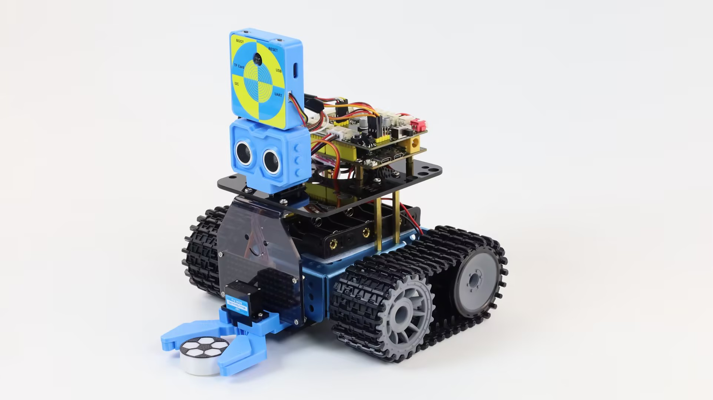

## 1.1 Introduction

This tutorial centers on a mini tracked tank robot (FKS0009 Mini Tracked Tank Robot V4.0). It can follow lines, avoid obstacles, follow objects, and be controlled over Wi-Fi, and it adds a front gripper and an AI vision module for object grabbing, color tracking, camera-based line following, face following, and QR code reading. From assembly to programming, the Arduino and MicroPython tracks each run 20 lessons, going from basic to advanced. Once you finish, you can combine several functions into an obstacle-avoiding car, a line-tracking car, a remote-control car, or a soccer robot.

The robot uses an Espressif ESP32-S3 as its main controller and a chassis with two tracks on the left and right. It can turn in place and handles obstacles and slopes more steadily than wheeled robots. An 8×16 dot matrix display on the front shows expressions and status, so you can tell which step the program is running without connecting to a computer. The motor driver board delivers 3A of current, plenty for the two track motors plus the servos on the pan-tilt and gripper, with headroom for extra modules.

Assembly is simple: most parts are fixed with screws and standoffs, and the expansion board plugs directly onto the main controller's header pins, so no soldering is needed. Following a few steps, you also walk through the basic concepts of line tracking, obstacle avoidance, ultrasonic ranging, motor driving, and wireless remote control. The first 16 lessons build up the robot's functions one by one, and the last 4 connect the AI vision module.

## 1.2 Features

1. **Wireless main controller**: The ESP32-S3 runs the control logic and has built-in Wi-Fi and BLE. Programs are uploaded and debugged over serial with a single USB cable, so no separate programmer is needed.
2. **Tracked chassis**: Each track is driven by its own motor, allowing in-place turning. It handles obstacles and slopes more steadily than wheeled designs, has a low center of gravity, and is less likely to tip over.
3. **Visible status**: The 8×16 dot matrix display shows expressions and direction icons directly, so you can tell which step the program is on without opening the serial monitor on a computer.
4. **Sufficient sensing**: Ultrasonic ranging and infrared line tracking form the base; the AI vision module is added for advanced work, so the robot acts on whatever it detects.
5. **Hands-on capable**: The pan-tilt servo turns the ultrasonic sensor and camera to scan, and the front gripper picks up objects, handling tasks such as color sorting and target transport.
6. **Phone control**: Connect the phone and the car to the same Wi-Fi network, then open a browser and enter the IP address to control it—no extra app or module required.
7. **Two languages**: The same hardware comes with two tutorial tracks, Arduino (C/C++) and MicroPython; just pick the language you are more familiar with.

## 1.3 Parameters

- Main controller chip: ESP32-S3
- Operating voltage: 3.3–5V
- Input voltage: 7–9V
- Maximum output current: 3A
- Logic level: 3.3V
- Motor driving method: Dual H-bridge driver (DRV8835)
- Ultrasonic detection range: 2 cm – 300 cm
- Infrared remote control range: 5 m

## 1.4 Kit Parts List

| No. | Name | Qty | Image |
| :---: | --- | :---: | :---: |
| 1 | 6mm single-head open-end wrench | 1 | 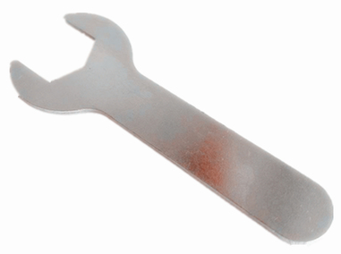 |
| 2 | Mini tracked tank robot bottom assembly | 1 |  |
| 3 | Keyestudio ESP32 S3 PRO development board | 1 |  |
| 4 | Keyestudio ESP32S3 DRV8835  motor expansion board | 1 |  |
| 5 | Ultrasonic module | 1 |  |
| 6 | keyestudio 8x16 LED board | 1 |  |
| 7 | Gripper launch sleeve  (one left, one right) | 1 | 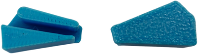 |
| 8 | Large mechanical gripper  (partly assembled) | 1 |  |
| 9 | TinyVision AI vision camera | 1 |  |
| 10 | 8×16 dot matrix mounting  bent acrylic plate | 1 | 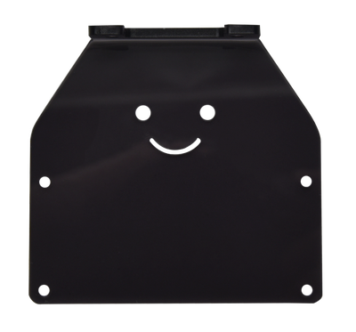 |
| 11 | Top acrylic plate | 1 | 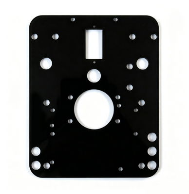 |
| 12 | Line-tracking and gripper  connecting acrylic plate | 1 | 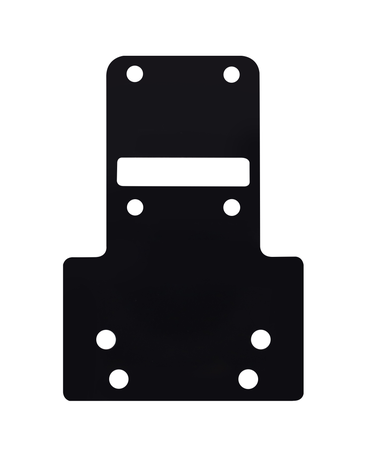 |
| 13 | 5-way IIC line-tracking sensor module | 1 |  |
| 14 | 17-key infrared remote control | 1 |  |
| 15 | Servo | 1 |  |
| 16 | Cable sleeve | 1 | 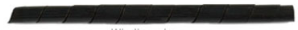 |
| 17 | 6-cell AA battery holder | 1 | 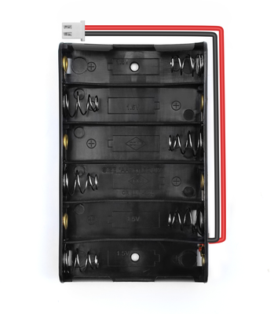 |
| 18 | Dual-cell 18650 battery holder + wires | 1 | 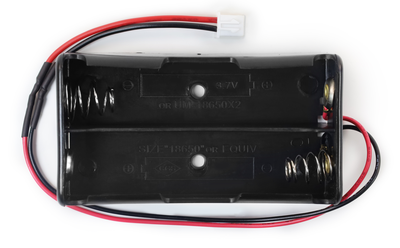 |
| 19 | Phillips screwdriver | 1 | 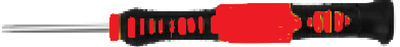 |
| 20 | Cable ties | 5 |  |
| 21 | USB Type-C cable | 1 | 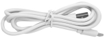 |
| 22 | M2+M3 small wrench | 1 | 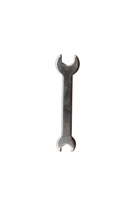 |
| 23 | 4P double-ended XH2.54 cable | 2 | 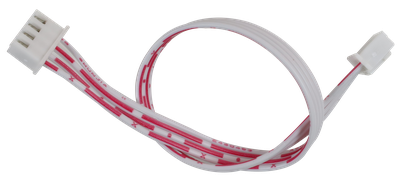 |
| 24 | 4P double-ended HX-2.54 cable | 1 | 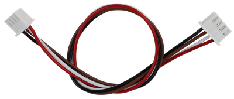 |
| 25 | LEGO 5×7 frame hole arm | 1 | 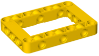 |
| 26 | LEGO friction pin, black | 6 | 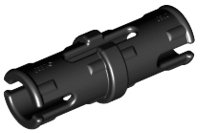 |
| 27 | MX1.25 to Dupont female cable | 1 | 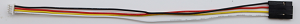 |
| 28 | Hook-and-loop tape | 3 |  |
| 29 | 3D-printed soccer ball | 1 | 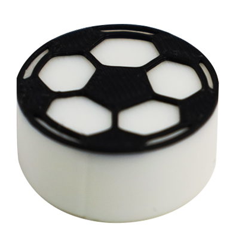 |
| 30 | Line-following track | 1 | 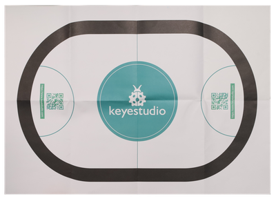 |
| 31 | M2 nuts | 8 | 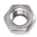 |
| 32 | M2×8mm round-head Phillips screws | 8 | 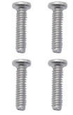 |
| 33 | M3×6mm round-head Phillips screws | 22 | 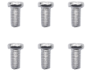 |
| 34 | M3×10mm round-head Phillips screws | 3 |  |
| 35 | M3×10mm flat-head Phillips screws | 5 | 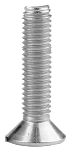 |
| 36 | M3 nuts | 7 |  |
| 37 | M3×10mm hex standoffs (through-hole) | 4 | 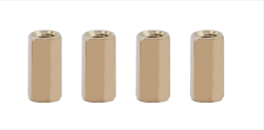 |
| 38 | M3×45mm hex standoffs (through-hole) | 4 | 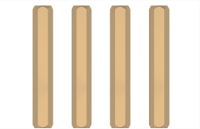 |
| 39 | M3×30mm hex standoffs (through-hole) | 2 | 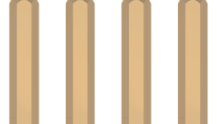 |

## 1.5 Main Controller Board (ESP32-S3)

The main controller board uses the ESP32-S3, with an ESP32-S3-WROOM-1 module in the center, running at 240 MHz with 16 MB of Flash. When writing programs, it mainly does three things: read sensors, work out the next action, and send levels to the motors and servos. Programs are uploaded through the board's USB port, and the same cable opens the serial monitor to view print output, so no extra programmer is needed.

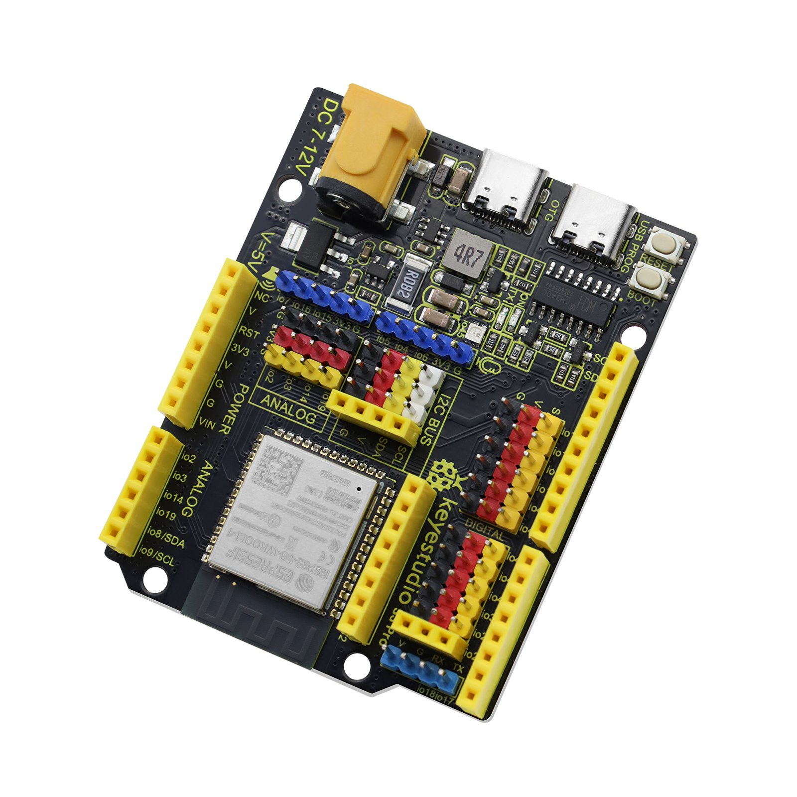

Let's go over the board's interfaces in the order you'll use them when wiring:

- **Two USB-C ports**: The one labeled `USB PROG` is for uploading programs and viewing the serial port; the other, labeled `OTG`, is for USB host mode and is not used in this kit. The chip next to the programming port is the CH340, which handles USB-to-serial conversion; the driver installed in Chapter 3 is for it.
- **DC power jack** (silkscreen `DC 7-12V` nearby): External power enters here; the 6-cell AA battery holder included in the kit connects to this port.
- **RESET / BOOT buttons**: RESET restarts the board; BOOT combined with reset enters download mode, and you don't need to press it for normal programming.
- **Header pins on both sides**: Digital, analog, I2C, and serial pins are all broken out separately, marked on the board with `DIGITAL` / `ANALOG` / `POWER` / `I2C BUS` silkscreen groups; see the pin diagram below for numbering.

There are two power paths: the DC jack takes 7–12V, and the USB port takes 5V. The kit uses the 6-cell AA holder (about 9V alkaline, about 7.2V Ni-MH), so the table in 1.3 lists 7–9V; the board itself accepts up to 12V, but the kit doesn't include a supply that high. The no-load current is about 80mA, so it draws power even without running a program—remove the batteries when not in use for long periods.

See this diagram for the pin definitions; every wiring table in section 2.3 has a corresponding silkscreen label on it:

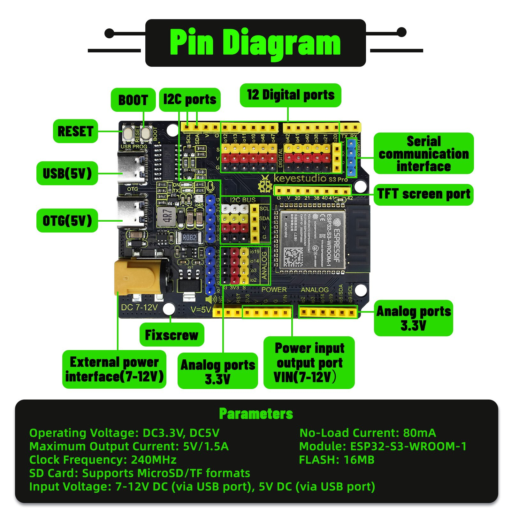

Here are the groups most often used in this kit, explained clearly:

| Label in diagram | Pin | What it connects in this kit |
| --- | --- | --- |
| Digital `io38` `io21` | IO38 / IO21 | Left motor (via expansion board channel A) |
| Digital `io40` `io41` | IO40 / IO41 | Right motor (via expansion board channel B) |
| Digital `io12` `io13` | IO12 / IO13 | Ultrasonic Echo / Trig |
| Digital `io42` | IO42 | Pan-tilt servo signal |
| Digital `io11` | IO11 | Gripper servo signal |
| Analog `io8/SDA` `io9/SCL` | IO8 / IO9 | Dot matrix DIN / CLK; line tracking also uses these two for I2C |
| Serial `TX` `RX` | IO17 / IO18 | AI vision module |
| I2C `SCL` `SDA` `V` `G` | IO9 / IO8 | Line-tracking sensor (PCF8574, address 0x20), socket on the expansion board |

## 1.6 Expansion Board (DRV8835)

The expansion board stacks onto the main controller. It does three things: carries the motors' high current, turns the controller's dense header pins into pluggable sockets, and distributes battery power to the motors and servos.

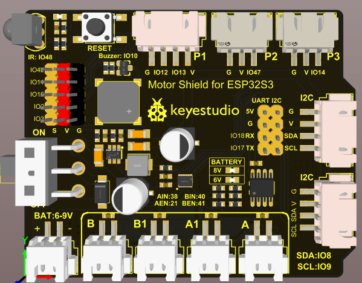

The driver chip is the DRV8835, with two H-bridges, one controlling the direction and speed of each track motor. Motor current flows through the expansion board, not through the controller's GPIO, so a stalled motor won't reset the controller.

Every connector on the board has a silkscreen label; follow this annotated diagram:

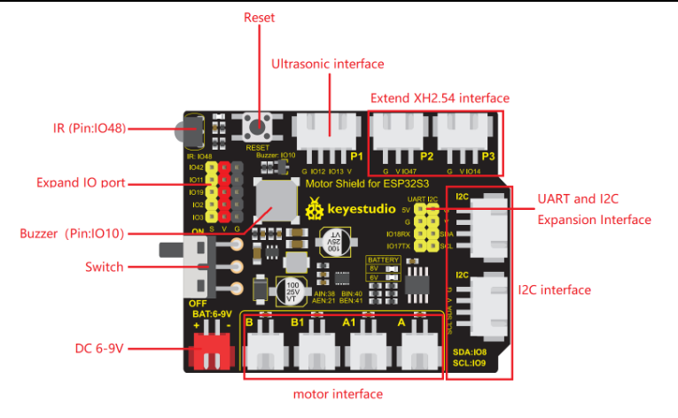

Reference table:

| Location | Board silkscreen | Function |
| --- | --- | --- |
| Four motor socket groups at the bottom | `B` `B1` `A1` `A` | Each H-bridge has two parallel ports; this tank uses only `A` and `B` |
| Motor control pins | `AIN:38` `BIN:40` `AEN:21` `BEN:41` | Correspond to controller IO38 / IO40 and IO21 / IO41 |
| Red terminal at lower left | `BAT:6-9V` `+` `-` | Battery input here; main power for the whole robot |
| Toggle switch at lower left | `ON` | Master on/off for the board; switch off when unused for long periods |
| 4P socket at the top | `G` `IO12` `IO13` `V` | Dedicated ultrasonic port; plug the four wires in this order |
| Three 3P socket groups at the top | `P1` `P2` `P3`, each with `G` `V` plus a free IO (`IO47`, `IO14`) | XH2.54 expansion ports, left empty in this kit |
| IR receiver at upper left | `IR: IO48` | On-board, for use with the infrared remote |
| Buzzer at lower left | `Buzzer: IO10` | On-board passive buzzer, unused in the tutorials; add a tone yourself if you like |
| Double header row at right | `UART I2C`: `5V` `G` `IO18RX` `IO17TX` / `G` `V` `SDA` `SCL` | Serial (including 5V, G) and I2C each broken out once, as spares |
| Two 4P sockets at right | `I2C`: `SCL` `SDA` `V` `G` (`SDA:IO8` `SCL:IO9`) | Plug the line-tracking sensor's four-wire cable here |

The program uses a signed number to represent speed: a positive value runs forward, a negative value runs backward, and 0 stops; the direction pin decides which way to turn, and the PWM pin decides how fast.

**Main controller and expansion board assembly photos:**

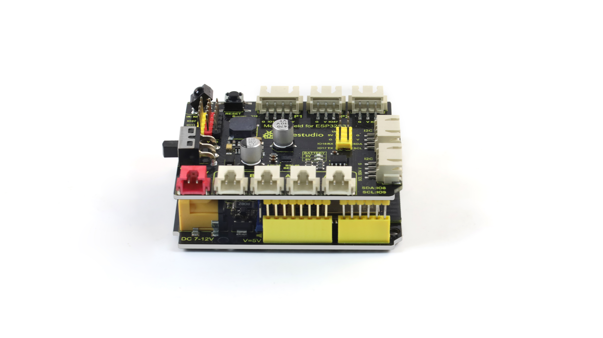

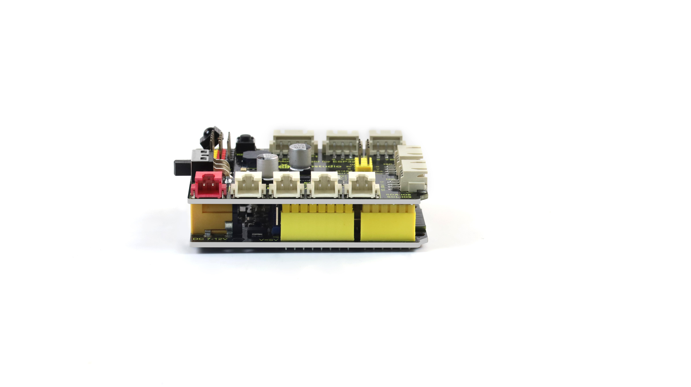

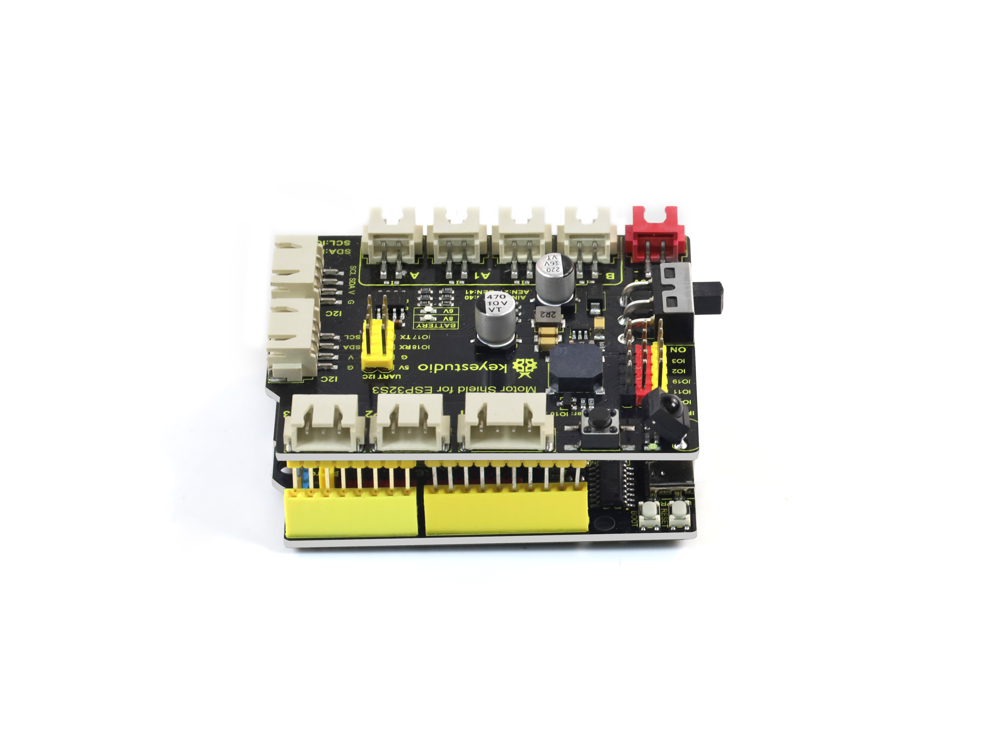

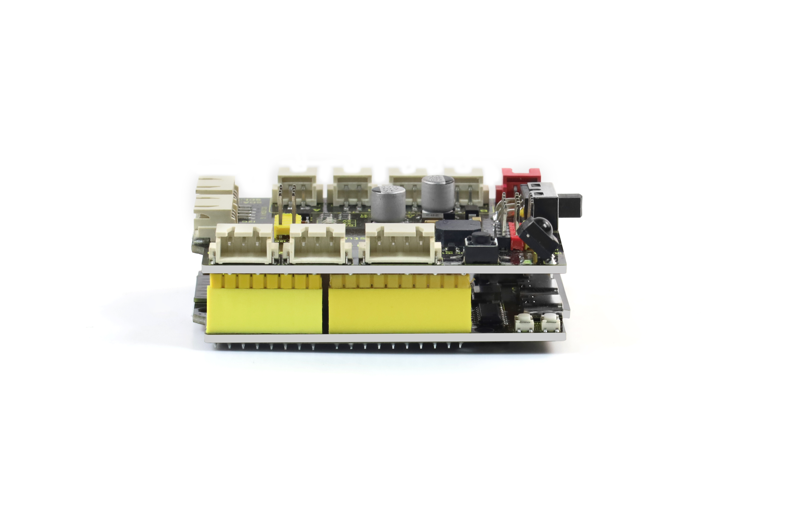

## 1.7 AI Vision Module

The AI vision module is a 52×54 mm square box, with the camera in the center of the front and a small LCD on the back.

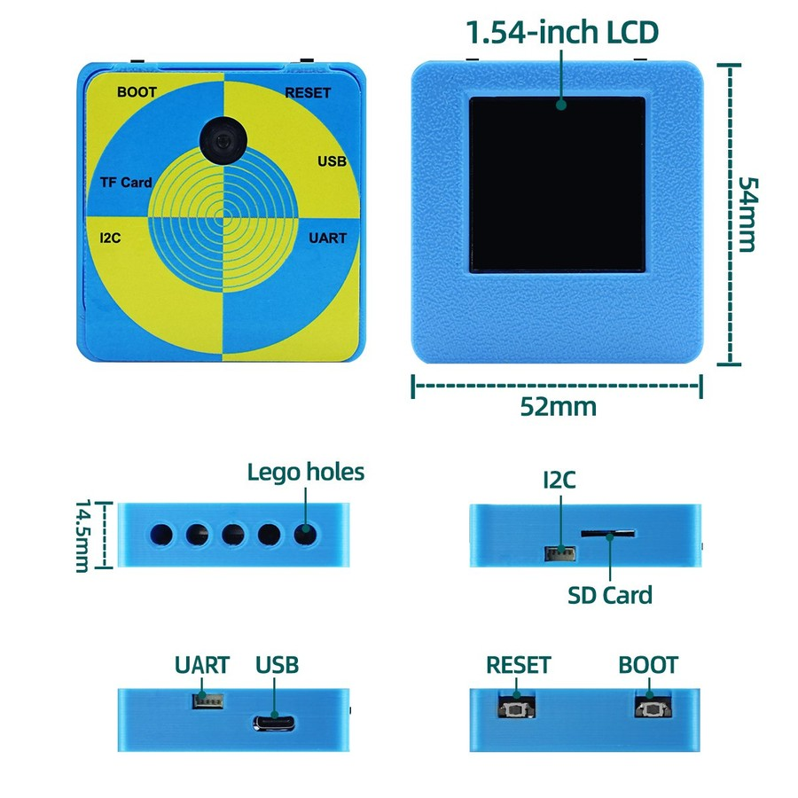

Image capture and recognition are both done inside the module; it only sends the result to the controller as one frame of text over the serial port, and the controller decides how the robot moves based on what it reads. The controller runs no image algorithms itself—just connect one serial cable to use it.

Let's go over the side connectors (the English text in the figure is from the board maker's original image):

| Side silkscreen | Function |
| --- | --- |
| `UART` | 4P socket for communication with the controller; this kit uses this one |
| `I2C` | 4P socket, not connected in this kit; only serial is used between controller and module |
| `USB` | For flashing firmware to the module itself, not connected in this kit |
| `SD Card` | TF card slot, no card included in the kit |
| `RESET` `BOOT` | Reset and download mode |
| `Lego holes` | A row of LEGO holes for fixing with LEGO pins |

On the back is a 1.54-inch LCD.

Wiring uses hardware serial 2, 9600 8N1, crossed: controller RX to module TX (IO18), controller TX to module RX (IO17).
